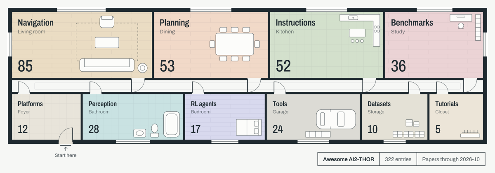
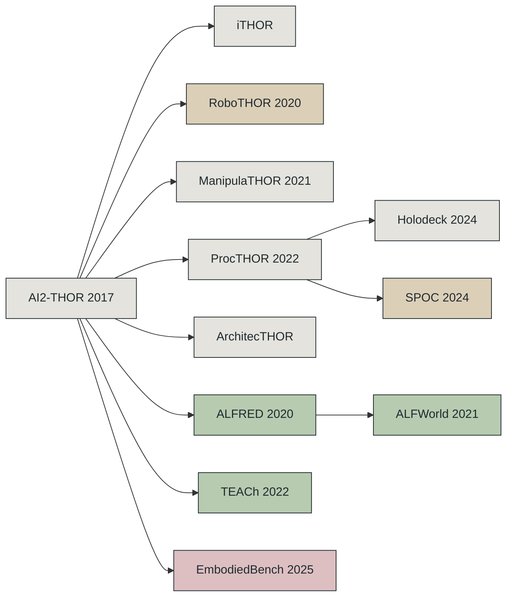
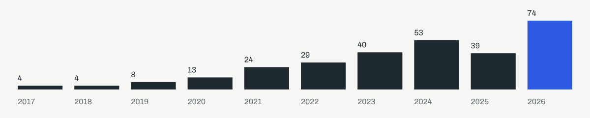

<!-- Generated from data.yml. Run python scripts/generate_readme.py. -->
<picture>
  <source media="(prefers-color-scheme: dark)" srcset="assets/floorplan-dark.svg">
  
</picture>

# Awesome AI2-THOR

A map of papers, benchmarks, and tools built on AI2-THOR and its family.

[](https://awesome.re)   [](https://github.com/XUJay111/awesome-ai2-thor) [](https://github.com/XUJay111/awesome-ai2-thor/actions/workflows/link-check.yml)

[Website](https://xujay111.github.io/awesome-ai2-thor/) / [中文](README.zh-CN.md) / [Contribute](CONTRIBUTING.md)

## Start here

**New to AI2-THOR**

1. [AI2-THOR paper](#ai2-thor-an-interactive-3d-environment-for-visual-ai) — what the simulator is
2. [Official docs](#ai2-thor-documentation) — run your first scene
3. [EmbodiedBench](#embodiedbench-comprehensive-benchmarking-mllms-for-vision-driven-embodied-agents) — how visual agents are evaluated

**ObjectNav and RoboTHOR**

1. [RoboTHOR paper](#robothor-an-open-simulation-to-real-embodied-ai-platform) — understand simulation-to-real evaluation
2. [ObjectNav tutorial](#allenact-objectnav-tutorial) — train a baseline
3. [CLIP for embodied AI](#simple-but-effective-clip-embeddings-for-embodied-ai) — compare visual representations

**ALFRED and TEACh**

1. [ALFRED paper](#alfred-a-benchmark-for-interpreting-grounded-instructions-for-everyday-tasks) — ground instructions in actions
2. [TEACh paper](#teach-task-driven-embodied-agents-that-chat) — add dialogue to household tasks
3. [ALFRED resources](#alfred-documentation-and-leaderboards) — check the evaluation protocol

<details>
<summary>Two more reading routes</summary>

**ProcTHOR and scene generation**

1. [ProcTHOR paper](#procthor-large-scale-embodied-ai-using-procedural-generation) — generate interactive houses
2. [ProcTHOR-10K repository](#procthor-10k-repository) — load the house corpus
3. [Holodeck paper](#holodeck-language-guided-generation-of-3d-embodied-ai-environments) — generate scenes from language

**LLM/VLM embodied agents**

1. [LoTa-Bench](#lota-bench-benchmarking-language-oriented-task-planners-for-embodied-agents) — compare language planners
2. [Embodied Agent Interface](#embodied-agent-interface-benchmarking-llms-for-embodied-decision-making) — inspect decision stages
3. [Embodied-Reasoner](#embodied-reasoner) — connect reasoning to interaction

</details>

## The THOR family



[AI2-THOR / iTHOR](#ai2-thor-an-interactive-3d-environment-for-visual-ai) / [RoboTHOR](#robothor-an-open-simulation-to-real-embodied-ai-platform) / [ManipulaTHOR](#manipulathor-a-framework-for-visual-object-manipulation) / [ProcTHOR](#procthor-large-scale-embodied-ai-using-procedural-generation) / [ArchitecTHOR evaluation](#selective-visual-representations-improve-convergence-and-generalization-for-embodied-ai) / [Holodeck](#holodeck-language-guided-generation-of-3d-embodied-ai-environments) / [SPOC](#spoc-imitating-shortest-paths-in-simulation-enables-effective-navigation-and-manipulation-in-the-real-world) / [ALFRED](#alfred-a-benchmark-for-interpreting-grounded-instructions-for-everyday-tasks) / [TEACh](#teach-task-driven-embodied-agents-that-chat) / [ALFWorld](#alfworld-aligning-text-and-embodied-environments-for-interactive-learning) / [EmbodiedBench](#embodiedbench-comprehensive-benchmarking-mllms-for-vision-driven-embodied-agents)

Edges show simulator extensions or task lineage, rather than model inheritance.

## What's new

30 entries added on 2026-10-28, covering arXiv papers from 2026-07 to 2026-10.

| Paper | Room | Env | Links |
| --- | :--: | :--: | --- |
| [**F2A-ObjectNav: An Adaptive Agentic Architecture for Object-Goal Navigation**](#f2a-objectnav-an-adaptive-agentic-architecture-for-object-goal-navigation)<br><sub>Coordinate ObjectNav modules with a rule-based supervisor and mission memory</sub> | Navigation | AI2-THOR<br>RoboTHOR<br>ProcTHOR | [](https://arxiv.org/abs/2610.19618) |
| [**From Failures to Learnable Worlds: Policy-Conditioned Environment Generation for Navigation Agents**](#from-failures-to-learnable-worlds-policy-conditioned-environment-generation-for-navigation-agents)<br><sub>Generate training houses that target a navigation policy&#x27;s failures</sub> | Navigation | ProcTHOR | [](https://arxiv.org/abs/2610.19420) [](https://zhangyuejoslin.github.io/WEDGE/) |
| [**MIND: Instruction-Conditioned Incremental Grounding for Robots**](#mind-instruction-conditioned-incremental-grounding-for-robots)<br><sub>Revise target-room choices as instruction-relevant events unfold</sub> | Planning | ProcTHOR<br>AI2-THOR | [](https://arxiv.org/abs/2610.19262) [](https://mind-icra27.github.io/) |
| [**Towards a Systematic Study of Embodied System 2 over Full Task Execution Cycles**](#towards-a-systematic-study-of-embodied-system-2-over-full-task-execution-cycles)<br><sub>SCOPER-bench: planning, execution, and recovery across full task cycles</sub> | Benchmarks | ProcTHOR | [](https://arxiv.org/abs/2610.17657) |
| [**Look Before You Move: Agent-Interface-Aligned Supervision for Open-World Mobile Manipulation**](#look-before-you-move-agent-interface-aligned-supervision-for-open-world-mobile-manipulation)<br><sub>Collects interface-aligned demonstrations for active vision and embodied navigation</sub> | Navigation | AI2-THOR<br>EB-Navigation | [](https://arxiv.org/abs/2610.15572) [](https://connerqiu.github.io/look-before-you-move/) |
| [**EMHO: EMbodied Agent Harness Optimization via Experience Traces**](#emho-embodied-agent-harness-optimization-via-experience-traces)<br><sub>Revises frozen-model agent harnesses from execution traces and sparse feedback</sub> | Planning | EB-Navigation | [](https://arxiv.org/abs/2610.08432) [](https://hyunjung00.github.io/emho/) |

<details>
<summary>24 more additions</summary>

| Paper | Room | Env | Links |
| --- | :--: | :--: | --- |
| [**SafeVantage: Vantage-Aware Memory for Reliable Embodied Decisions**](#safevantage-vantage-aware-memory-for-reliable-embodied-decisions)<br><sub>Viewpoint-aware memory for yes, no, or abstain decisions</sub> | Perception | ProcTHOR | [](https://arxiv.org/abs/2609.36906) [](https://github.com/seanhlewis/safevantage) [](https://safevantage.github.io) |
| [**SAGE: Symbolic Action-Gating and Editing for LLM Task Planners**](#sage-symbolic-action-gating-and-editing-for-llm-task-planners)<br><sub>Gate LLM household plans with symbolic precondition checks</sub> | Planning | AI2-THOR | [](https://arxiv.org/abs/2609.34268) [](https://github.com/mtbui2010/sage_release) |
| [**RoboFoundry: System-as-Policy Evolution for Self-Learning Embodied Agents**](#robofoundry-system-as-policy-evolution-for-self-learning-embodied-agents)<br><sub>Evolves persistent context and skill systems from validated embodied execution traces</sub> | Planning | EB-ALFRED<br>EB-Navigation | [](https://arxiv.org/abs/2609.32862) [](https://jingsongliang.com/robofoundry) [](https://github.com/robofoundry2026/RoboFoundry) |
| [**Strategic Transformer for Resource-Constrained Multi-Object Navigation in Ultra-Large-Scale Environments**](#strategic-transformer-for-resource-constrained-multi-object-navigation-in-ultra-large-scale-environments)<br><sub>Lightweight Transformer for multi-object navigation under resource limits</sub> | Navigation | ProcTHOR | [](https://arxiv.org/abs/2609.20227) |
| [**EvoNav-Bench: Benchmarking Lifelong Navigation in Evolving Environments**](#evonav-bench-benchmarking-lifelong-navigation-in-evolving-environments)<br><sub>Lifelong navigation in ProcTHOR houses that change between tasks</sub> | Benchmarks | ProcTHOR | [](https://arxiv.org/abs/2609.08292) |
| [**Seeing Less Is Not Seeing Safely: Privacy Leakage from Task-Scoped Robot Perception Exports**](#seeing-less-is-not-seeing-safely-privacy-leakage-from-task-scoped-robot-perception-exports)<br><sub>Measure privacy leakage from task-scoped robot perception exports</sub> | Benchmarks | AI2-THOR<br>ProcTHOR | [](https://arxiv.org/abs/2609.03055) |
| [**DSG: Dynamic 3D Scene Graph Construction for Embodied Agents in Changing Indoor Environments**](#dsg-dynamic-3d-scene-graph-construction-for-embodied-agents-in-changing-indoor-environments)<br><sub>Update 3D scene graphs as objects move, with the DynTHOR benchmark</sub> | Perception | AI2-THOR | [](https://arxiv.org/abs/2609.00619) |
| [**PRACTICE: From Experience to Expertise in Self-Evolving Embodied Agents**](#practice-from-experience-to-expertise-in-self-evolving-embodied-agents)<br><sub>Grow a persistent skill library from past embodied trajectories</sub> | Planning | EmbodiedBench<br>ALFRED | [](https://arxiv.org/abs/2608.30760) [](https://baai-agents.github.io/PRACTICE) |
| [**If, Then, Otherwise: Diagnosing Conditional Branching in Vision-Language Navigation**](#if-then-otherwise-diagnosing-conditional-branching-in-vision-language-navigation)<br><sub>Diagnose conditional branching in vision-language navigation instructions</sub> | Benchmarks | AI2-THOR | [](https://arxiv.org/abs/2608.17318) [](https://condvln.github.io/) |
| [**Breaking Planner Integrity Boundary: Enviroment State-Text Injection Attack on LLM-Driven Embodied Agents**](#breaking-planner-integrity-boundary-enviroment-state-text-injection-attack-on-llm-driven-embodied-agents)<br><sub>Attack LLM embodied agents by injecting false environment-state text</sub> | Benchmarks | AI2-THOR<br>iTHOR | [](https://arxiv.org/abs/2608.16806) |
| [**Graph-MambaNav: Spatial-Temporal Graph Mamba Leveraging Object-Relation Knowledge for Object-Goal Navigation**](#graph-mambanav-spatial-temporal-graph-mamba-leveraging-object-relation-knowledge-for-object-goal-navigation)<br><sub>Graph Mamba that orders objects by relevance for ObjectNav</sub> | Navigation | AI2-THOR<br>RoboTHOR | [](https://arxiv.org/abs/2608.13723) |
| [**Action- and Language-Conditioned Video Assessment for Embodied Control**](#action--and-language-conditioned-video-assessment-for-embodied-control)<br><sub>Scores action-conditioned videos to provide feedback for household policy optimization</sub> | Perception | ALFRED<br>AI2-THOR | [](https://arxiv.org/abs/2608.08273) |
| [**GraphThink: Graph-Enhanced LLM Thinking for Long-Horizon Embodied Task Planning**](#graphthink-graph-enhanced-llm-thinking-for-long-horizon-embodied-task-planning)<br><sub>Long-horizon household planning with task graphs and scene-graph replanning</sub> | Planning | ALFRED | [](https://arxiv.org/abs/2608.07905) |
| [**TRACE: A Multi-Layer Benchmark for Human AI Controller Coordination Under Drift and Failure**](#trace-a-multi-layer-benchmark-for-human-ai-controller-coordination-under-drift-and-failure)<br><sub>Diagnose layer-wise drift in ALFRED-derived execution traces</sub> | Benchmarks | ALFRED | [](https://arxiv.org/abs/2608.06657) |
| [**Mimir: A Neuro-Symbolic Memory System with Dynamic Grounding for Embodied Agents in Interactive Environments**](#mimir-a-neuro-symbolic-memory-system-with-dynamic-grounding-for-embodied-agents-in-interactive-environments)<br><sub>Neuro-symbolic memory that grounds goals before each action</sub> | Planning | EmbodiedBench<br>ALFRED | [](https://arxiv.org/abs/2608.04933) |
| [**Long-Horizon Embodied Decision-Making via Multimodal Memory Compression**](#long-horizon-embodied-decision-making-via-multimodal-memory-compression)<br><sub>Compresses preference-relevant multimodal memories for long-horizon house selection</sub> | Benchmarks | ProcTHOR | [](https://arxiv.org/abs/2608.01456) |
| [**Memory for Attention: Language-Conditioned Re-Perception with a Vision--Language--Motion Map**](#memory-for-attention-language-conditioned-re-perception-with-a-vision--language--motion-map)<br><sub>Re-perceive scenes by allocating attention over a vision-language-motion map</sub> | Perception | AI2-THOR | [](https://arxiv.org/abs/2607.23797) |
| [**MEMENTO: Memory-Guided Memetic Code-as-Policy Evolution**](#memento-memory-guided-memetic-code-as-policy-evolution)<br><sub>Evolve code-as-policy programs with memory-guided search</sub> | Planning | AI2-THOR | [](https://arxiv.org/abs/2607.22832) [](https://github.com/sygkounas/MEMENTO) |
| [**UniETP: Unifying Environments for Generalizable Embodied Task Planning**](#unietp-unifying-environments-for-generalizable-embodied-task-planning)<br><sub>Unify AI2-THOR, VirtualHome, Habitat, and BEHAVIOR for task planning</sub> | Benchmarks | AI2-THOR | [](https://arxiv.org/abs/2607.18062) [](https://github.com/woyut/UniETP) |
| [**Vision-Language-Motion Maps: An Open-Vocabulary, Uncertainty-Aware, Queryable Motion Attribute for 3D Scene Maps**](#vision-language-motion-maps-an-open-vocabulary-uncertainty-aware-queryable-motion-attribute-for-3d-scene-maps)<br><sub>Open-vocabulary 3D maps with per-object motion attributes</sub> | Perception | AI2-THOR | [](https://arxiv.org/abs/2607.16173) |
| [**Embodied Active Learning under Limited Annotation and Navigation Budget for Object Detection**](#embodied-active-learning-under-limited-annotation-and-navigation-budget-for-object-detection)<br><sub>Choose trajectories and images to retrain detectors on a budget</sub> | Perception | AI2-THOR | [](https://arxiv.org/abs/2607.15974) |
| [**Difference-Based Relational Learning for Zero-Shot Object-Goal Visual Navigation With Direct Sim-to-Real Transfer**](#difference-based-relational-learning-for-zero-shot-object-goal-visual-navigation-with-direct-sim-to-real-transfer)<br><sub>Zero-shot object-goal navigation with Siamese difference features and sim-to-real transfer</sub> | Navigation | AI2-THOR | [](https://arxiv.org/abs/2607.15642) |
| [**Mosaic: Runtime-Efficient Multi-Agent Embodied Planning**](#mosaic-runtime-efficient-multi-agent-embodied-planning)<br><sub>Faster multi-agent planning with shared memory and ILP action allocation</sub> | Planning | AI2-THOR | [](https://arxiv.org/abs/2607.09603) |
| [**Multi-scale Mixture of World Models for Embodied Agents in Evolving Environments**](#multi-scale-mixture-of-world-models-for-embodied-agents-in-evolving-environments)<br><sub>Routes between world models at different scales as embodied environments evolve</sub> | Planning | EB-Navigation | [](https://arxiv.org/abs/2607.00457) |

</details>

## Contents

- [Platforms and environment generation](#platforms-and-environment-generation) <sub>12</sub> — Simulators and generated worlds.
- [Benchmarks and evaluation](#benchmarks-and-evaluation) <sub>36</sub> — Shared tasks, safety, and evaluation protocols.
- [Instruction following and household tasks](#instruction-following-and-household-tasks) <sub>52</sub> — ALFRED, TEACh, and language-grounded execution.
- [Navigation](#navigation) <sub>85</sub> — ObjectNav, exploration, and sim-to-real transfer.
- [Planning, memory, and multi-agent systems](#planning-memory-and-multi-agent-systems) <sub>53</sub> — Replanning, spatial memory, and collaboration.
- [RL-trained VLM agents](#rl-trained-vlm-agents) <sub>17</sub> — Policy training and embodied reasoning.
- [Perception, physics, and scene graphs](#perception-physics-and-scene-graphs) <sub>28</sub> — Objects, affordances, and physical reasoning.
- [Datasets and assets](#datasets-and-assets) <sub>10</sub> — Scene corpora, object assets, and task data.
- [Tools and environments](#tools-and-environments) <sub>24</sub> — Training frameworks, wrappers, and utilities.
- [Tutorials and notes](#tutorials-and-notes) <sub>5</sub> — Installation, first scenes, and reproducible baselines.

322 simulator-family resources; 13 text-only ALFWorld papers appear in a separate appendix.

<a id="platforms-and-environment-generation"></a>

##  Platforms and environment generation

Simulators and generated worlds. 12 entries.

#### AI2-THOR: An Interactive 3D Environment for Visual AI

2017 · AI2-THOR

[](https://arxiv.org/abs/1712.05474) [](https://ai2thor.allenai.org/) [](https://github.com/allenai/ai2thor)

Provides interactive indoor scenes in AI2-THOR with navigation, physics, and object actions, establishing a shared simulator for household agents.

#### RoboTHOR: An Open Simulation-to-Real Embodied AI Platform

CVPR 2020 · RoboTHOR

[](https://arxiv.org/abs/2004.06799) [](https://ai2thor.allenai.org/robothor/) [](https://github.com/allenai/ai2thor)

Pairs simulated and physical rooms in RoboTHOR, letting researchers measure how navigation policies transfer to real environments.

#### ProcTHOR: Large-Scale Embodied AI Using Procedural Generation

NeurIPS 2022 · ProcTHOR

[](https://arxiv.org/abs/2206.06994) [](https://procthor.allenai.org/) [](https://github.com/allenai/procthor)

Generates 10,000 interactive ProcTHOR houses procedurally, making scene diversity a scalable training resource for navigation and household interaction.

#### Holodeck: Language Guided Generation of 3D Embodied AI Environments

CVPR 2024 · ProcTHOR

[](https://arxiv.org/abs/2312.09067) [](https://yueyang1996.github.io/holodeck/) [](https://github.com/allenai/Holodeck)

Builds interactive AI2-THOR-compatible scenes from language and Objaverse assets, extending environment generation beyond hand-authored layouts.

| Year | Paper / resource | Env | Links |
| :--: | --- | :--: | --- |
| 2026 | <a id="spread-spatial-physical-reasoning-via-geometry-aware-diffusion"></a>**SPREAD: Spatial-Physical REasoning via geometry Aware Diffusion**<br><sub>Generate spatial-physical structure with geometry-aware diffusion</sub> | ProcTHOR | [](https://arxiv.org/abs/2603.27573) |
| 2025 | <a id="dualthor"></a>**DualTHOR**<br><sub>Dual-arm task execution, replay, and contingency modeling</sub> | AI2-THOR | [](https://arxiv.org/abs/2506.16012) [](https://github.com/ds199895/DualTHOR) |
| 2025 | <a id="beyond-needles-in-the-embodied-haystack"></a>**Beyond Needle(s) in the Embodied Haystack**<br><sub>Long trajectories for extreme-context embodied reasoning</sub> | infinity-THOR | [](https://arxiv.org/abs/2505.16928) |
| 2025 | <a id="enhancing-multi-agent-systems-via-reinforcement-learning-with-llm-based-planner-and-graph-based-policy"></a>**Enhancing Multi-Agent Systems via Reinforcement Learning with LLM-based Planner and Graph-based Policy**<br><sub>Combine language planning and graph policies in multi-agent reinforcement learning</sub> | AI2-THOR | [](https://arxiv.org/abs/2503.10049) |
| 2024 | <a id="spoc-imitating-shortest-paths-in-simulation-enables-effective-navigation-and-manipulation-in-the-real-world"></a>**SPOC: Imitating Shortest Paths in Simulation Enables Effective Navigation and Manipulation in the Real World**<br><sub>Transfer shortest-path imitation from simulation to real robots</sub> | ProcTHOR | [](https://openaccess.thecvf.com/content/CVPR2024/html/Ehsani_SPOC_Imitating_Shortest_Paths_in_Simulation_Enables_Effective_Navigation_and_CVPR_2024_paper.html) [](https://spoc-robot.github.io/) [](https://github.com/allenai/spoc-robot-training) |
| 2022 | <a id="phone2proc-bringing-robust-robots-into-our-chaotic-world"></a>**Phone2Proc: Bringing Robust Robots Into Our Chaotic World**<br><sub>Generate training scenes conditioned on phone scans</sub> | ProcTHOR | [](https://arxiv.org/abs/2212.04819) [](https://allenai.org/project/phone2proc) [](https://github.com/allenai/phone2proc) |
| 2021 | <a id="manipulathor-a-framework-for-visual-object-manipulation"></a>**ManipulaTHOR: A Framework for Visual Object Manipulation**<br><sub>Mobile-arm interaction and ArmPointNav tasks</sub> | ManipulaTHOR | [](https://arxiv.org/abs/2104.11213) [](https://ai2thor.allenai.org/manipulathor/) [](https://github.com/allenai/manipulathor) |
| 2021 | <a id="visual-room-rearrangement"></a>**Visual Room Rearrangement**<br><sub>Restore displaced objects to a remembered room state</sub> | AI2-THOR | [](https://arxiv.org/abs/2103.16544) [](https://ai2thor.allenai.org/rearrangement/) [](https://github.com/allenai/ai2thor-rearrangement) |

<a id="benchmarks-and-evaluation"></a>

##  Benchmarks and evaluation

Shared tasks, safety, and evaluation protocols. 36 entries.

#### ALFRED: A Benchmark for Interpreting Grounded Instructions for Everyday Tasks

CVPR 2020 · ALFRED

[](https://arxiv.org/abs/1912.01734) [](https://askforalfred.com/) [](https://github.com/askforalfred/alfred)

Pairs household instructions with visual demonstrations in ALFRED, testing language grounding, navigation, and irreversible object interactions together.

#### TEACh: Task-driven Embodied Agents that Chat

AAAI 2022 · TEACh

[](https://arxiv.org/abs/2110.00534) [](https://github.com/alexa/teach)

Adds Commander–Follower dialogue to AI2-THOR household tasks in TEACh, testing how conversation resolves missing information during execution.

#### EmbodiedBench: Comprehensive Benchmarking MLLMs for Vision-Driven Embodied Agents

ICML 2025 · EmbodiedBench / ALFRED

[](https://openreview.net/forum?id=DgGF2LEBPS) [](https://embodiedbench.github.io/) [](https://github.com/EmbodiedBench/EmbodiedBench)

Tests multimodal agents in EmbodiedBench, including EB-ALFRED, separating high-level plans from failures in visual grounding and executable actions.

**Latest entries**

| Year | Paper / resource | Env | Links |
| :--: | --- | :--: | --- |
| 2026 | <a id="towards-a-systematic-study-of-embodied-system-2-over-full-task-execution-cycles"></a>**Towards a Systematic Study of Embodied System 2 over Full Task Execution Cycles** <br><sub>SCOPER-bench: planning, execution, and recovery across full task cycles</sub> | ProcTHOR | [](https://arxiv.org/abs/2610.17657) |
| 2026 | <a id="evonav-bench-benchmarking-lifelong-navigation-in-evolving-environments"></a>**EvoNav-Bench: Benchmarking Lifelong Navigation in Evolving Environments** <br><sub>Lifelong navigation in ProcTHOR houses that change between tasks</sub> | ProcTHOR | [](https://arxiv.org/abs/2609.08292) |
| 2026 | <a id="seeing-less-is-not-seeing-safely-privacy-leakage-from-task-scoped-robot-perception-exports"></a>**Seeing Less Is Not Seeing Safely: Privacy Leakage from Task-Scoped Robot Perception Exports** <br><sub>Measure privacy leakage from task-scoped robot perception exports</sub> | AI2-THOR<br>ProcTHOR | [](https://arxiv.org/abs/2609.03055) |
| 2026 | <a id="if-then-otherwise-diagnosing-conditional-branching-in-vision-language-navigation"></a>**If, Then, Otherwise: Diagnosing Conditional Branching in Vision-Language Navigation** <br><sub>Diagnose conditional branching in vision-language navigation instructions</sub> | AI2-THOR | [](https://arxiv.org/abs/2608.17318) [](https://condvln.github.io/) |
| 2026 | <a id="breaking-planner-integrity-boundary-enviroment-state-text-injection-attack-on-llm-driven-embodied-agents"></a>**Breaking Planner Integrity Boundary: Enviroment State-Text Injection Attack on LLM-Driven Embodied Agents** <br><sub>Attack LLM embodied agents by injecting false environment-state text</sub> | AI2-THOR<br>iTHOR | [](https://arxiv.org/abs/2608.16806) |

<details>
<summary>All 36 entries (28 more below)</summary>

| Year | Paper / resource | Env | Links |
| :--: | --- | :--: | --- |
| 2026 | <a id="trace-a-multi-layer-benchmark-for-human-ai-controller-coordination-under-drift-and-failure"></a>**TRACE: A Multi-Layer Benchmark for Human AI Controller Coordination Under Drift and Failure** <br><sub>Diagnose layer-wise drift in ALFRED-derived execution traces</sub> | ALFRED | [](https://arxiv.org/abs/2608.06657) |
| 2026 | <a id="long-horizon-embodied-decision-making-via-multimodal-memory-compression"></a>**Long-Horizon Embodied Decision-Making via Multimodal Memory Compression** <br><sub>Compresses preference-relevant multimodal memories for long-horizon house selection</sub> | ProcTHOR | [](https://arxiv.org/abs/2608.01456) |
| 2026 | <a id="unietp-unifying-environments-for-generalizable-embodied-task-planning"></a>**UniETP: Unifying Environments for Generalizable Embodied Task Planning** <br><sub>Unify AI2-THOR, VirtualHome, Habitat, and BEHAVIOR for task planning</sub> | AI2-THOR | [](https://arxiv.org/abs/2607.18062) [](https://github.com/woyut/UniETP) |
| 2026 | <a id="groundcontrol-anticipating-navigation-failures-in-vision-language-agents-via-trajectory-consistent-uncertainty-estimates"></a>**GroundControl: Anticipating Navigation Failures in Vision-Language Agents via Trajectory-Consistent Uncertainty Estimates**<br><sub>Anticipate navigation failure with trajectory-consistent uncertainty</sub> | EmbodiedBench | [](https://arxiv.org/abs/2606.20479) |
| 2026 | <a id="where-to-look-can-foundation-models-reach-a-target-viewpoint-through-active-exploration"></a>**Where to Look: Can Foundation Models Reach a Target Viewpoint Through Active Exploration?**<br><sub>Move until the current view matches a target image</sub> | AI2-THOR<br>ProcTHOR | [](https://arxiv.org/abs/2606.01247) [](https://github.com/aim-uofa/TVRBench) |
| 2026 | <a id="do-llms-build-world-models-from-text-a-multilingual-diagnostic-of-spatial-reasoning"></a>**Do LLMs Build World Models From Text? A Multilingual Diagnostic of Spatial Reasoning**<br><sub>Diagnose multilingual spatial reasoning from textual world descriptions</sub> | ProcTHOR | [](https://arxiv.org/abs/2605.28277) |
| 2026 | <a id="safetyalfred-evaluating-safety-conscious-planning-of-multimodal-large-language-models"></a>**SafetyALFRED: Evaluating Safety-Conscious Planning of Multimodal Large Language Models**<br><sub>Evaluate safety-conscious planning around kitchen hazards</sub> | ALFRED | [](https://arxiv.org/abs/2604.19638) [](https://github.com/sled-group/SafetyALFRED) |
| 2026 | <a id="pre-execution-safety-gate-task-safety-contracts-for-llm-controlled-robot-systems"></a>**Pre-Execution Safety Gate &amp; Task Safety Contracts for LLM-Controlled Robot Systems**<br><sub>Gate actions with pre-execution checks and task safety contracts</sub> | AI2-THOR | [](https://arxiv.org/abs/2604.05427) |
| 2026 | <a id="asgardbench"></a>**AsgardBench**<br><sub>Adapt household plans from visual observations and execution feedback</sub> | AI2-THOR | [](https://arxiv.org/abs/2603.15888) [](https://www.microsoft.com/en-us/research/blog/asgardbench-a-benchmark-for-visually-grounded-interactive-planning/) [](https://github.com/microsoft/AsgardBench) |
| 2026 | <a id="agentsafe-benchmarking-the-safety-of-embodied-agents-on-hazardous-instructions"></a>**AGENTSAFE: Benchmarking the Safety of Embodied Agents on Hazardous Instructions**<br><sub>Diagnose unsafe instructions in the SAFE-THOR sandbox</sub> | AI2-THOR | [](https://openaccess.thecvf.com/content/CVPR2026/papers/Ying_AGENTSAFE_Benchmarking_the_Safety_of_Embodied_Agents_on_Hazardous_Instructions_CVPR_2026_paper.pdf) [](https://arxiv.org/abs/2506.14697) |
| 2025 | <a id="detecting-non-optimal-decisions-of-embodied-agents-via-diversity-guided-metamorphic-testing"></a>**Detecting Non-Optimal Decisions of Embodied Agents via Diversity-Guided Metamorphic Testing**<br><sub>Detect poor decisions with diversity-guided metamorphic tests</sub> | AI2-THOR | [](https://arxiv.org/abs/2512.20083) |
| 2025 | <a id="sentinel-a-multi-level-formal-framework-for-safety-evaluation-of-foundation-model-based-embodied-agents"></a>**SENTINEL: A Multi-Level Formal Framework for Safety Evaluation of Foundation Model-based Embodied Agents**<br><sub>Evaluate embodied safety through multiple formal abstraction levels</sub> | AI2-THOR | [](https://arxiv.org/abs/2510.12985) |
| 2025 | <a id="embodied-web-agents"></a>**Embodied Web Agents**<br><sub>Combine household interaction with web information access</sub> | AI2-THOR | [](https://arxiv.org/abs/2506.15677) [](https://embodied-web-agent.github.io/) |
| 2024 | <a id="safeagentbench-a-benchmark-for-safe-task-planning-of-embodied-llm-agents"></a>**SafeAgentBench: A Benchmark for Safe Task Planning of Embodied LLM Agents**<br><sub>Test household plans against hazardous actions and physical risks</sub> | AI2-THOR | [](https://arxiv.org/abs/2412.13178) [](https://safeagentbench.github.io/) [](https://github.com/shengyin1224/SafeAgentBench) [](https://huggingface.co/datasets/safeagentbench/SafeAgentBench) |
| 2024 | <a id="robustness-testing-of-multi-modal-models-in-varied-home-environments-for-assistive-robots"></a>**Robustness Testing of Multi-Modal Models in Varied Home Environments for Assistive Robots**<br><sub>Test multimodal robustness across varied home environments</sub> | AI2-THOR | [](https://arxiv.org/abs/2406.12443) |
| 2024 | <a id="lota-bench-benchmarking-language-oriented-task-planners-for-embodied-agents"></a>**LoTa-Bench: Benchmarking Language-oriented Task Planners for Embodied Agents**<br><sub>Compare language planners with closed-loop household execution</sub> | ALFRED | [](https://openreview.net/forum?id=ADSxCpCu9s) [](https://arxiv.org/abs/2402.08178) [](https://choi-jaewoo.github.io/LoTa-Bench/) [](https://github.com/lbaa2022/LLMTaskPlanning) |
| 2024 | <a id="cl-alfred-online-continual-learning-for-interactive-instruction-following-agents"></a>**CL-ALFRED: Online Continual Learning for Interactive Instruction Following Agents**<br><sub>Continual instruction following across changing tasks and environments</sub> | ALFRED | [](https://openreview.net/forum?id=7M0EzjugaN) [](https://bhkim94.github.io/projects/CL-ALFRED/) [](https://github.com/snumprlab/cl-alfred) |
| 2024 | <a id="embodied-agent-interface-benchmarking-llms-for-embodied-decision-making"></a>**Embodied Agent Interface: Benchmarking LLMs for Embodied Decision Making**<br><sub>Separate goal interpretation, action generation, and state modeling</sub> | AI2-THOR | [](https://openreview.net/forum?id=iSwK1YqO7v) [](https://embodied-agent-interface.github.io/) |
| 2024 | <a id="realfred-an-embodied-instruction-following-benchmark-in-photo-realistic-environments"></a>**ReALFRED: An Embodied Instruction Following Benchmark in Photo-Realistic Environments**<br><sub>ALFRED-derived tasks in scanned photorealistic environments</sub> | ReALFRED | [](https://www.ecva.net/papers/eccv_2024/papers_ECCV/html/1610_ECCV_2024_paper.php) [](https://twoongg.github.io/projects/realfred/) [](https://github.com/snumprlab/realfred) |
| 2023 | <a id="maea-multimodal-attribution-for-embodied-ai"></a>**MAEA: Multimodal Attribution for Embodied AI**<br><sub>Attribute multimodal information in embodied decisions</sub> | ALFRED | [](https://arxiv.org/abs/2307.13850) |
| 2023 | <a id="2023-ai2-thor-rearrangement-challenge"></a>**2023 AI2-THOR Rearrangement Challenge**<br><sub>Task samplers, metrics, and baselines for room rearrangement</sub> | AI2-THOR | [](https://ai2thor.allenai.org/rearrangement/) [](https://github.com/allenai/ai2thor-rearrangement) |
| 2022 | <a id="dialog-acts-for-task-driven-embodied-agents"></a>**Dialog Acts for Task-Driven Embodied Agents**<br><sub>Annotate dialogue acts for task-driven agents</sub> | TEACh | [](https://arxiv.org/abs/2209.12953) [](https://github.com/alexa/teach) |
| 2022 | <a id="cows-on-pasture-baselines-and-benchmarks-for-language-driven-zero-shot-object-navigation"></a>**CoWs on Pasture: Baselines and Benchmarks for Language-Driven Zero-Shot Object Navigation**<br><sub>Benchmark language-driven zero-shot object navigation</sub> | RoboTHOR | [](https://arxiv.org/abs/2203.10421) [](https://github.com/real-stanford/cow) |
| 2022 | <a id="dialfred-dialogue-enabled-agents-for-embodied-instruction-following"></a>**DialFRED: Dialogue-Enabled Agents for Embodied Instruction Following**<br><sub>Ask clarification questions while following household instructions</sub> | ALFRED | [](https://arxiv.org/abs/2202.13330) [](https://eval.ai/web/challenges/challenge-page/1859/overview) [](https://github.com/xfgao/DialFRED) |
| 2022 | <a id="act-thor-a-controlled-benchmark-for-embodied-action-understanding-in-simulated-environments"></a>**ACT-Thor: A Controlled Benchmark for Embodied Action Understanding in Simulated Environments**<br><sub>Reason about visual changes caused by actions</sub> | AI2-THOR | [](https://aclanthology.org/2022.coling-1.495/) [](https://github.com/hannamw/ACT-Thor) [](https://huggingface.co/datasets/mwhanna/ACT-Thor) |
| 2021 | <a id="alfworld-aligning-text-and-embodied-environments-for-interactive-learning"></a>**ALFWorld: Aligning Text and Embodied Environments for Interactive Learning**<br><sub>Align text-game planning with visual household execution</sub> | ALFWorld<br>ALFRED | [](https://arxiv.org/abs/2010.03768) [](https://alfworld.github.io/) [](https://github.com/alfworld/alfworld) |
| 2019 | <a id="two-body-problem-collaborative-visual-task-completion"></a>**Two Body Problem: Collaborative Visual Task Completion**<br><sub>Collaborative visual task completion with communicating agents</sub> | AI2-THOR | [](https://openaccess.thecvf.com/content_CVPR_2019/html/Jain_Two_Body_Problem_Collaborative_Visual_Task_Completion_CVPR_2019_paper.html) |
| 2018 | <a id="iqa-visual-question-answering-in-interactive-environments"></a>**IQA: Visual Question Answering in Interactive Environments**<br><sub>Answer visual questions through navigation and interaction</sub> | AI2-THOR | [](https://openaccess.thecvf.com/content_cvpr_2018/html/Gordon_IQA_Visual_Question_CVPR_2018_paper.html) [](https://prior.allenai.org/projects/iqa) [](https://github.com/danielgordon10/thor-iqa-cvpr-2018) |

</details>

<a id="instruction-following-and-household-tasks"></a>

##  Instruction following and household tasks

ALFRED, TEACh, and language-grounded execution. 52 entries.

#### MOCA: Factorizing Perception and Policy for Interactive Instruction Following

ICCV 2021 · ALFRED

[](https://arxiv.org/abs/2012.03208) [](https://github.com/gistvision/moca)

Splits ALFRED instruction following into perception and policy streams, connecting object-centric grounding to executable household actions.

#### HLSM: Hierarchical Language-conditioned Spatial Model for Embodied Instruction Following

CoRL 2021 · ALFRED

[](https://arxiv.org/abs/2107.05612) [](https://hlsm-alfred.github.io/) [](https://github.com/valtsblukis/hlsm)

Maintains semantic spatial maps in ALFRED, giving hierarchical planners persistent state for long-horizon household instructions.

#### FILM: Following Instructions in Language with Modular Methods

ICLR 2022 · ALFRED

[](https://arxiv.org/abs/2110.07342) [](https://github.com/soyeonm/FILM)

Combines language parsing, semantic maps, search, and execution in ALFRED, providing a modular reference for instruction-following agents.

**Latest entries**

| Year | Paper / resource | Env | Links |
| :--: | --- | :--: | --- |
| 2026 | <a id="on-device-robotic-planning-eliminating-inference-redundancy-for-efficient-decision-making"></a>**On-Device Robotic Planning: Eliminating Inference Redundancy for Efficient Decision-Making**<br><sub>Remove redundant inference from on-device robotic planning</sub> | ALFRED | [](https://arxiv.org/abs/2605.31460) |
| 2026 | <a id="enabling-extensible-embodied-capabilities-with-tools"></a>**Enabling Extensible Embodied Capabilities with Tools**<br><sub>Extend embodied capabilities through tools</sub> | ALFRED<br>EmbodiedBench | [](https://arxiv.org/abs/2605.26637) |
| 2026 | <a id="replan-bot-multi-level-replanning-for-embodied-instruction-following"></a>**RePlan-Bot: Multi-Level Replanning for Embodied Instruction Following**<br><sub>Audit high-level plans and correct local execution</sub> | ALFRED | [](https://arxiv.org/abs/2605.25851) |
| 2026 | <a id="machine-intelligence-that-understands-visual-and-linguistic-information-and-interacts-with-humans-and-environments"></a>**Machine Intelligence that Understands Visual and Linguistic Information and Interacts with Humans and Environments**<br><sub>Study visually and linguistically grounded environmental interaction</sub> | ALFRED | [](https://arxiv.org/abs/2605.24020) |
| 2026 | <a id="recapa-hierarchical-predictive-correction-to-mitigate-cascading-failures"></a>**ReCAPA: Hierarchical Predictive Correction to Mitigate Cascading Failures**<br><sub>Hierarchical predictive correction for cascading execution failures</sub> | AI2-THOR | [](https://arxiv.org/abs/2604.21232) |

<details>
<summary>All 52 entries (44 more below)</summary>

| Year | Paper / resource | Env | Links |
| :--: | --- | :--: | --- |
| 2026 | <a id="environmental-understanding-vision-language-model-for-embodied-agent"></a>**Environmental Understanding Vision-Language Model for Embodied Agent**<br><sub>Model environment context for vision-language embodied agents</sub> | ALFRED | [](https://arxiv.org/abs/2604.19839) |
| 2026 | <a id="gala-hypergraph-guided-visual-language-models-for-procedural-planning"></a>**GaLa: Hypergraph-Guided Visual Language Models for Procedural Planning**<br><sub>Guide procedural plans with hypergraphs</sub> | ALFRED | [](https://arxiv.org/abs/2604.17241) |
| 2026 | <a id="brainmem-brain-inspired-evolving-memory-for-embodied-agent-task-planning"></a>**BrainMem: Brain-Inspired Evolving Memory for Embodied Agent Task Planning**<br><sub>Evolve memory for household task planning</sub> | ALFRED<br>EmbodiedBench | [](https://arxiv.org/abs/2604.16331) |
| 2026 | <a id="elite-experiential-learning-and-intent-aware-transfer-for-self-improving-embodied-agents"></a>**ELITE: Experiential Learning and Intent-Aware Transfer for Self-improving Embodied Agents**<br><sub>Transfer embodied experience according to task intent</sub> | ALFRED<br>EmbodiedBench | [](https://arxiv.org/abs/2603.24018) |
| 2026 | <a id="multi-robot-learning-informed-task-planning-under-uncertainty"></a>**Multi-Robot Learning-Informed Task Planning Under Uncertainty**<br><sub>Plan multi-robot tasks under uncertainty with learned guidance</sub> | ProcTHOR | [](https://arxiv.org/abs/2603.20544) |
| 2026 | <a id="svll-staged-vision-language-learning-for-physically-grounded-embodied-task-planning"></a>**SVLL: Staged Vision-Language Learning for Physically Grounded Embodied Task Planning**<br><sub>Stage vision-language learning for physically grounded plans</sub> | AI2-THOR | [](https://arxiv.org/abs/2603.11563) |
| 2026 | <a id="aligning-agentic-world-models-via-knowledgeable-experience-learning"></a>**Aligning Agentic World Models via Knowledgeable Experience Learning**<br><sub>Align world models through experience learning</sub> | ALFRED<br>EmbodiedBench | [](https://arxiv.org/abs/2601.13247) |
| 2026 | <a id="towards-zero-knowledge-task-planning-via-a-language-based-approach"></a>**Towards Zero-Knowledge Task Planning via a Language-based Approach**<br><sub>Language-based task planning without prior task knowledge</sub> | AI2-THOR | [](https://arxiv.org/abs/2601.03398) |
| 2026 | <a id="recurrent-reasoning-with-vision-language-models-for-estimating-long-horizon-embodied-task-progress"></a>**Recurrent Reasoning with Vision-Language Models for Estimating Long-Horizon Embodied Task Progress**<br><sub>Estimate task progress through recurrent visual reasoning</sub> | AI2-THOR | [](https://openaccess.thecvf.com/content/CVPR2026/html/Zhang_Recurrent_Reasoning_with_Vision-Language_Models_for_Estimating_Long-Horizon_Embodied_Task_CVPR_2026_paper.html) |
| 2026 | <a id="roboagent-chaining-basic-capabilities-for-embodied-task-planning"></a>**RoboAgent: Chaining Basic Capabilities for Embodied Task Planning**<br><sub>Chain basic capabilities into longer household procedures</sub> | AI2-THOR | [](https://openaccess.thecvf.com/content/CVPR2026/html/Xu_RoboAgent_Chaining_Basic_Capabilities_for_Embodied_Task_Planning_CVPR_2026_paper.html) |
| 2025 | <a id="madra-multi-agent-debate-for-risk-aware-embodied-planning"></a>**MADRA: Multi-Agent Debate for Risk-Aware Embodied Planning**<br><sub>Debate among agents for risk-aware embodied plans</sub> | AI2-THOR | [](https://arxiv.org/abs/2511.21460) |
| 2025 | <a id="reactree-hierarchical-llm-agent-trees-with-control-flow-for-long-horizon-task-planning"></a>**ReAcTree: Hierarchical LLM Agent Trees with Control Flow for Long-Horizon Task Planning**<br><sub>Structure long-horizon plans as hierarchical control-flow trees</sub> | ALFRED | [](https://arxiv.org/abs/2511.02424) |
| 2025 | <a id="exploratory-retrieval-augmented-planning-for-continual-embodied-instruction-following"></a>**Exploratory Retrieval-Augmented Planning For Continual Embodied Instruction Following**<br><sub>Retrieve exploratory experience for continual instruction following</sub> | ALFRED | [](https://arxiv.org/abs/2509.08222) |
| 2025 | <a id="llapa-a-vision-language-model-framework-for-counterfactual-aware-procedural-planning"></a>**LLaPa: A Vision-Language Model Framework for Counterfactual-Aware Procedural Planning**<br><sub>Plan procedures with counterfactual-aware visual-language reasoning</sub> | ALFRED | [](https://arxiv.org/abs/2507.08496) |
| 2025 | <a id="world-aware-planning-narratives-enhance-large-vision-language-model-planner"></a>**World-aware Planning Narratives Enhance Large Vision-Language Model Planner**<br><sub>Use world-aware narratives to guide visual-language planners</sub> | ALFRED<br>EmbodiedBench | [](https://arxiv.org/abs/2506.21230) |
| 2025 | <a id="graphormer-guided-task-planning-beyond-static-rules-with-llm-safety-perception"></a>**Graphormer-Guided Task Planning: Beyond Static Rules with LLM Safety Perception**<br><sub>Guide task planning with graph transformers and safety perception</sub> | AI2-THOR | [](https://arxiv.org/abs/2503.06866) |
| 2025 | <a id="planning-with-affordances-integrating-learned-affordance-models-and-symbolic-planning"></a>**Planning with affordances: Integrating learned affordance models and symbolic planning**<br><sub>Integrate learned affordance models with symbolic planning</sub> | AI2-THOR | [](https://arxiv.org/abs/2502.02768) |
| 2025 | <a id="thinkbot-embodied-instruction-following-with-thought-chain-reasoning"></a>**ThinkBot: Embodied Instruction Following with Thought Chain Reasoning**<br><sub>Recover implicit subgoals through thought-chain reasoning</sub> | ALFRED | [](https://openreview.net/forum?id=tFDTHA3odg) [](https://guanxinglu.github.io/thinkbot/) [](https://arxiv.org/abs/2312.07062) |
| 2024 | <a id="hindsight-planner-a-closed-loop-few-shot-planner-for-embodied-instruction-following"></a>**Hindsight Planner: A Closed-Loop Few-Shot Planner for Embodied Instruction Following**<br><sub>Few-shot replanning with hindsight feedback</sub> | ALFRED | [](https://arxiv.org/abs/2412.19562) |
| 2024 | <a id="embodied-cot-distillation-from-llm-to-off-the-shelf-agents"></a>**Embodied CoT Distillation From LLM To Off-the-shelf Agents**<br><sub>Distill embodied reasoning chains into existing agents</sub> | ALFRED | [](https://arxiv.org/abs/2412.11499) |
| 2024 | <a id="simulating-user-agents-for-embodied-conversational-ai"></a>**Simulating User Agents for Embodied Conversational-AI**<br><sub>Simulate users for conversational embodied tasks</sub> | TEACh | [](https://arxiv.org/abs/2410.23535) |
| 2024 | <a id="lamma-p-generalizable-multi-agent-long-horizon-task-allocation-and-planning-with-lm-driven-pddl-planner"></a>**LaMMA-P: Generalizable Multi-Agent Long-Horizon Task Allocation and Planning with LM-Driven PDDL Planner**<br><sub>Allocate long-horizon multi-agent tasks through language-driven PDDL planning</sub> | AI2-THOR | [](https://arxiv.org/abs/2409.20560) [](https://github.com/tasl-lab/LaMMA-P) |
| 2024 | <a id="multi-agent-planning-using-visual-language-models"></a>**Multi-Agent Planning Using Visual Language Models**<br><sub>Plan multi-agent tasks with visual language models</sub> | ALFRED | [](https://arxiv.org/abs/2408.05478) |
| 2024 | <a id="wonderful-team-zero-shot-physical-task-planning-with-visual-llms"></a>**Wonderful Team: Zero-Shot Physical Task Planning with Visual LLMs**<br><sub>Zero-shot physical plans from visual object states</sub> | AI2-THOR | [](https://arxiv.org/abs/2407.19094) [](https://github.com/wonderful-team-robotics/wonderful_team_robotics) |
| 2024 | <a id="disco-embodied-navigation-and-interaction-via-differentiable-scene-semantics-and-dual-level-control"></a>**DISCO: Embodied Navigation and Interaction via Differentiable Scene Semantics and Dual-level Control**<br><sub>Differentiable scene semantics with coarse-to-fine control</sub> | ALFRED | [](https://arxiv.org/abs/2407.14758) [](https://github.com/AllenXuuu/DISCO) |
| 2024 | <a id="vlm-agents-generate-their-own-memories-distilling-experience-into-embodied-programs-of-thought"></a>**VLM Agents Generate Their Own Memories: Distilling Experience into Embodied Programs of Thought**<br><sub>Distill experience into memory programs for embodied agents</sub> | TEACh | [](https://arxiv.org/abs/2406.14596) |
| 2024 | <a id="cook2ltl-translating-cooking-recipes-to-ltl-formulae-using-large-language-models"></a>**Cook2LTL: Translating Cooking Recipes to LTL Formulae using Large Language Models**<br><sub>Translate cooking recipes into executable temporal-logic specifications</sub> | AI2-THOR | [](https://arxiv.org/abs/2310.00163) [](https://prg.cs.umd.edu/cook2ltl) [](https://github.com/angmavrogiannis/Cook2LTL) |
| 2024 | <a id="sprint-scalable-policy-pre-training-via-language-instruction-relabeling"></a>**SPRINT: Scalable Policy Pre-Training via Language Instruction Relabeling**<br><sub>Relabel and chain trajectories for reusable skill pretraining</sub> | ALFRED | [](https://arxiv.org/abs/2306.11886) [](https://clvrai.github.io/sprint/) [](https://github.com/clvrai/sprint) |
| 2023 | <a id="lacma-language-aligning-contrastive-learning-with-meta-actions"></a>**LACMA: Language-Aligning Contrastive Learning with Meta-Actions**<br><sub>Align language with policy states through meta-actions</sub> | ALFRED | [](https://arxiv.org/abs/2310.12344) [](https://aclanthology.org/2023.emnlp-main.77/) [](https://github.com/joeyy5588/LACMA) |
| 2023 | <a id="heterogeneous-embodied-multi-agent-collaboration"></a>**Heterogeneous Embodied Multi-Agent Collaboration**<br><sub>Coordinate embodied agents with heterogeneous capabilities</sub> | ProcTHOR | [](https://arxiv.org/abs/2307.13957) |
| 2023 | <a id="egocentric-planning-for-scalable-embodied-task-achievement"></a>**Egocentric Planning for Scalable Embodied Task Achievement**<br><sub>Scale task achievement through egocentric planning</sub> | ALFRED | [](https://arxiv.org/abs/2306.01295) |
| 2023 | <a id="multimodal-contextualized-plan-prediction-for-embodied-task-completion"></a>**Multimodal Contextualized Plan Prediction for Embodied Task Completion**<br><sub>Predict plans from multimodal dialogue context</sub> | TEACh | [](https://arxiv.org/abs/2305.06485) |
| 2023 | <a id="embodied-concept-learner-self-supervised-learning-of-concepts-and-mapping-through-instruction-following"></a>**Embodied Concept Learner: Self-supervised Learning of Concepts and Mapping through Instruction Following**<br><sub>Learn concepts and maps through instruction following</sub> | ALFRED | [](https://arxiv.org/abs/2304.03767) |
| 2023 | <a id="implicit-and-explicit-commonsense-for-multi-sentence-video-captioning"></a>**Implicit and Explicit Commonsense for Multi-sentence Video Captioning**<br><sub>Combine implicit and explicit commonsense for video captions</sub> | AI2-THOR<br>ALFRED | [](https://arxiv.org/abs/2303.07545) |
| 2023 | <a id="multimodal-speech-recognition-for-language-guided-embodied-agents"></a>**Multimodal Speech Recognition for Language-Guided Embodied Agents**<br><sub>Recognize spoken instructions for language-guided agents</sub> | ALFRED | [](https://arxiv.org/abs/2302.14030) |
| 2023 | <a id="embodied-concept-learner-self-supervised-learning-of-concepts-and-mapping-for-instruction-following"></a>**Embodied Concept Learner: Self-supervised Learning of Concepts and Mapping for Instruction Following**<br><sub>Learn semantic concepts and maps through embodied interaction</sub> | ALFRED | [](https://proceedings.mlr.press/v205/ding23b.html) [](https://dingmyu.github.io/ecl/) |
| 2023 | <a id="llm-planner-few-shot-grounded-planning-for-embodied-agents-with-large-language-models"></a>**LLM-Planner: Few-Shot Grounded Planning for Embodied Agents with Large Language Models**<br><sub>Few-shot language planning grounded in executable steps</sub> | AI2-THOR | [](https://openaccess.thecvf.com/content/ICCV2023/html/Song_LLM-Planner_Few-Shot_Grounded_Planning_for_Embodied_Agents_with_Large_Language_ICCV_2023_paper.html) [](https://dki-lab.github.io/LLM-Planner/) [](https://github.com/OSU-NLP-Group/LLM-Planner) |
| 2022 | <a id="danli-deliberative-agent-for-following-natural-language-instructions"></a>**DANLI: Deliberative Agent for Following Natural Language Instructions**<br><sub>Track symbolic state and subgoals during instruction execution</sub> | TEACh | [](https://arxiv.org/abs/2210.12485) [](https://aclanthology.org/2022.emnlp-main.83/) [](https://github.com/sled-group/DANLI) |
| 2021 | <a id="embodied-bert-a-transformer-model-for-embodied-language-guided-visual-task-completion"></a>**Embodied BERT: A Transformer Model for Embodied, Language-guided Visual Task Completion**<br><sub>Transformer modeling of language and panoramic object context</sub> | ALFRED | [](https://arxiv.org/abs/2108.04927) |
| 2021 | <a id="look-wide-and-interpret-twice"></a>**Look Wide and Interpret Twice**<br><sub>Refine tentative plans using panoramic and object-centric observations</sub> | ALFRED | [](https://arxiv.org/abs/2106.00596) [](https://github.com/quangvnai/lwit-alfred) |
| 2021 | <a id="episodic-transformer-for-vision-and-language-navigation"></a>**Episodic Transformer for Vision-and-Language Navigation**<br><sub>Attend over complete language, vision, and action histories</sub> | ALFRED | [](https://arxiv.org/abs/2105.06453) [](https://sites.google.com/view/episodictransformer) [](https://github.com/alexpashevich/E.T.) |
| 2021 | <a id="are-we-there-yet-learning-to-localize-in-embodied-instruction-following"></a>**Are We There Yet? Learning to Localize in Embodied Instruction Following**<br><sub>Localize instruction subgoals with multiple viewing angles</sub> | ALFRED | [](https://arxiv.org/abs/2101.03431) |
| 2021 | <a id="agent-with-the-big-picture"></a>**Agent with the Big Picture**<br><sub>Use observations from nearby navigable directions</sub> | ALFRED | [](https://askforalfred.com/EAI21/) [](https://github.com/snumprlab/abp) [](https://huggingface.co/datasets/byeonghwikim/abp_dataset) |
| 2021 | <a id="hitut-hierarchical-task-learning-from-language-instructions-with-unified-transformers-and-self-monitoring"></a>**HiTUT: Hierarchical Task Learning from Language Instructions with Unified Transformers and Self-Monitoring**<br><sub>Hierarchical subgoals, navigation, and manipulation with self-monitoring</sub> | ALFRED | [](https://aclanthology.org/2021.findings-acl.368/) [](https://github.com/594zyc/HiTUT) |

</details>

<a id="navigation"></a>

##  Navigation

ObjectNav, exploration, and sim-to-real transfer. 85 entries.

#### Target-driven Visual Navigation in Indoor Scenes using Deep Reinforcement Learning

ICRA 2017 · AI2-THOR

[](https://arxiv.org/abs/1609.05143) [](https://prior.allenai.org/projects/target-driven-visual-navigation) [](https://github.com/caomw/icra2017-visual-navigation-1)

Learns target-conditioned policies from egocentric AI2-THOR views, establishing a visual navigation baseline for unseen indoor scenes.

#### SAVN: Self-Adaptive Visual Navigation Using Meta-Learning

CVPR Oral 2019 · AI2-THOR

[](https://arxiv.org/abs/1812.00971) [](https://github.com/allenai/savn)

Adapts navigation policies during AI2-THOR test episodes through self-supervised interaction, addressing the gap between training and unfamiliar rooms.

#### PoliFormer: Scaling On-Policy RL with Transformers Results in Masterful Navigators

arXiv 2024 · ProcTHOR

[](https://arxiv.org/abs/2406.20083) [](https://github.com/allenai/PoliFormer)

Scales transformer policies with on-policy reinforcement learning in ProcTHOR, studying how training scenes and model capacity affect ObjectNav.

**Latest entries**

| Year | Paper / resource | Env | Links |
| :--: | --- | :--: | --- |
| 2026 | <a id="f2a-objectnav-an-adaptive-agentic-architecture-for-object-goal-navigation"></a>**F2A-ObjectNav: An Adaptive Agentic Architecture for Object-Goal Navigation** <br><sub>Coordinate ObjectNav modules with a rule-based supervisor and mission memory</sub> | AI2-THOR<br>RoboTHOR<br>ProcTHOR | [](https://arxiv.org/abs/2610.19618) |
| 2026 | <a id="from-failures-to-learnable-worlds-policy-conditioned-environment-generation-for-navigation-agents"></a>**From Failures to Learnable Worlds: Policy-Conditioned Environment Generation for Navigation Agents** <br><sub>Generate training houses that target a navigation policy&#x27;s failures</sub> | ProcTHOR | [](https://arxiv.org/abs/2610.19420) [](https://zhangyuejoslin.github.io/WEDGE/) |
| 2026 | <a id="look-before-you-move-agent-interface-aligned-supervision-for-open-world-mobile-manipulation"></a>**Look Before You Move: Agent-Interface-Aligned Supervision for Open-World Mobile Manipulation** <br><sub>Collects interface-aligned demonstrations for active vision and embodied navigation</sub> | AI2-THOR<br>EB-Navigation | [](https://arxiv.org/abs/2610.15572) [](https://connerqiu.github.io/look-before-you-move/) |
| 2026 | <a id="strategic-transformer-for-resource-constrained-multi-object-navigation-in-ultra-large-scale-environments"></a>**Strategic Transformer for Resource-Constrained Multi-Object Navigation in Ultra-Large-Scale Environments** <br><sub>Lightweight Transformer for multi-object navigation under resource limits</sub> | ProcTHOR | [](https://arxiv.org/abs/2609.20227) |
| 2026 | <a id="graph-mambanav-spatial-temporal-graph-mamba-leveraging-object-relation-knowledge-for-object-goal-navigation"></a>**Graph-MambaNav: Spatial-Temporal Graph Mamba Leveraging Object-Relation Knowledge for Object-Goal Navigation** <br><sub>Graph Mamba that orders objects by relevance for ObjectNav</sub> | AI2-THOR<br>RoboTHOR | [](https://arxiv.org/abs/2608.13723) |

<details>
<summary>All 85 entries (77 more below)</summary>

| Year | Paper / resource | Env | Links |
| :--: | --- | :--: | --- |
| 2026 | <a id="difference-based-relational-learning-for-zero-shot-object-goal-visual-navigation-with-direct-sim-to-real-transfer"></a>**Difference-Based Relational Learning for Zero-Shot Object-Goal Visual Navigation With Direct Sim-to-Real Transfer** <br><sub>Zero-shot object-goal navigation with Siamese difference features and sim-to-real transfer</sub> | AI2-THOR | [](https://arxiv.org/abs/2607.15642) |
| 2026 | <a id="sage-nav-leveraging-llm-planning-and-alignment-fusion-for-hierarchical-scene-graph-guided-navigation"></a>**SAGE-Nav: Leveraging LLM Planning and Alignment Fusion for Hierarchical Scene Graph-Guided Navigation**<br><sub>Guide navigation with hierarchical scene graphs and language planning</sub> | RoboTHOR | [](https://arxiv.org/abs/2606.25497) |
| 2026 | <a id="embodiskill-skill-aware-reflection-for-self-evolving-embodied-agents"></a>**EmbodiSkill: Skill-Aware Reflection for Self-Evolving Embodied Agents**<br><sub>Reflect on skills to improve embodied agents</sub> | EmbodiedBench | [](https://arxiv.org/abs/2605.10332) |
| 2026 | <a id="from-reactive-to-map-based-ai-tuned-local-llms-for-semantic-zone-inference-in-object-goal-navigation"></a>**From Reactive to Map-Based AI: Tuned Local LLMs for Semantic Zone Inference in Object-Goal Navigation**<br><sub>Infer semantic zones using local language models and maps</sub> | AI2-THOR | [](https://arxiv.org/abs/2603.08086) |
| 2026 | <a id="effective-task-planning-with-missing-objects-using-learning-informed-object-search"></a>**Effective Task Planning with Missing Objects using Learning-Informed Object Search**<br><sub>Search for missing objects during task planning</sub> | ProcTHOR | [](https://arxiv.org/abs/2602.11468) |
| 2026 | <a id="aion-aerial-indoor-object-goal-navigation-using-dual-policy-reinforcement-learning"></a>**AION: Aerial Indoor Object-Goal Navigation Using Dual-Policy Reinforcement Learning**<br><sub>Separate aerial object search from goal-reaching control</sub> | AI2-THOR | [](https://arxiv.org/abs/2601.15614) [](https://github.com/Zichen-Yan/AION) |
| 2025 | <a id="seenav-agent-enhancing-vision-language-navigation-with-visual-prompt-and-step-level-policy-optimization"></a>**SeeNav-Agent: Enhancing Vision-Language Navigation with Visual Prompt and Step-Level Policy Optimization**<br><sub>Optimize navigation with visual prompts and step-level policy updates</sub> | EmbodiedBench | [](https://arxiv.org/abs/2512.02631) |
| 2025 | <a id="vistav2-world-imagination-for-indoor-vision-and-language-navigation"></a>**VISTAv2: World Imagination for Indoor Vision-and-Language Navigation**<br><sub>Imagine indoor worlds for vision-language navigation</sub> | RoboTHOR | [](https://arxiv.org/abs/2512.00041) |
| 2025 | <a id="plan-verification-for-llm-based-embodied-task-completion-agents"></a>**Plan Verification for LLM-Based Embodied Task Completion Agents**<br><sub>Verify plans during language-model task completion</sub> | TEACh | [](https://arxiv.org/abs/2509.02761) |
| 2025 | <a id="cogddn-a-cognitive-demand-driven-navigation-with-decision-optimization-and-dual-process-thinking"></a>**CogDDN: A Cognitive Demand-Driven Navigation with Decision Optimization and Dual-Process Thinking**<br><sub>Navigate from implicit human demands and semantic matching</sub> | ProcTHOR | [](https://arxiv.org/abs/2507.11334) [](https://yuehaohuang.github.io/CogDDN/) |
| 2025 | <a id="vista-generative-visual-imagination-for-vision-and-language-navigation"></a>**VISTA: Generative Visual Imagination for Vision-and-Language Navigation**<br><sub>Generate imagined views for vision-language navigation</sub> | RoboTHOR | [](https://arxiv.org/abs/2505.07868) |
| 2025 | <a id="strive-structured-representation-integrating-vlm-reasoning-for-efficient-object-navigation"></a>**STRIVE: Structured Representation Integrating VLM Reasoning for Efficient Object Navigation**<br><sub>Structure visual-language reasoning for efficient object navigation</sub> | RoboTHOR | [](https://arxiv.org/abs/2505.06729) |
| 2025 | <a id="collision-aware-object-goal-visual-navigation-via-two-stage-deep-reinforcement-learning"></a>**Collision-Aware Object-Goal Visual Navigation via Two-Stage Deep Reinforcement Learning**<br><sub>Two-stage reinforcement learning for collision-aware object navigation</sub> | AI2-THOR | [](https://arxiv.org/abs/2502.13498) |
| 2025 | <a id="nolo-navigate-only-look-once"></a>**NOLO: Navigate Only Look Once**<br><sub>Released object-navigation implementation</sub> | AI2-THOR | [](https://github.com/zhoubohan0/NOLO) |
| 2025 | <a id="strive-project-page"></a>**STRIVE project page**<br><sub>Project resources for structured visual-language navigation</sub> | RoboTHOR<br>ProcTHOR | [](https://github.com/igzat1no/STRIVE) |
| 2024 | <a id="the-one-ring-a-robotic-indoor-navigation-generalist"></a>**The One RING: a Robotic Indoor Navigation Generalist**<br><sub>Generalist policies for indoor robot navigation</sub> | AI2-THOR | [](https://arxiv.org/abs/2412.14401) |
| 2024 | <a id="efficient-policy-adaptation-with-contrastive-prompt-ensemble-for-embodied-agents"></a>**Efficient Policy Adaptation with Contrastive Prompt Ensemble for Embodied Agents**<br><sub>Adapt policies using contrastive prompt ensembles</sub> | AI2-THOR | [](https://arxiv.org/abs/2412.11484) |
| 2024 | <a id="cognav-cognitive-process-modeling-for-object-goal-navigation-with-llms"></a>**CogNav: Cognitive Process Modeling for Object Goal Navigation with LLMs**<br><sub>Model cognitive processes for language-guided object navigation</sub> | RoboTHOR | [](https://arxiv.org/abs/2412.10439) |
| 2024 | <a id="grounding-video-models-to-actions-through-goal-conditioned-exploration"></a>**Grounding Video Models to Actions through Goal Conditioned Exploration**<br><sub>Ground video models in goal-conditioned exploratory actions</sub> | AI2-THOR | [](https://arxiv.org/abs/2411.07223) |
| 2024 | <a id="exploring-the-reliability-of-foundation-model-based-frontier-selection-in-zero-shot-object-goal-navigation"></a>**Exploring the Reliability of Foundation Model-Based Frontier Selection in Zero-Shot Object Goal Navigation**<br><sub>Audit foundation-model frontier selection in zero-shot navigation</sub> | RoboTHOR | [](https://arxiv.org/abs/2410.21037) |
| 2024 | <a id="zero-shot-object-navigation-with-vision-language-models-reasoning"></a>**Zero-shot Object Navigation with Vision-Language Models Reasoning**<br><sub>Reason with vision-language models during zero-shot object search</sub> | RoboTHOR | [](https://arxiv.org/abs/2410.18570) |
| 2024 | <a id="sg-nav-online-3d-scene-graph-prompting-for-llm-based-zero-shot-object-navigation"></a>**SG-Nav: Online 3D Scene Graph Prompting for LLM-based Zero-shot Object Navigation**<br><sub>Prompt language planners with online 3D scene graphs</sub> | RoboTHOR | [](https://arxiv.org/abs/2410.08189) |
| 2024 | <a id="efficient-strategy-learning-by-decoupling-searching-and-pathfinding-for-object-navigation"></a>**Efficient Strategy Learning by Decoupling Searching and Pathfinding for Object Navigation**<br><sub>Decouple searching from pathfinding in object navigation</sub> | AI2-THOR<br>RoboTHOR | [](https://arxiv.org/abs/2406.14103) |
| 2024 | <a id="leveraging-unknown-objects-to-construct-labeled-unlabeled-meta-relationships-for-zero-shot-object-navigation"></a>**Leveraging Unknown Objects to Construct Labeled-Unlabeled Meta-Relationships for Zero-Shot Object Navigation**<br><sub>Relate labeled and unlabeled objects for zero-shot navigation</sub> | RoboTHOR | [](https://arxiv.org/abs/2405.15222) |
| 2024 | <a id="tdanet-target-directed-attention-network-for-object-goal-visual-navigation-with-zero-shot-ability"></a>**TDANet: Target-Directed Attention Network For Object-Goal Visual Navigation With Zero-Shot Ability**<br><sub>Direct attention toward targets for zero-shot visual navigation</sub> | AI2-THOR | [](https://arxiv.org/abs/2404.08353) |
| 2024 | <a id="commonsense-scene-graph-based-target-localization-for-object-search"></a>**Commonsense Scene Graph-based Target Localization for Object Search**<br><sub>Localize search targets through commonsense scene graphs</sub> | AI2-THOR | [](https://arxiv.org/abs/2404.00343) |
| 2024 | <a id="advancing-object-goal-navigation-through-llm-enhanced-object-affinities-transfer"></a>**Advancing Object Goal Navigation Through LLM-enhanced Object Affinities Transfer**<br><sub>Transfer language-model object affinities into navigation</sub> | AI2-THOR | [](https://arxiv.org/abs/2403.09971) |
| 2024 | <a id="aligning-knowledge-graph-with-visual-perception-for-object-goal-navigation"></a>**Aligning Knowledge Graph with Visual Perception for Object-goal Navigation**<br><sub>Align knowledge graphs with visual observations for object search</sub> | AI2-THOR | [](https://arxiv.org/abs/2402.18892) [](https://github.com/nuoxu/AKGVP) |
| 2024 | <a id="rdmae-nav"></a>**RDMAE-Nav**<br><sub>Robust navigation under visual corruption</sub> | RoboTHOR | [](https://github.com/danelpeng/RDMAE_Nav) |
| 2023 | <a id="promptable-behaviors-personalizing-multi-objective-rewards-from-human-preferences"></a>**Promptable Behaviors: Personalizing Multi-Objective Rewards from Human Preferences**<br><sub>Personalize multi-objective rewards from human preferences</sub> | RoboTHOR<br>ProcTHOR | [](https://arxiv.org/abs/2312.09337) |
| 2023 | <a id="building-category-graphs-representation-with-spatial-and-temporal-attention-for-visual-navigation"></a>**Building Category Graphs Representation with Spatial and Temporal Attention for Visual Navigation**<br><sub>Attend over spatial and temporal category graphs</sub> | AI2-THOR | [](https://arxiv.org/abs/2312.03327) |
| 2023 | <a id="robogpt-an-intelligent-agent-of-making-embodied-long-term-decisions-for-daily-instruction-tasks"></a>**RoboGPT: an intelligent agent of making embodied long-term decisions for daily instruction tasks**<br><sub>Make long-term household decisions with language models</sub> | ALFRED | [](https://arxiv.org/abs/2311.15649) |
| 2023 | <a id="selective-visual-representations-improve-convergence-and-generalization-for-embodied-ai"></a>**Selective Visual Representations Improve Convergence and Generalization for Embodied AI**<br><sub>Filter visual representations using task-conditioned bottlenecks</sub> | ProcTHOR<br>ArchitecTHOR<br>RoboTHOR<br>iTHOR<br>ManipulaTHOR | [](https://arxiv.org/abs/2311.04193) [](https://embodied-codebook.github.io/) [](https://github.com/allenai/procthor-rl) |
| 2023 | <a id="zero-shot-object-goal-visual-navigation-with-class-independent-relationship-network"></a>**Zero-Shot Object Goal Visual Navigation With Class-Independent Relationship Network**<br><sub>Navigate to unseen categories with class-independent relationships</sub> | AI2-THOR | [](https://arxiv.org/abs/2310.09883) |
| 2023 | <a id="find-what-you-want-learning-demand-conditioned-object-attribute-space-for-demand-driven-navigation"></a>**Find What You Want: Learning Demand-conditioned Object Attribute Space for Demand-driven Navigation**<br><sub>Condition object-attribute search on human demands</sub> | ProcTHOR | [](https://arxiv.org/abs/2309.08138) [](https://github.com/whcpumpkin/Demand-driven-navigation) |
| 2023 | <a id="saynav-grounding-large-language-models-for-dynamic-planning-to-navigation-in-new-environments"></a>**SayNav: Grounding Large Language Models for Dynamic Planning to Navigation in New Environments**<br><sub>Ground dynamic language plans in unfamiliar environments</sub> | ProcTHOR | [](https://arxiv.org/abs/2309.04077) [](https://github.com/arajv/SayNav) |
| 2023 | <a id="implicit-obstacle-map-driven-indoor-navigation-model-for-robust-obstacle-avoidance"></a>**Implicit Obstacle Map-driven Indoor Navigation Model for Robust Obstacle Avoidance**<br><sub>Avoid obstacles using implicit obstacle maps</sub> | AI2-THOR<br>RoboTHOR | [](https://arxiv.org/abs/2308.12845) |
| 2023 | <a id="cartier-cartographic-language-reasoning-targeted-at-instruction-execution-for-robots"></a>**CARTIER: Cartographic lAnguage Reasoning Targeted at Instruction Execution for Robots**<br><sub>Use cartographic language reasoning to execute instructions</sub> | AI2-THOR | [](https://arxiv.org/abs/2307.11865) |
| 2023 | <a id="privacy-risks-in-reinforcement-learning-for-household-robots"></a>**Privacy Risks in Reinforcement Learning for Household Robots**<br><sub>Analyze privacy risks in household reinforcement learning</sub> | AI2-THOR | [](https://arxiv.org/abs/2306.09273) |
| 2023 | <a id="moving-forward-by-moving-backward-embedding-action-impact-over-action-semantics"></a>**Moving Forward by Moving Backward: Embedding Action Impact over Action Semantics**<br><sub>Represent actions through their effects on the environment</sub> | AI2-THOR | [](https://arxiv.org/abs/2304.12289) |
| 2023 | <a id="when-learning-is-out-of-reach-reset-generalization-in-autonomous-visuomotor-reinforcement-learning"></a>**When Learning Is Out of Reach, Reset: Generalization in Autonomous Visuomotor Reinforcement Learning**<br><sub>Use resets to study generalization in autonomous visual control</sub> | RoboTHOR | [](https://arxiv.org/abs/2303.17600) [](https://github.com/zcczhang/rmrl) |
| 2023 | <a id="zero-shot-object-searching-using-large-scale-object-relationship-prior"></a>**Zero-Shot Object Searching Using Large-scale Object Relationship Prior**<br><sub>Search for unseen objects using large-scale relation priors</sub> | AI2-THOR | [](https://arxiv.org/abs/2303.06228) |
| 2023 | <a id="can-an-embodied-agent-find-your-cat-shaped-mug-llm-guided-exploration-for-zero-shot-object-navigation"></a>**Can an Embodied Agent Find Your &quot;Cat-shaped Mug&quot;? LLM-Guided Exploration for Zero-Shot Object Navigation**<br><sub>Guide exploration using language descriptions of unusual objects</sub> | RoboTHOR | [](https://arxiv.org/abs/2303.03480) |
| 2023 | <a id="elba-learning-by-asking-for-embodied-visual-navigation-and-task-completion"></a>**ELBA: Learning by Asking for Embodied Visual Navigation and Task Completion**<br><sub>Ask questions during visual navigation and task completion</sub> | TEACh | [](https://arxiv.org/abs/2302.04865) |
| 2023 | <a id="multiple-thinking-achieving-meta-ability-decoupling-for-object-navigation"></a>**Multiple Thinking Achieving Meta-Ability Decoupling for Object Navigation**<br><sub>Decouple navigation abilities through multiple reasoning processes</sub> | AI2-THOR<br>RoboTHOR | [](https://arxiv.org/abs/2302.01520) |
| 2023 | <a id="esc-exploration-with-soft-commonsense-constraints-for-zero-shot-object-navigation"></a>**ESC: Exploration with Soft Commonsense Constraints for Zero-shot Object Navigation**<br><sub>Apply soft commonsense constraints to zero-shot exploration</sub> | RoboTHOR | [](https://arxiv.org/abs/2301.13166) |
| 2023 | <a id="generalized-object-search"></a>**Generalized Object Search**<br><sub>Generalize object search across target queries</sub> | AI2-THOR | [](https://arxiv.org/abs/2301.10121) |
| 2023 | <a id="lgx-language-guided-exploration"></a>**LGX: Language-Guided Exploration**<br><sub>Released language-guided zero-shot exploration code</sub> | RoboTHOR | [](https://github.com/vdorbala/LGX) |
| 2023 | <a id="search-for-or-navigate-to-dual-adaptive-thinking-for-object-navigation"></a>**Search for or Navigate to? Dual Adaptive Thinking for Object Navigation**<br><sub>Switch between object search and goal-reaching policies</sub> | AI2-THOR | [](https://openaccess.thecvf.com/content/ICCV2023/html/Dang_Search_for_or_Navigate_to_Dual_Adaptive_Thinking_for_Object_ICCV_2023_paper.html) |
| 2022 | <a id="role-of-reward-shaping-in-object-goal-navigation"></a>**Role of reward shaping in object-goal navigation**<br><sub>Analyze reward shaping for object-goal navigation</sub> | AI2-THOR | [](https://arxiv.org/abs/2207.08021) |
| 2022 | <a id="zero-shot-object-goal-visual-navigation"></a>**Zero-shot object goal visual navigation**<br><sub>Navigate to object goals without category-specific training</sub> | AI2-THOR | [](https://arxiv.org/abs/2206.07423) |
| 2022 | <a id="on-the-limits-of-evaluating-embodied-agent-model-generalization-using-validation-sets"></a>**On the Limits of Evaluating Embodied Agent Model Generalization Using Validation Sets**<br><sub>Examine limits of validation-based generalization evaluation</sub> | ALFRED | [](https://arxiv.org/abs/2205.09249) |
| 2022 | <a id="unbiased-directed-object-attention-graph-for-object-navigation"></a>**Unbiased Directed Object Attention Graph for Object Navigation**<br><sub>Reduce object-attention bias with directed graphs</sub> | AI2-THOR | [](https://arxiv.org/abs/2204.04421) |
| 2022 | <a id="object-memory-transformer-for-object-goal-navigation"></a>**Object Memory Transformer for Object Goal Navigation**<br><sub>Attend to long-term object observations during search</sub> | AI2-THOR | [](https://arxiv.org/abs/2203.14708) |
| 2022 | <a id="lebp----language-expectation-binding-policy-a-two-stream-framework-for-embodied-vision-and-language-interaction-task-learning-agents"></a>**LEBP -- Language Expectation &amp; Binding Policy: A Two-Stream Framework for Embodied Vision-and-Language Interaction Task Learning Agents**<br><sub>Separate language expectation and binding policies</sub> | ALFRED | [](https://arxiv.org/abs/2203.04637) |
| 2022 | <a id="learning-to-act-with-affordance-aware-multimodal-neural-slam"></a>**Learning to Act with Affordance-Aware Multimodal Neural SLAM**<br><sub>Combine affordance awareness with multimodal neural SLAM</sub> | ALFRED | [](https://arxiv.org/abs/2201.09862) |
| 2022 | <a id="what-do-navigation-agents-learn-about-their-environment"></a>**What Do Navigation Agents Learn About Their Environment?**<br><sub>Probe spatial information encoded by navigation agents</sub> | AI2-THOR | [](https://openaccess.thecvf.com/content/CVPR2022/papers/Dwivedi_What_Do_Navigation_Agents_Learn_About_Their_Environment_CVPR_2022_paper.pdf) |
| 2021 | <a id="agent-centric-relation-graph-for-object-visual-navigation"></a>**Agent-Centric Relation Graph for Object Visual Navigation**<br><sub>Model object relations relative to the navigating agent</sub> | AI2-THOR | [](https://arxiv.org/abs/2111.14422) |
| 2021 | <a id="simple-but-effective-clip-embeddings-for-embodied-ai"></a>**Simple but Effective: CLIP Embeddings for Embodied AI**<br><sub>Use pretrained CLIP embeddings for embodied navigation</sub> | iTHOR<br>RoboTHOR | [](https://arxiv.org/abs/2111.09888) [](https://github.com/allenai/embodied-clip) |
| 2021 | <a id="towards-optimal-correlational-object-search"></a>**Towards Optimal Correlational Object Search**<br><sub>Use object correlations to guide search</sub> | AI2-THOR | [](https://arxiv.org/abs/2110.09991) |
| 2021 | <a id="hierarchical-object-to-zone-graph-for-object-navigation"></a>**Hierarchical Object-to-Zone Graph for Object Navigation**<br><sub>Link objects and zones through hierarchical graphs</sub> | AI2-THOR | [](https://arxiv.org/abs/2109.02066) [](https://github.com/sx-zhang/HOZ) |
| 2021 | <a id="communicative-learning-with-natural-gestures-for-embodied-navigation-agents-with-human-in-the-scene"></a>**Communicative Learning with Natural Gestures for Embodied Navigation Agents with Human-in-the-Scene**<br><sub>Guide navigation with human gestures in Ges-THOR</sub> | AI2-THOR | [](https://arxiv.org/abs/2108.02846) |
| 2021 | <a id="learning-embeddings-that-capture-spatial-semantics-for-indoor-navigation"></a>**Learning Embeddings that Capture Spatial Semantics for Indoor Navigation**<br><sub>Embed spatial semantics for indoor navigation</sub> | AI2-THOR | [](https://arxiv.org/abs/2108.00159) |
| 2021 | <a id="vtnet-visual-transformer-network-for-object-goal-navigation"></a>**VTNet: Visual Transformer Network for Object Goal Navigation**<br><sub>Transformer-based visual representations for object-goal navigation</sub> | AI2-THOR | [](https://arxiv.org/abs/2105.09447) |
| 2021 | <a id="pushing-it-out-of-the-way-interactive-visual-navigation"></a>**Pushing it out of the Way: Interactive Visual Navigation**<br><sub>Push obstacles and predict physical action effects</sub> | AI2-THOR | [](https://arxiv.org/abs/2104.14040) |
| 2021 | <a id="learning-for-visual-navigation-by-imagining-the-success"></a>**Learning for Visual Navigation by Imagining the Success**<br><sub>Imagine successful outcomes to learn visual navigation</sub> | AI2-THOR | [](https://arxiv.org/abs/2103.00446) |
| 2020 | <a id="learning-object-relation-graph-and-tentative-policy-for-visual-navigation"></a>**Learning Object Relation Graph and Tentative Policy for Visual Navigation**<br><sub>Combine object relations, tentative policies, and episodic memory</sub> | AI2-THOR | [](https://arxiv.org/abs/2007.11018) [](https://github.com/xiaobaishu0097/ECCV-VN) |
| 2020 | <a id="dynamic-value-estimation-for-single-task-multi-scene-reinforcement-learning"></a>**Dynamic Value Estimation for Single-Task Multi-Scene Reinforcement Learning**<br><sub>Estimate dynamic values across scenes in reinforcement learning</sub> | AI2-THOR | [](https://arxiv.org/abs/2005.12254) |
| 2020 | <a id="improving-target-driven-visual-navigation-with-attention-on-3d-spatial-relationships"></a>**Improving Target-driven Visual Navigation with Attention on 3D Spatial Relationships**<br><sub>Attend to 3D spatial relations for target-driven navigation</sub> | AI2-THOR | [](https://arxiv.org/abs/2005.02153) |
| 2020 | <a id="optimistic-agent-accurate-graph-based-value-estimation-for-more-successful-visual-navigation"></a>**Optimistic Agent: Accurate Graph-Based Value Estimation for More Successful Visual Navigation**<br><sub>Estimate navigation values on graphs</sub> | AI2-THOR | [](https://arxiv.org/abs/2004.03222) |
| 2020 | <a id="visual-reaction-learning-to-play-catch-with-your-drone"></a>**Visual Reaction: Learning to Play Catch with Your Drone**<br><sub>Train reactive aerial control for catching tasks</sub> | AI2-THOR | [](https://arxiv.org/abs/1912.02155) [](https://github.com/KuoHaoZeng/Visual_Reaction) |
| 2019 | <a id="reinforcement-learning-based-visual-navigation-with-information-theoretic-regularization"></a>**Reinforcement Learning-based Visual Navigation with Information-Theoretic Regularization**<br><sub>Regularize visual navigation policies with information-theoretic objectives</sub> | AI2-THOR | [](https://arxiv.org/abs/1912.04078) |
| 2019 | <a id="unsupervised-reinforcement-learning-of-transferable-meta-skills-for-embodied-navigation"></a>**Unsupervised Reinforcement Learning of Transferable Meta-Skills for Embodied Navigation**<br><sub>Learn reusable navigation skills without target annotations</sub> | AI2-THOR | [](https://arxiv.org/abs/1911.07450) |
| 2019 | <a id="vusfavariational-universal-successor-features-approximator-to-improve-transfer-drl-for-target-driven-visual-navigation"></a>**VUSFA:Variational Universal Successor Features Approximator to Improve Transfer DRL for Target Driven Visual Navigation**<br><sub>Transfer navigation policies with universal successor features</sub> | AI2-THOR | [](https://arxiv.org/abs/1908.06376) |
| 2019 | <a id="vision-based-navigation-using-deep-reinforcement-learning"></a>**Vision-based Navigation Using Deep Reinforcement Learning**<br><sub>Learn visual navigation through deep reinforcement learning</sub> | AI2-THOR | [](https://arxiv.org/abs/1908.03627) |
| 2018 | <a id="visual-semantic-navigation-using-scene-priors"></a>**Visual Semantic Navigation using Scene Priors**<br><sub>Guide object search with semantic relation graphs</sub> | AI2-THOR | [](https://arxiv.org/abs/1810.06543) |
| 2018 | <a id="active-object-perceiver-recognition-guided-policy-learning-for-object-searching-on-mobile-robots"></a>**Active Object Perceiver: Recognition-guided Policy Learning for Object Searching on Mobile Robots**<br><sub>Guide object-search policies with recognition feedback</sub> | AI2-THOR | [](https://arxiv.org/abs/1807.11174) |

</details>

<a id="planning-memory-and-multi-agent-systems"></a>

##  Planning, memory, and multi-agent systems

Replanning, spatial memory, and collaboration. 53 entries.

#### TIDEE: Tidying Up Novel Rooms using Visuo-Semantic Commonsense Priors

ECCV 2022 · AI2-THOR

[](https://arxiv.org/abs/2207.10761) [](https://tidee-agent.github.io/) [](https://github.com/Gabesarch/TIDEE)

Finds misplaced objects in AI2-THOR and moves them to plausible locations using visual commonsense, graph memory, and search.

#### HELPER: Open-Ended Instructable Embodied Agents with Memory-Augmented Large Language Models

Findings of EMNLP 2023 · TEACh

[](https://arxiv.org/abs/2310.15127) [](https://helper-agent-llm.github.io/) [](https://github.com/Gabesarch/HELPER)

Retrieves language-program memories for TEACh household requests, allowing an embodied planner to reuse experience and adapt to user routines.

#### LLaMAR: Long-Horizon Planning for Multi-Agent Robots in Partially Observable Environments

NeurIPS 2024 · MAP-THOR

[](https://proceedings.neurips.cc/paper_files/paper/2024/hash/7d6e85e88495104442af94c98e899659-Abstract-Conference.html) [](https://nsidn98.github.io/LLaMAR/) [](https://github.com/nsidn98/LLaMAR)

Coordinates robots in MAP-THOR through planning, action, correction, and verification, handling long household tasks with partial observations.

**Latest entries**

| Year | Paper / resource | Env | Links |
| :--: | --- | :--: | --- |
| 2026 | <a id="mind-instruction-conditioned-incremental-grounding-for-robots"></a>**MIND: Instruction-Conditioned Incremental Grounding for Robots** <br><sub>Revise target-room choices as instruction-relevant events unfold</sub> | ProcTHOR<br>AI2-THOR | [](https://arxiv.org/abs/2610.19262) [](https://mind-icra27.github.io/) |
| 2026 | <a id="emho-embodied-agent-harness-optimization-via-experience-traces"></a>**EMHO: EMbodied Agent Harness Optimization via Experience Traces** <br><sub>Revises frozen-model agent harnesses from execution traces and sparse feedback</sub> | EB-Navigation | [](https://arxiv.org/abs/2610.08432) [](https://hyunjung00.github.io/emho/) |
| 2026 | <a id="sage-symbolic-action-gating-and-editing-for-llm-task-planners"></a>**SAGE: Symbolic Action-Gating and Editing for LLM Task Planners** <br><sub>Gate LLM household plans with symbolic precondition checks</sub> | AI2-THOR | [](https://arxiv.org/abs/2609.34268) [](https://github.com/mtbui2010/sage_release) |
| 2026 | <a id="robofoundry-system-as-policy-evolution-for-self-learning-embodied-agents"></a>**RoboFoundry: System-as-Policy Evolution for Self-Learning Embodied Agents** <br><sub>Evolves persistent context and skill systems from validated embodied execution traces</sub> | EB-ALFRED<br>EB-Navigation | [](https://arxiv.org/abs/2609.32862) [](https://jingsongliang.com/robofoundry) [](https://github.com/robofoundry2026/RoboFoundry) |
| 2026 | <a id="practice-from-experience-to-expertise-in-self-evolving-embodied-agents"></a>**PRACTICE: From Experience to Expertise in Self-Evolving Embodied Agents** <br><sub>Grow a persistent skill library from past embodied trajectories</sub> | EmbodiedBench<br>ALFRED | [](https://arxiv.org/abs/2608.30760) [](https://baai-agents.github.io/PRACTICE) |

<details>
<summary>All 53 entries (45 more below)</summary>

| Year | Paper / resource | Env | Links |
| :--: | --- | :--: | --- |
| 2026 | <a id="graphthink-graph-enhanced-llm-thinking-for-long-horizon-embodied-task-planning"></a>**GraphThink: Graph-Enhanced LLM Thinking for Long-Horizon Embodied Task Planning** <br><sub>Long-horizon household planning with task graphs and scene-graph replanning</sub> | ALFRED | [](https://arxiv.org/abs/2608.07905) |
| 2026 | <a id="mimir-a-neuro-symbolic-memory-system-with-dynamic-grounding-for-embodied-agents-in-interactive-environments"></a>**Mimir: A Neuro-Symbolic Memory System with Dynamic Grounding for Embodied Agents in Interactive Environments** <br><sub>Neuro-symbolic memory that grounds goals before each action</sub> | EmbodiedBench<br>ALFRED | [](https://arxiv.org/abs/2608.04933) |
| 2026 | <a id="memento-memory-guided-memetic-code-as-policy-evolution"></a>**MEMENTO: Memory-Guided Memetic Code-as-Policy Evolution** <br><sub>Evolve code-as-policy programs with memory-guided search</sub> | AI2-THOR | [](https://arxiv.org/abs/2607.22832) [](https://github.com/sygkounas/MEMENTO) |
| 2026 | <a id="mosaic-runtime-efficient-multi-agent-embodied-planning"></a>**Mosaic: Runtime-Efficient Multi-Agent Embodied Planning** <br><sub>Faster multi-agent planning with shared memory and ILP action allocation</sub> | AI2-THOR | [](https://arxiv.org/abs/2607.09603) |
| 2026 | <a id="multi-scale-mixture-of-world-models-for-embodied-agents-in-evolving-environments"></a>**Multi-scale Mixture of World Models for Embodied Agents in Evolving Environments** <br><sub>Routes between world models at different scales as embodied environments evolve</sub> | EB-Navigation | [](https://arxiv.org/abs/2607.00457) |
| 2026 | <a id="agentspec-understanding-embodied-agent-scaffolds-through-controlled-composition"></a>**AgentSpec: Understanding Embodied Agent Scaffolds Through Controlled Composition**<br><sub>Control scaffold composition to study reasoning and memory modules</sub> | ALFRED<br>RoboTHOR | [](https://arxiv.org/abs/2606.14674) [](https://agentspec-embodied.github.io/) |
| 2026 | <a id="emem-a-hybrid-spatio-temporal-memory-system-for-embodied-agents"></a>**eMEM: A Hybrid Spatio-Temporal Memory System For Embodied Agents**<br><sub>Combine spatial and temporal memory for embodied decisions</sub> | ProcTHOR | [](https://arxiv.org/abs/2606.03374) |
| 2026 | <a id="escape-episodic-spatial-memory-and-adaptive-execution-policy-for-long-horizon-mobile-manipulation"></a>**ESCAPE: Episodic Spatial Memory and Adaptive Execution Policy for Long-Horizon Mobile Manipulation**<br><sub>Combine episodic spatial memory with adaptive manipulation policies</sub> | ALFRED | [](https://arxiv.org/abs/2604.13633) |
| 2026 | <a id="statelinformer-stateful-training-enhancing-long-term-memory-in-navigation"></a>**StateLinFormer: Stateful Training Enhancing Long-term Memory in Navigation**<br><sub>Train stateful navigation models for long-term memory</sub> | ProcTHOR | [](https://arxiv.org/abs/2603.23571) |
| 2026 | <a id="scale-plan-scalable-language-enabled-task-planning-for-heterogeneous-multi-robot-teams"></a>**Scale-Plan: Scalable Language-Enabled Task Planning for Heterogeneous Multi-Robot Teams**<br><sub>Filter actions and objects before heterogeneous multi-robot planning</sub> | MAT2-THOR | [](https://arxiv.org/abs/2603.08814) |
| 2026 | <a id="keep-a-kv-cache-centric-memory-management-system-for-efficient-embodied-planning"></a>**KEEP: A KV-Cache-Centric Memory Management System for Efficient Embodied Planning**<br><sub>Manage planner memory around the KV cache</sub> | ALFRED | [](https://arxiv.org/abs/2602.23592) |
| 2025 | <a id="emergence-overcoming-privileged-information-bias-in-asymmetric-embodied-agents-via-active-querying"></a>**Emergence: Overcoming Privileged Information Bias in Asymmetric Embodied Agents via Active Querying**<br><sub>Compare active queries and leader instructions under asymmetric information</sub> | AI2-THOR | [](https://arxiv.org/abs/2512.15776) |
| 2025 | <a id="spatial-policy-guiding-visuomotor-robotic-manipulation-with-spatial-aware-modeling-and-reasoning"></a>**Spatial Policy: Guiding Visuomotor Robotic Manipulation with Spatial-Aware Modeling and Reasoning**<br><sub>Guide visuomotor manipulation with spatial modeling and reasoning</sub> | iTHOR | [](https://arxiv.org/abs/2508.15874) |
| 2025 | <a id="flexible-agent-alignment-with-goal-inference-from-open-ended-dialog"></a>**Flexible Agent Alignment with Goal Inference from Open-Ended Dialog**<br><sub>Infer goals from open-ended dialogue for agent alignment</sub> | AI2-THOR | [](https://arxiv.org/abs/2508.15119) |
| 2025 | <a id="scene-graph-guided-proactive-replanning-for-failure-resilient-embodied-agent"></a>**Scene Graph-Guided Proactive Replanning for Failure-Resilient Embodied Agent**<br><sub>Trigger replanning by comparing current and reference scene graphs</sub> | AI2-THOR | [](https://arxiv.org/abs/2508.11286) |
| 2024 | <a id="embodiedrag-dynamic-3d-scene-graph-retrieval-for-efficient-and-scalable-robot-task-planning"></a>**EmbodiedRAG: Dynamic 3D Scene Graph Retrieval for Efficient and Scalable Robot Task Planning**<br><sub>Retrieve dynamic 3D scene graphs for task planning</sub> | AI2-THOR | [](https://arxiv.org/abs/2410.23968) |
| 2024 | <a id="goal-inference-from-open-ended-dialog"></a>**Goal Inference from Open-Ended Dialog**<br><sub>Infer goals from open-ended dialogue</sub> | AI2-THOR | [](https://arxiv.org/abs/2410.13957) |
| 2024 | <a id="videoagent-self-improving-video-generation"></a>**VideoAgent: Self-Improving Video Generation**<br><sub>Self-improve video generation through agent interaction</sub> | iTHOR | [](https://arxiv.org/abs/2410.10076) |
| 2024 | <a id="karma-augmenting-embodied-ai-agents-with-long-and-short-term-memory-systems"></a>**KARMA: Augmenting Embodied AI Agents with Long-and-short Term Memory Systems**<br><sub>Combine long-term scene graphs with short-term state memory</sub> | AI2-THOR | [](https://arxiv.org/abs/2409.14908) [](https://github.com/WZX0Swarm0Robotics/KARMA) |
| 2024 | <a id="helper-x-a-unified-instructable-embodied-agent"></a>**HELPER-X: A Unified Instructable Embodied Agent**<br><sub>Share retrieved examples across instruction, dialogue, and reorganization tasks</sub> | ALFRED<br>TEACh | [](https://arxiv.org/abs/2404.19065) [](https://helper-agent-llm.github.io/) |
| 2024 | <a id="socratic-planner-inquiry-based-zero-shot-planning-for-embodied-instruction-following"></a>**Socratic Planner: Inquiry-Based Zero-Shot Planning for Embodied Instruction Following**<br><sub>Decompose instructions through self-questioning and visual feedback</sub> | ALFRED | [](https://arxiv.org/abs/2404.15190) |
| 2024 | <a id="smart-help-strategic-opponent-modeling-for-proactive-and-adaptive-robot-assistance-in-households"></a>**Smart Help: Strategic Opponent Modeling for Proactive and Adaptive Robot Assistance in Households**<br><sub>Model human capabilities and goals for proactive assistance</sub> | AI2-THOR | [](https://arxiv.org/abs/2404.09001) |
| 2024 | <a id="recover-a-neuro-symbolic-framework-for-failure-detection-and-recovery"></a>**Recover: A Neuro-Symbolic Framework for Failure Detection and Recovery**<br><sub>Detect and recover from failures with neuro-symbolic reasoning</sub> | AI2-THOR | [](https://arxiv.org/abs/2404.00756) |
| 2024 | <a id="cordial-sync"></a>**Cordial Sync**<br><sub>Released code for multi-agent embodied coordination</sub> | AI2-THOR | [](https://github.com/allenai/cordial-sync) |
| 2024 | <a id="embodied-reasoner"></a>**Embodied-Reasoner**<br><sub>Connect visual search, reasoning, and action</sub> | AI2-THOR | [](https://github.com/zwq2018/embodied_reasoner) |
| 2023 | <a id="dialmat-dialogue-enabled-transformer-with-moment-based-adversarial-training"></a>**DialMAT: Dialogue-Enabled Transformer with Moment-Based Adversarial Training**<br><sub>Dialogue transformers trained with moment-based adversarial objectives</sub> | ALFRED | [](https://arxiv.org/abs/2311.06855) |
| 2023 | <a id="mass-a-simple-approach-for-visual-rearrangement"></a>**MaSS: A Simple Approach for Visual Rearrangement**<br><sub>Rearrange rooms with voxel maps and semantic search</sub> | AI2-THOR | [](https://arxiv.org/abs/2206.13396) [](https://github.com/brandontrabucco/mass) |
| 2023 | <a id="capeam-context-aware-planning-and-environment-aware-memory"></a>**CAPEAM: Context-Aware Planning and Environment-Aware Memory**<br><sub>Track object-state changes with environment-aware memory</sub> | ALFRED | [](https://openaccess.thecvf.com/content/ICCV2023/html/Kim_Context-Aware_Planning_and_Environment-Aware_Memory_for_Instruction_Following_Embodied_Agents_ICCV_2023_paper.html) [](https://bhkim94.github.io/projects/CAPEAM/) [](https://github.com/snumprlab/capeam) |
| 2023 | <a id="smart-llm"></a>**SMART-LLM**<br><sub>Released multi-agent language-model planning code</sub> | AI2-THOR | [](https://github.com/SMARTlab-Purdue/SMART-LLM) |
| 2023 | <a id="tapa"></a>**TaPA**<br><sub>Released language-model task planning code</sub> | AI2-THOR | [](https://github.com/Gary3410/TaPA) |
| 2022 | <a id="prompter-utilizing-llm-prompting-for-data-efficient-embodied-instruction-following"></a>**Prompter: Utilizing LLM Prompting for Data-Efficient Embodied Instruction Following**<br><sub>Use language-model knowledge for data-efficient instruction following</sub> | ALFRED | [](https://arxiv.org/abs/2211.03267) |
| 2022 | <a id="embodied-referring-expression-for-manipulation-question-answering-in-interactive-environment"></a>**Embodied Referring Expression for Manipulation Question Answering in Interactive Environment**<br><sub>Ground referring expressions for interactive manipulation questions</sub> | AI2-THOR | [](https://arxiv.org/abs/2210.02709) |
| 2022 | <a id="jarvis-a-neuro-symbolic-commonsense-reasoning-framework-for-conversational-embodied-agents"></a>**JARVIS: A Neuro-Symbolic Commonsense Reasoning Framework for Conversational Embodied Agents**<br><sub>Connect household dialogue to symbolic actions through commonsense</sub> | TEACh | [](https://arxiv.org/abs/2208.13266) |
| 2022 | <a id="doro-disambiguation-of-referred-object-for-embodied-agents"></a>**DoRO: Disambiguation of referred object for embodied agents**<br><sub>Disambiguate objects referred to in instructions</sub> | AI2-THOR | [](https://arxiv.org/abs/2207.14205) |
| 2022 | <a id="matching-options-to-tasks-using-option-indexed-hierarchical-reinforcement-learning"></a>**Matching options to tasks using Option-Indexed Hierarchical Reinforcement Learning**<br><sub>Match options to tasks through hierarchical reinforcement learning</sub> | AI2-THOR | [](https://arxiv.org/abs/2206.05750) |
| 2022 | <a id="sgl-symbolic-goal-learning-in-a-hybrid-modular-framework-for-human-instruction-following"></a>**SGL: Symbolic Goal Learning in a Hybrid, Modular Framework for Human Instruction Following**<br><sub>Learn symbolic goals for modular instruction following</sub> | AI2-THOR | [](https://arxiv.org/abs/2202.12912) |
| 2022 | <a id="towards-disturbance-free-visual-mobile-manipulation"></a>**Towards Disturbance-Free Visual Mobile Manipulation**<br><sub>Complete mobile manipulation while limiting environmental disturbance</sub> | ManipulaTHOR | [](https://arxiv.org/abs/2112.12612) |
| 2021 | <a id="shaping-embodied-agent-behavior-with-activity-context-priors-from-egocentric-video"></a>**Shaping embodied agent behavior with activity-context priors from egocentric video**<br><sub>Transfer activity-context priors from egocentric video to agent behavior</sub> | iTHOR | [](https://arxiv.org/abs/2110.07692) |
| 2021 | <a id="piglet-language-grounding-through-neuro-symbolic-interaction-in-a-3d-world"></a>**PIGLeT: Language Grounding Through Neuro-Symbolic Interaction in a 3D World**<br><sub>Ground language in object interactions and state transitions</sub> | AI2-THOR | [](https://arxiv.org/abs/2106.00188) [](https://rowanzellers.com/piglet) [](https://github.com/rowanz/piglet) |
| 2020 | <a id="reinforcement-learning-for-sparse-reward-object-interaction-tasks-in-a-first-person-simulated-3d-environment"></a>**Reinforcement Learning for Sparse-Reward Object-Interaction Tasks in a First-person Simulated 3D Environment**<br><sub>Learn sparse-reward object interaction in first-person 3D scenes</sub> | AI2-THOR | [](https://arxiv.org/abs/2010.15195) |
| 2019 | <a id="robocse-robot-common-sense-embedding"></a>**RoboCSE: Robot Common Sense Embedding**<br><sub>Embed robot commonsense relations</sub> | AI2-THOR | [](https://arxiv.org/abs/1903.00412) |
| 2017 | <a id="automata-guided-hierarchical-reinforcement-learning-for-skill-composition"></a>**Automata-Guided Hierarchical Reinforcement Learning for Skill Composition**<br><sub>Compose skills with automata-guided hierarchical reinforcement learning</sub> | AI2-THOR | [](https://arxiv.org/abs/1711.00129) |
| 2017 | <a id="visual-semantic-planning-using-deep-successor-representations"></a>**Visual Semantic Planning using Deep Successor Representations**<br><sub>Plan object-state changes with successor representations</sub> | AI2-THOR | [](https://arxiv.org/abs/1705.08080) [](https://prior.allenai.org/projects/visual-semantic-planning) |
| — | <a id="ask4help"></a>**Ask4Help**<br><sub>Learn when a navigating agent should ask for help</sub> | RoboTHOR | [](https://github.com/allenai/ask4help) |
| — | <a id="ogamus-online-grounding-of-action-models-in-unknown-situations"></a>**OGAMUS: Online Grounding of Action Models in Unknown Situations**<br><sub>Ground action models online in unknown situations</sub> | AI2-THOR | [](https://github.com/LamannaLeonardo/OGAMUS) |

</details>

<details>
<summary>ALFWorld-adjacent work (text-only, 13)</summary>

These papers use ALFWorld text tasks; this does not establish execution in the THOR visual simulator. They are excluded from room counts.

| Year | Paper / resource | Env | Links |
| :--: | --- | :--: | --- |
| 2026 | <a id="pr-opd-privileged-representation-on-policy-self-distillation-for-agentic-reinforcement-learning"></a>**PR-OPD: Privileged Representation On-policy Self-Distillation for Agentic Reinforcement Learning**<br><sub>Self-distill agent hidden states from a skill-conditioned teacher</sub> | ALFWorld | [](https://arxiv.org/abs/2609.36642) [](https://github.com/balibata/PR-OPD) |
| 2026 | <a id="triage-role-typed-credit-assignment-for-agentic-reinforcement-learning"></a>**TRIAGE: Role-Typed Credit Assignment for Agentic Reinforcement Learning**<br><sub>Assign reinforcement credit by text-agent roles</sub> | ALFWorld | [](https://arxiv.org/abs/2606.32017) |
| 2026 | <a id="self-evolving-world-models-for-llm-agent-planning"></a>**Self-Evolving World Models for LLM Agent Planning**<br><sub>Evolve world models for text-agent planning</sub> | ALFWorld | [](https://arxiv.org/abs/2606.30639) |
| 2026 | <a id="duomem-towards-capable-on-device-memory-agents-via-dual-space-distillation"></a>**DuoMem: Towards Capable On-Device Memory Agents via Dual-Space Distillation**<br><sub>Distill compact text-agent memory across dual representation spaces</sub> | ALFWorld | [](https://arxiv.org/abs/2606.29961) |
| 2026 | <a id="ucob-learning-to-utilize-and-evolve-agentic-skills-via-credit-aware-on-policy-bidirectional-self-distillation"></a>**UCOB: Learning to Utilize and Evolve Agentic Skills via Credit-Aware On-Policy Bidirectional Self-Distillation**<br><sub>Evolve text-agent skills with credit-aware bidirectional distillation</sub> | ALFWorld | [](https://arxiv.org/abs/2606.29502) |
| 2026 | <a id="selective-memory-retention-for-long-horizon-llm-agents"></a>**Selective Memory Retention for Long-Horizon LLM Agents**<br><sub>Select which memories to retain during long text tasks</sub> | ALFWorld | [](https://arxiv.org/abs/2606.29178) |
| 2026 | <a id="atod-annealed-turn-aware-on-policy-distillation-for-multi-turn-autonomous-agents"></a>**ATOD: Annealed Turn-aware On-policy Distillation for Multi-turn Autonomous Agents**<br><sub>Distill multi-turn text agents with turn-aware annealing</sub> | ALFWorld | [](https://arxiv.org/abs/2606.27814) |
| 2026 | <a id="opid-on-policy-skill-distillation-for-agentic-reinforcement-learning"></a>**OPID: On-Policy Skill Distillation for Agentic Reinforcement Learning**<br><sub>Distill reusable text-agent skills on-policy</sub> | ALFWorld | [](https://arxiv.org/abs/2606.26790) |
| 2026 | <a id="skill-disco-distilling-and-compiling-agent-traces-into-reusable-procedural-skills"></a>**SKILL-DISCO: Distilling and Compiling Agent Traces into Reusable Procedural Skills**<br><sub>Compile text-agent traces into reusable procedural skills</sub> | ALFWorld | [](https://arxiv.org/abs/2606.26669) |
| 2026 | <a id="semantic-consistency-policy-optimization-for-reinforcement-learning-of-llm-agents"></a>**Semantic Consistency Policy Optimization for Reinforcement Learning of LLM Agents**<br><sub>Optimize text-agent policies for semantic consistency</sub> | ALFWorld | [](https://arxiv.org/abs/2606.25852) |
| 2026 | <a id="bipace-bisimulation-guided-policy-optimization-with-action-counterfactual-estimation-for-llm-agents"></a>**BiPACE: Bisimulation-Guided Policy Optimization with Action Counterfactual Estimation for LLM Agents**<br><sub>Optimize text-agent policies with bisimulation and action counterfactuals</sub> | ALFWorld | [](https://arxiv.org/abs/2606.25556) |
| 2026 | <a id="the-interplay-of-harness-design-and-post-training-in-llm-agents"></a>**The Interplay of Harness Design and Post-Training in LLM Agents**<br><sub>Analyze agent harness design alongside post-training</sub> | ALFWorld | [](https://arxiv.org/abs/2606.25447) |
| 2026 | <a id="group-graph-policy-optimization-for-long-horizon-agentic-reinforcement-learning"></a>**Group-Graph Policy Optimization for Long-Horizon Agentic Reinforcement Learning**<br><sub>Optimize long-horizon text-agent policies through group graphs</sub> | ALFWorld | [](https://arxiv.org/abs/2606.22995) |

</details>

<a id="rl-trained-vlm-agents"></a>

##  RL-trained VLM agents

Policy training and embodied reasoning. 17 entries.

#### ERA: Transforming VLMs into Embodied Agents via Embodied Prior Learning and Online Reinforcement Learning

arXiv 2025 · EmbodiedBench / ALFRED

[](https://arxiv.org/abs/2510.12693) [](https://github.com/Embodied-Reasoning-Agent/Embodied-Reasoning-Agent)

Combines embodied prior learning and online reinforcement learning in EB-ALFRED and EB-Manipulation, training visual agents for sparse-reward tasks.

#### ESearch-R1: Learning Cost-Aware MLLM Agents for Interactive Embodied Search via Reinforcement Learning

arXiv 2025 · AI2-THOR

[](https://arxiv.org/abs/2512.18571)

Trains AI2-THOR search agents to balance navigation, memory retrieval, and questions, making exploration and human-attention costs part of the objective.

**Latest entries**

| Year | Paper / resource | Env | Links |
| :--: | --- | :--: | --- |
| 2026 | <a id="think-twice-act-once-verifier-guided-action-selection-for-embodied-agents"></a>**Think Twice, Act Once: Verifier-Guided Action Selection for Embodied Agents**<br><sub>Select candidate actions with a failure-trained generative verifier</sub> | ALFRED | [](https://arxiv.org/abs/2605.12620) |
| 2026 | <a id="memcompiler-compile-dont-inject----state-conditioned-memory-for-embodied-agents"></a>**MemCompiler: Compile, Don&#x27;t Inject -- State-Conditioned Memory for Embodied Agents**<br><sub>Compile state-conditioned memory for embodied decisions</sub> | EmbodiedBench | [](https://arxiv.org/abs/2605.07594) |
| 2026 | <a id="when-should-a-robot-think-resource-aware-reasoning-via-reinforcement-learning-for-embodied-robotic-decision-making"></a>**When Should a Robot Think? Resource-Aware Reasoning via Reinforcement Learning for Embodied Robotic Decision-Making**<br><sub>Allocate reasoning effort through resource-aware reinforcement learning</sub> | ALFRED | [](https://arxiv.org/abs/2603.16673) |
| 2026 | <a id="rendermem-rendering-as-spatial-memory-retrieval"></a>**RenderMem: Rendering as Spatial Memory Retrieval**<br><sub>Retrieve spatial memories by rendering</sub> | AI2-THOR | [](https://arxiv.org/abs/2603.14669) |
| 2026 | <a id="memctrl-using-mllms-as-active-memory-controllers-on-embodied-agents"></a>**MemCtrl: Using MLLMs as Active Memory Controllers on Embodied Agents**<br><sub>Let multimodal models control memory operations</sub> | EmbodiedBench | [](https://arxiv.org/abs/2601.20831) |

<details>
<summary>All 17 entries (10 more below)</summary>

| Year | Paper / resource | Env | Links |
| :--: | --- | :--: | --- |
| 2026 | <a id="toward-agentic-ai-task-oriented-communication-for-hierarchical-planning-of-long-horizon-tasks"></a>**Toward Agentic AI: Task-Oriented Communication for Hierarchical Planning of Long-Horizon Tasks**<br><sub>Communicate task information across hierarchical planning levels</sub> | AI2-THOR | [](https://arxiv.org/abs/2601.13685) |
| 2026 | <a id="robogpt-r1-enhancing-robot-task-planning-with-reinforcement-learning"></a>**RoboGPT-R1: Enhancing Robot Task Planning with Reinforcement Learning**<br><sub>Fine-tune visual task planners with expert sequences and reinforcement learning</sub> | EmbodiedBench | [](https://arxiv.org/abs/2510.14828) |
| 2025 | <a id="robomemory-a-brain-inspired-multi-memory-agentic-framework-for-interactive-environmental-learning-in-physical-embodied-systems"></a>**RoboMemory: A Brain-inspired Multi-memory Agentic Framework for Interactive Environmental Learning in Physical Embodied Systems**<br><sub>Coordinate multiple memories for interactive environmental learning</sub> | EmbodiedBench | [](https://arxiv.org/abs/2508.01415) |
| 2025 | <a id="reinforced-reasoning-for-embodied-planning"></a>**Reinforced Reasoning for Embodied Planning**<br><sub>Distill decisions before reinforcement fine-tuning of embodied planners</sub> | EmbodiedBench | [](https://arxiv.org/abs/2505.22050) |
| 2024 | <a id="splatr-experience-goal-visual-rearrangement-with-3d-gaussian-splatting-and-dense-feature-matching"></a>**SplatR : Experience Goal Visual Rearrangement with 3D Gaussian Splatting and Dense Feature Matching**<br><sub>Visual rearrangement with Gaussian splatting and dense feature matching</sub> | AI2-THOR | [](https://arxiv.org/abs/2411.14322) |
| 2024 | <a id="selu-self-learning-embodied-mllms-in-unknown-environments"></a>**SELU: Self-Learning Embodied MLLMs in Unknown Environments**<br><sub>Self-learn embodied multimodal policies in unknown environments</sub> | AI2-THOR | [](https://arxiv.org/abs/2410.03303) |
| 2024 | <a id="automating-transfer-of-robot-task-plans-using-functorial-data-migrations"></a>**Automating Transfer of Robot Task Plans using Functorial Data Migrations**<br><sub>Transfer robot task plans through functorial data migrations</sub> | AI2-THOR | [](https://arxiv.org/abs/2406.15961) |
| 2022 | <a id="asc-me-to-do-anything-multi-task-training-for-embodied-ai"></a>**ASC me to Do Anything: Multi-task Training for Embodied AI**<br><sub>Train shared embodied policies across multiple tasks</sub> | AI2-THOR | [](https://arxiv.org/abs/2202.06987) |
| 2021 | <a id="gridtopix-training-embodied-agents-with-minimal-supervision"></a>**GridToPix: Training Embodied Agents with Minimal Supervision**<br><sub>Transfer grid-world supervision to pixel-based embodied policies</sub> | AI2-THOR | [](https://arxiv.org/abs/2105.00931) |
| 2018 | <a id="neural-task-graphs-generalizing-to-unseen-tasks-from-a-single-video-demonstration"></a>**Neural Task Graphs: Generalizing to Unseen Tasks from a Single Video Demonstration**<br><sub>Infer reusable task graphs from one video demonstration</sub> | AI2-THOR | [](https://arxiv.org/abs/1807.03480) |

</details>

<a id="perception-physics-and-scene-graphs"></a>

##  Perception, physics, and scene graphs

Objects, affordances, and physical reasoning. 28 entries.

#### Learning About Objects by Learning to Interact with Them

NeurIPS 2020 · AI2-THOR

[](https://proceedings.neurips.cc/paper/2020/hash/291597a100aadd814d197af4f4bab3a7-Abstract.html) [](https://github.com/allenai/learning_from_interaction)

Learns object extent and physical properties through interaction in AI2-THOR, connecting perception to the consequences of actions.

#### ESCA: Contextualizing Embodied Agents via Scene-Graph Generation

NeurIPS 2025 · AI2-THOR

[](https://arxiv.org/abs/2510.15963) [](https://github.com/video-fm/ESCA) [](https://github.com/video-fm/LASER)

Builds spatial-temporal scene graphs for embodied agents, grounding object relations and state changes for AI2-THOR-family planning workflows.

**Latest entries**

| Year | Paper / resource | Env | Links |
| :--: | --- | :--: | --- |
| 2026 | <a id="safevantage-vantage-aware-memory-for-reliable-embodied-decisions"></a>**SafeVantage: Vantage-Aware Memory for Reliable Embodied Decisions** <br><sub>Viewpoint-aware memory for yes, no, or abstain decisions</sub> | ProcTHOR | [](https://arxiv.org/abs/2609.36906) [](https://github.com/seanhlewis/safevantage) [](https://safevantage.github.io) |
| 2026 | <a id="dsg-dynamic-3d-scene-graph-construction-for-embodied-agents-in-changing-indoor-environments"></a>**DSG: Dynamic 3D Scene Graph Construction for Embodied Agents in Changing Indoor Environments** <br><sub>Update 3D scene graphs as objects move, with the DynTHOR benchmark</sub> | AI2-THOR | [](https://arxiv.org/abs/2609.00619) |
| 2026 | <a id="action--and-language-conditioned-video-assessment-for-embodied-control"></a>**Action- and Language-Conditioned Video Assessment for Embodied Control** <br><sub>Scores action-conditioned videos to provide feedback for household policy optimization</sub> | ALFRED<br>AI2-THOR | [](https://arxiv.org/abs/2608.08273) |
| 2026 | <a id="memory-for-attention-language-conditioned-re-perception-with-a-vision--language--motion-map"></a>**Memory for Attention: Language-Conditioned Re-Perception with a Vision--Language--Motion Map** <br><sub>Re-perceive scenes by allocating attention over a vision-language-motion map</sub> | AI2-THOR | [](https://arxiv.org/abs/2607.23797) |
| 2026 | <a id="vision-language-motion-maps-an-open-vocabulary-uncertainty-aware-queryable-motion-attribute-for-3d-scene-maps"></a>**Vision-Language-Motion Maps: An Open-Vocabulary, Uncertainty-Aware, Queryable Motion Attribute for 3D Scene Maps** <br><sub>Open-vocabulary 3D maps with per-object motion attributes</sub> | AI2-THOR | [](https://arxiv.org/abs/2607.16173) |

<details>
<summary>All 28 entries (21 more below)</summary>

| Year | Paper / resource | Env | Links |
| :--: | --- | :--: | --- |
| 2026 | <a id="embodied-active-learning-under-limited-annotation-and-navigation-budget-for-object-detection"></a>**Embodied Active Learning under Limited Annotation and Navigation Budget for Object Detection** <br><sub>Choose trajectories and images to retrain detectors on a budget</sub> | AI2-THOR | [](https://arxiv.org/abs/2607.15974) |
| 2026 | <a id="funfact-building-probabilistic-functional-3d-scene-graphs-via-factor-graph-reasoning"></a>**FunFact: Building Probabilistic Functional 3D Scene Graphs via Factor-Graph Reasoning**<br><sub>Infer probabilistic functional scene graphs with factor graphs</sub> | AI2-THOR | [](https://arxiv.org/abs/2604.03696) |
| 2026 | <a id="see-symbolize-act-grounding-vlms-with-spatial-representations-for-better-gameplay"></a>**See, Symbolize, Act: Grounding VLMs with Spatial Representations for Better Gameplay**<br><sub>Ground visual decisions in symbolic spatial representations</sub> | AI2-THOR | [](https://arxiv.org/abs/2603.11601) |
| 2026 | <a id="corelin-constraint-based-reasoning-for-zero-shot-lifelong-interactive-navigation"></a>**CoReLIN: Constraint-based Reasoning for Zero-shot Lifelong Interactive Navigation**<br><sub>Constrain zero-shot lifelong interactive navigation</sub> | ProcTHOR | [](https://arxiv.org/abs/2602.20055) |
| 2025 | <a id="grip-a-unified-framework-for-grid-based-relay-and-co-occurrence-aware-planning-in-dynamic-environments"></a>**GRIP: A Unified Framework for Grid-Based Relay and Co-Occurrence-Aware Planning in Dynamic Environments**<br><sub>Combine grid relays with co-occurrence-aware dynamic planning</sub> | AI2-THOR<br>RoboTHOR | [](https://arxiv.org/abs/2510.10865) |
| 2025 | <a id="investigating-domain-gaps-for-indoor-3d-object-detection"></a>**Investigating Domain Gaps for Indoor 3D Object Detection**<br><sub>Analyze synthetic-to-real gaps in indoor 3D detection</sub> | ProcTHOR | [](https://arxiv.org/abs/2508.17439) |
| 2025 | <a id="integrating-vision-foundation-models-with-reinforcement-learning-for-enhanced-object-interaction"></a>**Integrating Vision Foundation Models with Reinforcement Learning for Enhanced Object Interaction**<br><sub>Combine foundation-model perception with reinforcement-learned interaction</sub> | AI2-THOR | [](https://arxiv.org/abs/2508.05838) |
| 2025 | <a id="a-unified-framework-for-real-time-failure-handling-in-robotics-using-vision-language-models-reactive-planner-and-behavior-trees"></a>**A Unified Framework for Real-Time Failure Handling in Robotics Using Vision-Language Models, Reactive Planner and Behavior Trees**<br><sub>Handle failures with reactive planning and behavior trees</sub> | AI2-THOR | [](https://arxiv.org/abs/2503.15202) |
| 2025 | <a id="physbench-benchmarking-and-enhancing-vision-language-models-for-physical-world-understanding"></a>**PhysBench: Benchmarking and Enhancing Vision-Language Models for Physical World Understanding**<br><sub>Evaluate physical properties, relations, and dynamics in visual reasoning</sub> | AI2-THOR | [](https://arxiv.org/abs/2501.16411) [](https://physbench.github.io/) |
| 2024 | <a id="discovering-object-attributes-by-prompting-large-language-models-with-perception-action-apis"></a>**Discovering Object Attributes by Prompting Large Language Models with Perception-Action APIs**<br><sub>Discover object attributes through perception-action APIs</sub> | AI2-THOR | [](https://arxiv.org/abs/2409.15505) |
| 2024 | <a id="behind-the-veil-enhanced-indoor-3d-scene-reconstruction-with-occluded-surfaces-completion"></a>**Behind the Veil: Enhanced Indoor 3D Scene Reconstruction with Occluded Surfaces Completion**<br><sub>Complete occluded surfaces in indoor 3D reconstruction</sub> | iTHOR | [](https://arxiv.org/abs/2404.03070) |
| 2024 | <a id="segment-any-object-model-saom-real-to-simulation-fine-tuning-strategy-for-multi-class-multi-instance-segmentation"></a>**Segment Any Object Model (SAOM): Real-to-Simulation Fine-Tuning Strategy for Multi-Class Multi-Instance Segmentation**<br><sub>Fine-tune real-to-simulation models for multi-instance segmentation</sub> | AI2-THOR | [](https://arxiv.org/abs/2403.10780) |
| 2024 | <a id="odin-a-single-model-for-2d-and-3d-segmentation"></a>**ODIN: A Single Model for 2D and 3D Segmentation**<br><sub>Unify segmentation of 2D images and 3D scenes</sub> | TEACh | [](https://arxiv.org/abs/2401.02416) |
| 2023 | <a id="segmatron-embodied-adaptive-semantic-segmentation-for-indoor-environment"></a>**SegmATRon: Embodied Adaptive Semantic Segmentation for Indoor Environment**<br><sub>Adapt semantic segmentation through embodied observations</sub> | AI2-THOR | [](https://arxiv.org/abs/2310.12031) |
| 2023 | <a id="learning-concept-based-causal-transition-and-symbolic-reasoning-for-visual-planning"></a>**Learning Concept-Based Causal Transition and Symbolic Reasoning for Visual Planning**<br><sub>Learn causal transitions for symbolic visual planning</sub> | AI2-THOR | [](https://arxiv.org/abs/2310.03325) |
| 2022 | <a id="moment-based-adversarial-training-for-embodied-language-comprehension"></a>**Moment-based Adversarial Training for Embodied Language Comprehension**<br><sub>Train embodied language understanding with moment-based adversarial objectives</sub> | ALFRED | [](https://arxiv.org/abs/2204.00889) |
| 2021 | <a id="ifr-explore-learning-inter-object-functional-relationships-in-3d-indoor-scenes"></a>**IFR-Explore: Learning Inter-object Functional Relationships in 3D Indoor Scenes**<br><sub>Explore functional relationships between indoor objects</sub> | AI2-THOR | [](https://arxiv.org/abs/2112.05298) |
| 2020 | <a id="actionet-an-interactive-end-to-end-platform-for-task-based-data-collection-and-augmentation-in-3d-environment"></a>**Actionet: An Interactive End-To-End Platform For Task-Based Data Collection And Augmentation In 3D Environment**<br><sub>Collects and augments household task demonstrations in customized AI2-THOR scenes</sub> | AI2-THOR | [](https://arxiv.org/abs/2010.01357) [](https://github.com/SamsonYuBaiJian/actionet) |
| 2020 | <a id="learning-affordance-landscapes-for-interaction-exploration-in-3d-environments"></a>**Learning Affordance Landscapes for Interaction Exploration in 3D Environments**<br><sub>Explore interactions through learned affordance landscapes</sub> | iTHOR | [](https://arxiv.org/abs/2008.09241) |
| 2020 | <a id="towards-embodied-scene-description"></a>**Towards Embodied Scene Description**<br><sub>Describe scenes through embodied observations</sub> | AI2-THOR | [](https://arxiv.org/abs/2004.14638) |
| 2019 | <a id="leveraging-semantics-for-incremental-learning-in-multi-relational-embeddings"></a>**Leveraging Semantics for Incremental Learning in Multi-Relational Embeddings**<br><sub>Incrementally learn multi-relational embeddings with semantics</sub> | AI2-THOR | [](https://arxiv.org/abs/1905.12181) |

</details>

<a id="datasets-and-assets"></a>

##  Datasets and assets

Scene corpora, object assets, and task data. 10 entries.

#### Objaverse-THOR / Objathor

AI2-THOR / ProcTHOR

[](https://github.com/allenai/objathor) [](https://github.com/allenai/objathor/tree/main/objathor/dataset)

Imports and annotates 3D objects for AI2-THOR and ProcTHOR, providing the asset tooling needed to populate generated interactive scenes.

#### ProcTHOR-10K

ProcTHOR

[](https://huggingface.co/datasets/allenai/procthor-10k) [](https://github.com/allenai/procthor)

Releases 10,000 interactive ProcTHOR houses as a reusable corpus for navigation, rearrangement, and embodied-agent evaluation.

| Year | Paper / resource | Env | Links |
| :--: | --- | :--: | --- |
| 2025 | <a id="video2layout-recall-and-reconstruct-metric-grounded-cognitive-map-for-spatial-reasoning"></a>**Video2Layout: Recall and Reconstruct Metric-Grounded Cognitive Map for Spatial Reasoning**<br><sub>Reconstruct metric-grounded cognitive maps from video</sub> | AI2-THOR | [](https://arxiv.org/abs/2511.16160) |
| 2024 | <a id="mm-conv-a-multi-modal-conversational-dataset-for-virtual-humans"></a>**MM-Conv: A Multi-modal Conversational Dataset for Virtual Humans**<br><sub>Multimodal conversations for virtual humans</sub> | AI2-THOR | [](https://arxiv.org/abs/2410.00253) |
| 2024 | <a id="dstruct2design-data-and-benchmarks-for-data-structure-driven-generative-floor-plan-design"></a>**DStruct2Design: Data and Benchmarks for Data Structure Driven Generative Floor Plan Design**<br><sub>Generate floor plans from structured data</sub> | ProcTHOR | [](https://arxiv.org/abs/2407.15723) |
| 2023 | <a id="habitat-synthetic-scenes-dataset-hssd-200-an-analysis-of-3d-scene-scale-and-realism-tradeoffs-for-objectgoal-navigation"></a>**Habitat Synthetic Scenes Dataset (HSSD-200): An Analysis of 3D Scene Scale and Realism Tradeoffs for ObjectGoal Navigation**<br><sub>Compare scene scale and realism for object navigation</sub> | ProcTHOR | [](https://arxiv.org/abs/2306.11290) |
| 2022 | <a id="procthor-10k-repository"></a>**ProcTHOR-10K Repository**<br><sub>Dataset files and tools for procedural houses</sub> | ProcTHOR | [](https://github.com/allenai/procthor-10k) |
| — | <a id="map-thor"></a>**MAP-THOR**<br><sub>Multi-agent household planning under partial observability</sub> | MAP-THOR | [](https://arxiv.org/abs/2407.10031) [](https://github.com/nsidn98/LLaMAR) |
| — | <a id="ai2-thor-objectnav-evaluation-datasets"></a>**AI2-THOR ObjectNav Evaluation Datasets**<br><sub>Standard ObjectNav task instances and evaluation splits</sub> | RoboTHOR | [](https://github.com/allenai/robothor-challenge#dataset) [](https://github.com/allenai/robothor-challenge) |
| — | <a id="semantic2thor-dataset"></a>**Semantic2Thor Dataset**<br><sub>Semantic embeddings and affordances for simulator objects</sub> | AI2-THOR | [](https://github.com/maxzuo/semantic-ai2thor-dataset) |

<a id="tools-and-environments"></a>

##  Tools and environments

Training frameworks, wrappers, and utilities. 24 entries.

#### AllenAct

2020 · AI2-THOR

[](https://arxiv.org/abs/2008.12760) [](https://allenact.org/) [](https://github.com/allenai/allenact)

Provides modular training and evaluation components for AI2-THOR-family agents, supporting reproducible navigation and manipulation experiments.

#### AI2-THOR Docker

AI2-THOR

[](https://github.com/allenai/ai2thor-docker)

Packages AI2-THOR rendering in containers, supporting headless and GPU-backed simulator experiments on servers.

**Latest entries**

| Year | Paper / resource | Env | Links |
| :--: | --- | :--: | --- |
| 2022 | <a id="prior-data-package"></a>**PRIOR Data Package**<br><sub>Distribute scene datasets and embodied assets</sub> | ProcTHOR | [](https://github.com/allenai/prior) |
| — | <a id="advisor"></a>**ADVISOR**<br><sub>Embodied-agent training infrastructure and policies</sub> | AI2-THOR<br>RoboTHOR | [](https://github.com/allenai/advisor) |
| — | <a id="ai2-objectnav-evaluation"></a>**AI2 ObjectNav Evaluation**<br><sub>Evaluate ObjectNav models on standard tasks</sub> | AI2-THOR<br>RoboTHOR | [](https://github.com/allenai/object-nav-eval) |
| — | <a id="ai2-thor-colab"></a>**AI2-THOR Colab**<br><sub>Display and X-server utilities for notebook demos</sub> | AI2-THOR | [](https://github.com/allenai/ai2thor-colab) |
| — | <a id="ai2-thor-examples"></a>**AI2-THOR Examples**<br><sub>Runnable examples of controller setup and object interaction</sub> | AI2-THOR | [](https://ai2thor.allenai.org/ithor/documentation/) [](https://github.com/allenai/ai2thor) |

<details>
<summary>All 24 entries (17 more below)</summary>

| Year | Paper / resource | Env | Links |
| :--: | --- | :--: | --- |
| — | <a id="ai2-thor-publications-index"></a>**AI2-THOR Publications Index**<br><sub>Official bibliography of simulator research</sub> | AI2-THOR | [](https://ai2thor.allenai.org/publications/) |
| — | <a id="ai2thor-keyboard-player"></a>**AI2Thor Keyboard Player**<br><sub>Inspect scenes and collect interactions with keyboard controls</sub> | AI2-THOR | [](https://github.com/ByZ0e/AI2Thor_keyboard_player) |
| — | <a id="ai2thor-gym"></a>**ai2thor-gym**<br><sub>Gymnasium wrapper with object-search and cooking rewards</sub> | AI2-THOR | [](https://github.com/m-barker/ai2thor-gym) |
| — | <a id="ai2thor-task-planner"></a>**ai2thor-task-planner**<br><sub>Ground PDDL plans with neural perception and simulator metadata</sub> | iTHOR | [](https://github.com/xHugo21/ai2thor-task-planner) |
| — | <a id="ai2thor-web"></a>**ai2thor-web**<br><sub>Remote simulator control and human data collection in browsers</sub> | AI2-THOR | [](https://github.com/zkytony/ai2thor-web) |
| — | <a id="alfred-rl"></a>**ALFRED-RL**<br><sub>Online and offline reinforcement-learning stack for household tasks</sub> | ALFRED | [](https://github.com/clvrai/sprint) |
| — | <a id="cups-rl"></a>**cups-rl**<br><sub>Study domain and task transfer in household interaction</sub> | AI2-THOR | [](https://github.com/TheMTank/cups-rl) |
| — | <a id="embodied-reasoning-agent"></a>**Embodied Reasoning Agent**<br><sub>Released implementation of embodied priors and online policy training</sub> | EmbodiedBench | [](https://github.com/Embodied-Reasoning-Agent/Embodied-Reasoning-Agent) |
| — | <a id="indoor-scene-generation-for-eai-luminous-for-alfred"></a>**Indoor Scene Generation for EAI / Luminous-for-ALFRED**<br><sub>Generate indoor scenes and household trajectories</sub> | ALFRED | [](https://github.com/amazon-science/indoor-scene-generation-eai) |
| — | <a id="procthor-rl"></a>**ProcTHOR RL**<br><sub>Official policy training and evaluation in procedural houses</sub> | ProcTHOR | [](https://github.com/allenai/procthor-rl) |
| — | <a id="procthor-nav-vis"></a>**ProcTHOR-Nav-Vis**<br><sub>Annotate actions and render multi-view scene replays</sub> | ProcTHOR | [](https://github.com/khm159/ProcthorNavVis) |
| — | <a id="rl-thor"></a>**RL-THOR**<br><sub>Customizable reinforcement-learning tasks with a Gym-like interface</sub> | AI2-THOR | [](https://github.com/Kajiih/rl_thor) |
| — | <a id="robothor-objectnav-challenge"></a>**RoboTHOR ObjectNav Challenge**<br><sub>Official navigation challenge scripts, baselines, and submissions</sub> | RoboTHOR | [](https://github.com/allenai/robothor-challenge) |
| — | <a id="robustnav"></a>**RobustNav**<br><sub>Test navigation under visual corruptions and distribution shifts</sub> | RoboTHOR | [](https://github.com/allenai/robustnav) |
| — | <a id="teach-tatc"></a>**TEACh TATC**<br><sub>Two-agent Commander–Follower task completion</sub> | TEACh | [](https://github.com/GLAMOR-USC/teach_tatc) |
| — | <a id="thor2blender"></a>**thor2blender**<br><sub>Transfer simulator scenes into Blender rendering workflows</sub> | AI2-THOR | [](https://github.com/Tomoya-Matsubara/thor2blender) |
| — | <a id="thortils"></a>**thortils**<br><sub>Reusable utilities for simulator scripting</sub> | AI2-THOR | [](https://github.com/zkytony/thortils) |

</details>

<a id="tutorials-and-notes"></a>

##  Tutorials and notes

Installation, first scenes, and reproducible baselines. 5 entries.

#### AI2-THOR Documentation

AI2-THOR

[](https://ai2thor.allenai.org/ithor/documentation/) [](https://github.com/allenai/ai2thor)

Documents AI2-THOR installation, controllers, actions, and event metadata, helping readers run a first scene and inspect object interactions.

#### AllenAct ObjectNav Tutorial

RoboTHOR

[](https://allenact.org/tutorials/distributed-objectnav-tutorial/) [](https://github.com/allenai/allenact)

Walks through RoboTHOR ObjectNav training and evaluation with AllenAct, connecting simulator setup to a reproducible navigation baseline.

| Year | Paper / resource | Env | Links |
| :--: | --- | :--: | --- |
| — | <a id="alfred-documentation-and-leaderboards"></a>**ALFRED Documentation and Leaderboards**<br><sub>Official benchmark resources, evaluation protocol, and leaderboards</sub> | ALFRED | [](https://askforalfred.com/) [](https://github.com/askforalfred/alfred) |
| — | <a id="cook2ltl-csdn-note"></a>**Cook2LTL CSDN note**<br><sub>Chinese learning note on recipe-to-temporal-logic planning</sub> | AI2-THOR | [](https://blog.csdn.net/muyulingfengye/article/details/144618712) [](https://github.com/angmavrogiannis/Cook2LTL) |
| — | <a id="csdn-ai2-thor-tutorial"></a>**CSDN AI2-THOR tutorial**<br><sub>Community walkthrough of simulator usage in Chinese</sub> | AI2-THOR | [](https://blog.csdn.net/u010705932/article/details/104472316) |

## By the numbers

<picture>
  <source media="(prefers-color-scheme: dark)" srcset="assets/timeline-dark.svg">
  
</picture>

AI2-THOR 166 / ALFRED 66 / ProcTHOR 38 / RoboTHOR 34 / EmbodiedBench 18 / TEACh 13 / iTHOR 9 / EB-Navigation 4 / ManipulaTHOR 3 / MAP-THOR 2 / infinity-THOR 1 / ALFWorld 1 / ReALFRED 1 / ArchitecTHOR 1 / MAT2-THOR 1 / EB-ALFRED 1

348 tracked records: 322 simulator-family resources, 13 text-only papers, and 13 candidates awaiting verification.

Undated resources are omitted from the chart; ecosystem labels can overlap. Presentation updates and source verification dates are tracked separately.

## Contributing

Edit `data.yml`, then validate and regenerate every view:

```bash
python -m pip install -r requirements.txt
make check
```

[Contribution guide](CONTRIBUTING.md)

## Star history

[](https://star-history.com/#XUJay111/awesome-ai2-thor&Date)

## License

[CC0-1.0](LICENSE). Archivo: [SIL Open Font License](assets/fonts/OFL.txt).
