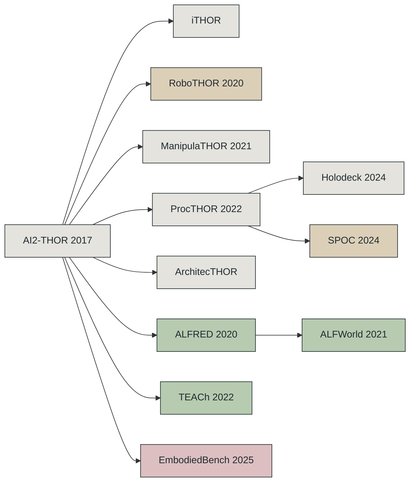

<!-- Generated from data.yml. Run python scripts/generate_readme.py. -->
<picture>
  <source media="(prefers-color-scheme: dark)" srcset="assets/floorplan-dark.svg">
  
</picture>

# Awesome AI2-THOR

AI2-THOR 及其家族的论文、基准与工具地图。

[](https://awesome.re)   [](https://github.com/XUJay111/awesome-ai2-thor) [](https://github.com/XUJay111/awesome-ai2-thor/actions/workflows/link-check.yml)

[网站](https://xujay111.github.io/awesome-ai2-thor/) / [English](README.md) / [参与贡献](CONTRIBUTING.md)

## 开始阅读

**初识 AI2-THOR**

1. [AI2-THOR 论文](#ai2-thor-an-interactive-3d-environment-for-visual-ai) — 了解模拟器
2. [官方文档](#ai2-thor-documentation) — 运行首个场景
3. [EmbodiedBench](#embodiedbench-comprehensive-benchmarking-mllms-for-vision-driven-embodied-agents) — 了解视觉智能体评测

**目标导航与 RoboTHOR**

1. [RoboTHOR 论文](#robothor-an-open-simulation-to-real-embodied-ai-platform) — 了解仿真到真实评测
2. [目标导航教程](#allenact-objectnav-tutorial) — 训练基线
3. [CLIP 与具身智能](#simple-but-effective-clip-embeddings-for-embodied-ai) — 比较视觉表征

**ALFRED 与 TEACh**

1. [ALFRED 论文](#alfred-a-benchmark-for-interpreting-grounded-instructions-for-everyday-tasks) — 将指令落地为动作
2. [TEACh 论文](#teach-task-driven-embodied-agents-that-chat) — 为家务任务加入对话
3. [ALFRED 资源](#alfred-documentation-and-leaderboards) — 查看评测协议

<details>
<summary>另两条阅读路线</summary>

**ProcTHOR 与场景生成**

1. [ProcTHOR 论文](#procthor-large-scale-embodied-ai-using-procedural-generation) — 生成可交互房屋
2. [ProcTHOR-10K 仓库](#procthor-10k-repository) — 加载房屋语料
3. [Holodeck 论文](#holodeck-language-guided-generation-of-3d-embodied-ai-environments) — 从语言生成场景

**LLM/VLM 具身智能体**

1. [LoTa-Bench](#lota-bench-benchmarking-language-oriented-task-planners-for-embodied-agents) — 比较语言规划器
2. [Embodied Agent Interface](#embodied-agent-interface-benchmarking-llms-for-embodied-decision-making) — 检查决策阶段
3. [Embodied-Reasoner](#embodied-reasoner) — 连接推理与交互

</details>

## THOR 家族



[AI2-THOR / iTHOR](#ai2-thor-an-interactive-3d-environment-for-visual-ai) / [RoboTHOR](#robothor-an-open-simulation-to-real-embodied-ai-platform) / [ManipulaTHOR](#manipulathor-a-framework-for-visual-object-manipulation) / [ProcTHOR](#procthor-large-scale-embodied-ai-using-procedural-generation) / [ArchitecTHOR evaluation](#selective-visual-representations-improve-convergence-and-generalization-for-embodied-ai) / [Holodeck](#holodeck-language-guided-generation-of-3d-embodied-ai-environments) / [SPOC](#spoc-imitating-shortest-paths-in-simulation-enables-effective-navigation-and-manipulation-in-the-real-world) / [ALFRED](#alfred-a-benchmark-for-interpreting-grounded-instructions-for-everyday-tasks) / [TEACh](#teach-task-driven-embodied-agents-that-chat) / [ALFWorld](#alfworld-aligning-text-and-embodied-environments-for-interactive-learning) / [EmbodiedBench](#embodiedbench-comprehensive-benchmarking-mllms-for-vision-driven-embodied-agents)

连接线表示模拟器扩展或任务谱系，不表示模型继承。

## 最近新增

2026-10-28 新增 30 条，覆盖 2026-07 to 2026-10 的 arXiv 论文。

| 论文 | 房间 | 环境 | 链接 |
| --- | :--: | :--: | --- |
| [**F2A-ObjectNav: An Adaptive Agentic Architecture for Object-Goal Navigation**](#f2a-objectnav-an-adaptive-agentic-architecture-for-object-goal-navigation)<br><sub>用规则监督器与任务记忆协调目标导航的各个模块</sub> | 导航 | AI2-THOR<br>RoboTHOR<br>ProcTHOR | [](https://arxiv.org/abs/2610.19618) |
| [**From Failures to Learnable Worlds: Policy-Conditioned Environment Generation for Navigation Agents**](#from-failures-to-learnable-worlds-policy-conditioned-environment-generation-for-navigation-agents)<br><sub>针对导航策略诊断出的弱点生成训练环境</sub> | 导航 | ProcTHOR | [](https://arxiv.org/abs/2610.19420) [](https://zhangyuejoslin.github.io/WEDGE/) |
| [**MIND: Instruction-Conditioned Incremental Grounding for Robots**](#mind-instruction-conditioned-incremental-grounding-for-robots)<br><sub>在与指令相关的事件发生后，增量更新机器人的目标房间决策</sub> | 规划 | ProcTHOR<br>AI2-THOR | [](https://arxiv.org/abs/2610.19262) [](https://mind-icra27.github.io/) |
| [**Towards a Systematic Study of Embodied System 2 over Full Task Execution Cycles**](#towards-a-systematic-study-of-embodied-system-2-over-full-task-execution-cycles)<br><sub>评测具身智能体基于观测的规划、执行与失败恢复全流程</sub> | 基准 | ProcTHOR | [](https://arxiv.org/abs/2610.17657) |
| [**Look Before You Move: Agent-Interface-Aligned Supervision for Open-World Mobile Manipulation**](#look-before-you-move-agent-interface-aligned-supervision-for-open-world-mobile-manipulation)<br><sub>收集与智能体接口一致的演示，训练主动视觉与具身导航</sub> | 导航 | AI2-THOR<br>EmbodiedBench | [](https://arxiv.org/abs/2610.15572) [](https://connerqiu.github.io/look-before-you-move/) |
| [**EMHO: EMbodied Agent Harness Optimization via Experience Traces**](#emho-embodied-agent-harness-optimization-via-experience-traces)<br><sub>根据执行轨迹和稀疏反馈修订冻结模型的智能体框架</sub> | 规划 | EmbodiedBench<br>AI2-THOR | [](https://arxiv.org/abs/2610.08432) [](https://hyunjung00.github.io/emho/) |

<details>
<summary>其余 24 条新增</summary>

| 论文 | 房间 | 环境 | 链接 |
| --- | :--: | :--: | --- |
| [**SafeVantage: Vantage-Aware Memory for Reliable Embodied Decisions**](#safevantage-vantage-aware-memory-for-reliable-embodied-decisions)<br><sub>保留每个主张的视角证据，输出是、否或弃权的具身决策</sub> | 感知 | ProcTHOR | [](https://arxiv.org/abs/2609.36906) [](https://github.com/seanhlewis/safevantage) [](https://safevantage.github.io) |
| [**SAGE: Symbolic Action-Gating and Editing for LLM Task Planners**](#sage-symbolic-action-gating-and-editing-for-llm-task-planners)<br><sub>用符号前置条件检查在执行前拦截LLM家务规划中的错误动作</sub> | 规划 | AI2-THOR | [](https://arxiv.org/abs/2609.34268) [](https://github.com/mtbui2010/sage_release) |
| [**RoboFoundry: System-as-Policy Evolution for Self-Learning Embodied Agents**](#robofoundry-system-as-policy-evolution-for-self-learning-embodied-agents)<br><sub>根据验证后的具身执行轨迹进化持久上下文与技能系统</sub> | 规划 | EmbodiedBench<br>ALFRED<br>AI2-THOR | [](https://arxiv.org/abs/2609.32862) [](https://jingsongliang.com/robofoundry) [](https://github.com/robofoundry2026/RoboFoundry) |
| [**Strategic Transformer for Resource-Constrained Multi-Object Navigation in Ultra-Large-Scale Environments**](#strategic-transformer-for-resource-constrained-multi-object-navigation-in-ultra-large-scale-environments)<br><sub>用轻量Transformer规划资源受限的多目标导航</sub> | 导航 | ProcTHOR | [](https://arxiv.org/abs/2609.20227) |
| [**EvoNav-Bench: Benchmarking Lifelong Navigation in Evolving Environments**](#evonav-bench-benchmarking-lifelong-navigation-in-evolving-environments)<br><sub>在ProcTHOR中构建环境变化下的终身导航基准</sub> | 基准 | ProcTHOR | [](https://arxiv.org/abs/2609.08292) |
| [**Seeing Less Is Not Seeing Safely: Privacy Leakage from Task-Scoped Robot Perception Exports**](#seeing-less-is-not-seeing-safely-privacy-leakage-from-task-scoped-robot-perception-exports)<br><sub>评估机器人任务感知输出的隐私泄露风险，并在AI2-THOR中验证</sub> | 基准 | AI2-THOR<br>ProcTHOR | [](https://arxiv.org/abs/2609.03055) |
| [**DSG: Dynamic 3D Scene Graph Construction for Embodied Agents in Changing Indoor Environments**](#dsg-dynamic-3d-scene-graph-construction-for-embodied-agents-in-changing-indoor-environments)<br><sub>在物体移动后更新三维场景图，并发布基于AI2-THOR的DynTHOR</sub> | 感知 | AI2-THOR | [](https://arxiv.org/abs/2609.00619) |
| [**PRACTICE: From Experience to Expertise in Self-Evolving Embodied Agents**](#practice-from-experience-to-expertise-in-self-evolving-embodied-agents)<br><sub>训练技能学习器，从历史轨迹维护持久技能库</sub> | 规划 | EmbodiedBench<br>ALFRED | [](https://arxiv.org/abs/2608.30760) [](https://baai-agents.github.io/PRACTICE) |
| [**If, Then, Otherwise: Diagnosing Conditional Branching in Vision-Language Navigation**](#if-then-otherwise-diagnosing-conditional-branching-in-vision-language-navigation)<br><sub>在四个场景数据集上诊断视觉语言导航中的条件分支</sub> | 基准 | AI2-THOR | [](https://arxiv.org/abs/2608.17318) [](https://condvln.github.io/) |
| [**Breaking Planner Integrity Boundary: Enviroment State-Text Injection Attack on LLM-Driven Embodied Agents**](#breaking-planner-integrity-boundary-enviroment-state-text-injection-attack-on-llm-driven-embodied-agents)<br><sub>注入虚假环境状态文本，在闭环中攻击LLM驱动的具身智能体</sub> | 基准 | AI2-THOR<br>iTHOR | [](https://arxiv.org/abs/2608.16806) |
| [**Graph-MambaNav: Spatial-Temporal Graph Mamba Leveraging Object-Relation Knowledge for Object-Goal Navigation**](#graph-mambanav-spatial-temporal-graph-mamba-leveraging-object-relation-knowledge-for-object-goal-navigation)<br><sub>在图Mamba中按目标相关性排序物体，用于目标导航</sub> | 导航 | AI2-THOR<br>RoboTHOR | [](https://arxiv.org/abs/2608.13723) |
| [**Action- and Language-Conditioned Video Assessment for Embodied Control**](#action--and-language-conditioned-video-assessment-for-embodied-control)<br><sub>为动作条件视频评分，为家务策略优化提供反馈</sub> | 感知 | ALFRED<br>AI2-THOR | [](https://arxiv.org/abs/2608.08273) |
| [**GraphThink: Graph-Enhanced LLM Thinking for Long-Horizon Embodied Task Planning**](#graphthink-graph-enhanced-llm-thinking-for-long-horizon-embodied-task-planning)<br><sub>用任务图和场景图重规划完成长程家务任务</sub> | 规划 | ALFRED | [](https://arxiv.org/abs/2608.07905) |
| [**TRACE: A Multi-Layer Benchmark for Human AI Controller Coordination Under Drift and Failure**](#trace-a-multi-layer-benchmark-for-human-ai-controller-coordination-under-drift-and-failure)<br><sub>基于ALFRED轨迹注入漂移，构建多层故障诊断基准</sub> | 基准 | ALFRED | [](https://arxiv.org/abs/2608.06657) |
| [**Mimir: A Neuro-Symbolic Memory System with Dynamic Grounding for Embodied Agents in Interactive Environments**](#mimir-a-neuro-symbolic-memory-system-with-dynamic-grounding-for-embodied-agents-in-interactive-environments)<br><sub>加入神经符号记忆，在每步动作前把目标绑定到世界状态</sub> | 规划 | EmbodiedBench<br>ALFRED | [](https://arxiv.org/abs/2608.04933) |
| [**Long-Horizon Embodied Decision-Making via Multimodal Memory Compression**](#long-horizon-embodied-decision-making-via-multimodal-memory-compression)<br><sub>压缩与偏好相关的多模态记忆，支持长程房屋选择</sub> | 基准 | ProcTHOR | [](https://arxiv.org/abs/2608.01456) |
| [**Memory for Attention: Language-Conditioned Re-Perception with a Vision--Language--Motion Map**](#memory-for-attention-language-conditioned-re-perception-with-a-vision--language--motion-map)<br><sub>将机器人的重新感知视为在持久视觉-语言-运动地图上的注意力分配</sub> | 感知 | AI2-THOR | [](https://arxiv.org/abs/2607.23797) |
| [**MEMENTO: Memory-Guided Memetic Code-as-Policy Evolution**](#memento-memory-guided-memetic-code-as-policy-evolution)<br><sub>用记忆引导的爬山与宏变异进化代码策略程序</sub> | 规划 | AI2-THOR | [](https://arxiv.org/abs/2607.22832) [](https://github.com/sygkounas/MEMENTO) |
| [**UniETP: Unifying Environments for Generalizable Embodied Task Planning**](#unietp-unifying-environments-for-generalizable-embodied-task-planning)<br><sub>将AI2-THOR等四个模拟器统一为具身任务规划基准</sub> | 基准 | AI2-THOR | [](https://arxiv.org/abs/2607.18062) [](https://github.com/woyut/UniETP) |
| [**Vision-Language-Motion Maps: An Open-Vocabulary, Uncertainty-Aware, Queryable Motion Attribute for 3D Scene Maps**](#vision-language-motion-maps-an-open-vocabulary-uncertainty-aware-queryable-motion-attribute-for-3d-scene-maps)<br><sub>构建带有逐物体运动属性和不确定性的开放词汇三维地图</sub> | 感知 | AI2-THOR | [](https://arxiv.org/abs/2607.16173) |
| [**Embodied Active Learning under Limited Annotation and Navigation Budget for Object Detection**](#embodied-active-learning-under-limited-annotation-and-navigation-budget-for-object-detection)<br><sub>在导航和标注预算约束下选择轨迹与图像，用于微调检测器</sub> | 感知 | AI2-THOR | [](https://arxiv.org/abs/2607.15974) |
| [**Difference-Based Relational Learning for Zero-Shot Object-Goal Visual Navigation With Direct Sim-to-Real Transfer**](#difference-based-relational-learning-for-zero-shot-object-goal-visual-navigation-with-direct-sim-to-real-transfer)<br><sub>用孪生差分网络实现零样本目标导航，并迁移到真实机器人</sub> | 导航 | AI2-THOR | [](https://arxiv.org/abs/2607.15642) |
| [**Mosaic: Runtime-Efficient Multi-Agent Embodied Planning**](#mosaic-runtime-efficient-multi-agent-embodied-planning)<br><sub>用智能体中心记忆和整数线性规划分配动作，加速多智能体规划</sub> | 规划 | AI2-THOR | [](https://arxiv.org/abs/2607.09603) |
| [**Multi-scale Mixture of World Models for Embodied Agents in Evolving Environments**](#multi-scale-mixture-of-world-models-for-embodied-agents-in-evolving-environments)<br><sub>在环境变化时，按尺度路由并更新具身世界模型</sub> | 规划 | EmbodiedBench<br>AI2-THOR | [](https://arxiv.org/abs/2607.00457) |

</details>

## 目录

- [平台与环境生成](#platforms-and-environment-generation) <sub>12</sub> — 模拟器与场景生成。
- [基准与评测](#benchmarks-and-evaluation) <sub>36</sub> — 任务、安全与评测协议。
- [指令跟随与家务任务](#instruction-following-and-household-tasks) <sub>52</sub> — ALFRED、TEACh 与语言驱动的执行。
- [导航](#navigation) <sub>85</sub> — 目标导航、探索与仿真迁移。
- [规划、记忆与多智能体](#planning-memory-and-multi-agent-systems) <sub>53</sub> — 重规划、空间记忆与协作。
- [强化学习训练的 VLM 智能体](#rl-trained-vlm-agents) <sub>17</sub> — 策略训练与具身推理。
- [感知、物理与场景图](#perception-physics-and-scene-graphs) <sub>28</sub> — 物体、可供性与物理推理。
- [数据集与资产](#datasets-and-assets) <sub>10</sub> — 场景、物体资产与任务数据。
- [工具与环境](#tools-and-environments) <sub>24</sub> — 训练框架、封装与实用工具。
- [教程与笔记](#tutorials-and-notes) <sub>5</sub> — 安装、首个场景与可复现基线。

322 条模拟器家族资源；另附 13 条 ALFWorld 文本环境工作。

<a id="platforms-and-environment-generation"></a>

##  平台与环境生成

模拟器与场景生成。 12 条。

#### AI2-THOR: An Interactive 3D Environment for Visual AI

2017 · AI2-THOR

[](https://arxiv.org/abs/1712.05474) [](https://ai2thor.allenai.org/) [](https://github.com/allenai/ai2thor)

AI2-THOR 将导航、物理与物体操作放入可交互室内场景，为家务智能体提供共用模拟器。

#### RoboTHOR: An Open Simulation-to-Real Embodied AI Platform

CVPR 2020 · RoboTHOR

[](https://arxiv.org/abs/2004.06799) [](https://ai2thor.allenai.org/robothor/) [](https://github.com/allenai/ai2thor)

RoboTHOR 配对仿真与真实房间，让研究者测量导航策略向真实环境迁移的效果。

#### ProcTHOR: Large-Scale Embodied AI Using Procedural Generation

NeurIPS 2022 · ProcTHOR

[](https://arxiv.org/abs/2206.06994) [](https://procthor.allenai.org/) [](https://github.com/allenai/procthor)

ProcTHOR 程序化生成一万套可交互房屋，为导航与家务交互训练提供可扩展的场景多样性。

#### Holodeck: Language Guided Generation of 3D Embodied AI Environments

CVPR 2024 · ProcTHOR

[](https://arxiv.org/abs/2312.09067) [](https://yueyang1996.github.io/holodeck/) [](https://github.com/allenai/Holodeck)

Holodeck 结合语言与 Objaverse 资产构建兼容 AI2-THOR 的交互场景，将环境生成扩展到手工布局之外。

| 年份 | 论文或资源 | 环境 | 链接 |
| :--: | --- | :--: | --- |
| 2026 | <a id="spread-spatial-physical-reasoning-via-geometry-aware-diffusion"></a>**SPREAD: Spatial-Physical REasoning via geometry Aware Diffusion**<br><sub>通过几何感知扩散生成空间物理结构</sub> | ProcTHOR | [](https://arxiv.org/abs/2603.27573) |
| 2025 | <a id="dualthor"></a>**DualTHOR**<br><sub>双臂任务执行、回放与意外情况建模</sub> | AI2-THOR | [](https://arxiv.org/abs/2506.16012) [](https://github.com/ds199895/DualTHOR) |
| 2025 | <a id="beyond-needles-in-the-embodied-haystack"></a>**Beyond Needle(s) in the Embodied Haystack**<br><sub>用长轨迹评测超长上下文具身推理</sub> | infinity-THOR | [](https://arxiv.org/abs/2505.16928) |
| 2025 | <a id="enhancing-multi-agent-systems-via-reinforcement-learning-with-llm-based-planner-and-graph-based-policy"></a>**Enhancing Multi-Agent Systems via Reinforcement Learning with LLM-based Planner and Graph-based Policy**<br><sub>结合语言规划与图策略进行多智能体强化学习</sub> | AI2-THOR | [](https://arxiv.org/abs/2503.10049) |
| 2024 | <a id="spoc-imitating-shortest-paths-in-simulation-enables-effective-navigation-and-manipulation-in-the-real-world"></a>**SPOC: Imitating Shortest Paths in Simulation Enables Effective Navigation and Manipulation in the Real World**<br><sub>将仿真中的最短路径模仿迁移到真实机器人</sub> | ProcTHOR | [](https://openaccess.thecvf.com/content/CVPR2024/html/Ehsani_SPOC_Imitating_Shortest_Paths_in_Simulation_Enables_Effective_Navigation_and_CVPR_2024_paper.html) [](https://spoc-robot.github.io/) [](https://github.com/allenai/spoc-robot-training) |
| 2022 | <a id="phone2proc-bringing-robust-robots-into-our-chaotic-world"></a>**Phone2Proc: Bringing Robust Robots Into Our Chaotic World**<br><sub>根据手机扫描结果生成训练场景</sub> | ProcTHOR | [](https://arxiv.org/abs/2212.04819) [](https://allenai.org/project/phone2proc) [](https://github.com/allenai/phone2proc) |
| 2021 | <a id="manipulathor-a-framework-for-visual-object-manipulation"></a>**ManipulaTHOR: A Framework for Visual Object Manipulation**<br><sub>移动机械臂交互与 ArmPointNav 任务</sub> | ManipulaTHOR | [](https://arxiv.org/abs/2104.11213) [](https://ai2thor.allenai.org/manipulathor/) [](https://github.com/allenai/manipulathor) |
| 2021 | <a id="visual-room-rearrangement"></a>**Visual Room Rearrangement**<br><sub>记住房间原状，再恢复被移动的物体</sub> | AI2-THOR | [](https://arxiv.org/abs/2103.16544) [](https://ai2thor.allenai.org/rearrangement/) [](https://github.com/allenai/ai2thor-rearrangement) |

<a id="benchmarks-and-evaluation"></a>

##  基准与评测

任务、安全与评测协议。 36 条。

#### ALFRED: A Benchmark for Interpreting Grounded Instructions for Everyday Tasks

CVPR 2020 · ALFRED

[](https://arxiv.org/abs/1912.01734) [](https://askforalfred.com/) [](https://github.com/askforalfred/alfred)

ALFRED 将家务指令与视觉演示配对，联合检验语言落地、导航与不可逆物体交互。

#### TEACh: Task-driven Embodied Agents that Chat

AAAI 2022 · TEACh

[](https://arxiv.org/abs/2110.00534) [](https://github.com/alexa/teach)

TEACh 为 AI2-THOR 家务任务加入指挥者与执行者对话，检验对话能否补足执行中缺失的信息。

#### EmbodiedBench: Comprehensive Benchmarking MLLMs for Vision-Driven Embodied Agents

ICML 2025 · EmbodiedBench / ALFRED

[](https://openreview.net/forum?id=DgGF2LEBPS) [](https://embodiedbench.github.io/) [](https://github.com/EmbodiedBench/EmbodiedBench)

EmbodiedBench 包含 EB-ALFRED 等任务，区分多模态智能体的高层规划与视觉落地、动作执行失败。

**最新条目**

| 年份 | 论文或资源 | 环境 | 链接 |
| :--: | --- | :--: | --- |
| 2026 | <a id="towards-a-systematic-study-of-embodied-system-2-over-full-task-execution-cycles"></a>**Towards a Systematic Study of Embodied System 2 over Full Task Execution Cycles** <br><sub>评测具身智能体基于观测的规划、执行与失败恢复全流程</sub> | ProcTHOR | [](https://arxiv.org/abs/2610.17657) |
| 2026 | <a id="evonav-bench-benchmarking-lifelong-navigation-in-evolving-environments"></a>**EvoNav-Bench: Benchmarking Lifelong Navigation in Evolving Environments** <br><sub>在ProcTHOR中构建环境变化下的终身导航基准</sub> | ProcTHOR | [](https://arxiv.org/abs/2609.08292) |
| 2026 | <a id="seeing-less-is-not-seeing-safely-privacy-leakage-from-task-scoped-robot-perception-exports"></a>**Seeing Less Is Not Seeing Safely: Privacy Leakage from Task-Scoped Robot Perception Exports** <br><sub>评估机器人任务感知输出的隐私泄露风险，并在AI2-THOR中验证</sub> | AI2-THOR<br>ProcTHOR | [](https://arxiv.org/abs/2609.03055) |
| 2026 | <a id="if-then-otherwise-diagnosing-conditional-branching-in-vision-language-navigation"></a>**If, Then, Otherwise: Diagnosing Conditional Branching in Vision-Language Navigation** <br><sub>在四个场景数据集上诊断视觉语言导航中的条件分支</sub> | AI2-THOR | [](https://arxiv.org/abs/2608.17318) [](https://condvln.github.io/) |
| 2026 | <a id="breaking-planner-integrity-boundary-enviroment-state-text-injection-attack-on-llm-driven-embodied-agents"></a>**Breaking Planner Integrity Boundary: Enviroment State-Text Injection Attack on LLM-Driven Embodied Agents** <br><sub>注入虚假环境状态文本，在闭环中攻击LLM驱动的具身智能体</sub> | AI2-THOR<br>iTHOR | [](https://arxiv.org/abs/2608.16806) |

<details>
<summary>全部 36 条（另 28 条）</summary>

| 年份 | 论文或资源 | 环境 | 链接 |
| :--: | --- | :--: | --- |
| 2026 | <a id="trace-a-multi-layer-benchmark-for-human-ai-controller-coordination-under-drift-and-failure"></a>**TRACE: A Multi-Layer Benchmark for Human AI Controller Coordination Under Drift and Failure** <br><sub>基于ALFRED轨迹注入漂移，构建多层故障诊断基准</sub> | ALFRED | [](https://arxiv.org/abs/2608.06657) |
| 2026 | <a id="long-horizon-embodied-decision-making-via-multimodal-memory-compression"></a>**Long-Horizon Embodied Decision-Making via Multimodal Memory Compression** <br><sub>压缩与偏好相关的多模态记忆，支持长程房屋选择</sub> | ProcTHOR | [](https://arxiv.org/abs/2608.01456) |
| 2026 | <a id="unietp-unifying-environments-for-generalizable-embodied-task-planning"></a>**UniETP: Unifying Environments for Generalizable Embodied Task Planning** <br><sub>将AI2-THOR等四个模拟器统一为具身任务规划基准</sub> | AI2-THOR | [](https://arxiv.org/abs/2607.18062) [](https://github.com/woyut/UniETP) |
| 2026 | <a id="groundcontrol-anticipating-navigation-failures-in-vision-language-agents-via-trajectory-consistent-uncertainty-estimates"></a>**GroundControl: Anticipating Navigation Failures in Vision-Language Agents via Trajectory-Consistent Uncertainty Estimates**<br><sub>利用轨迹一致性不确定度预判导航失败</sub> | EmbodiedBench | [](https://arxiv.org/abs/2606.20479) |
| 2026 | <a id="where-to-look-can-foundation-models-reach-a-target-viewpoint-through-active-exploration"></a>**Where to Look: Can Foundation Models Reach a Target Viewpoint Through Active Exploration?**<br><sub>移动至当前视角与目标图像匹配</sub> | AI2-THOR<br>ProcTHOR | [](https://arxiv.org/abs/2606.01247) [](https://github.com/aim-uofa/TVRBench) |
| 2026 | <a id="do-llms-build-world-models-from-text-a-multilingual-diagnostic-of-spatial-reasoning"></a>**Do LLMs Build World Models From Text? A Multilingual Diagnostic of Spatial Reasoning**<br><sub>根据文字世界描述诊断多语言空间推理</sub> | ProcTHOR | [](https://arxiv.org/abs/2605.28277) |
| 2026 | <a id="safetyalfred-evaluating-safety-conscious-planning-of-multimodal-large-language-models"></a>**SafetyALFRED: Evaluating Safety-Conscious Planning of Multimodal Large Language Models**<br><sub>评测厨房危险场景中的安全规划</sub> | ALFRED | [](https://arxiv.org/abs/2604.19638) [](https://github.com/sled-group/SafetyALFRED) |
| 2026 | <a id="pre-execution-safety-gate-task-safety-contracts-for-llm-controlled-robot-systems"></a>**Pre-Execution Safety Gate &amp; Task Safety Contracts for LLM-Controlled Robot Systems**<br><sub>通过执行前检查与任务安全契约约束动作</sub> | AI2-THOR | [](https://arxiv.org/abs/2604.05427) |
| 2026 | <a id="asgardbench"></a>**AsgardBench**<br><sub>根据视觉观察与执行反馈调整家务计划</sub> | AI2-THOR | [](https://arxiv.org/abs/2603.15888) [](https://www.microsoft.com/en-us/research/blog/asgardbench-a-benchmark-for-visually-grounded-interactive-planning/) [](https://github.com/microsoft/AsgardBench) |
| 2026 | <a id="agentsafe-benchmarking-the-safety-of-embodied-agents-on-hazardous-instructions"></a>**AGENTSAFE: Benchmarking the Safety of Embodied Agents on Hazardous Instructions**<br><sub>在 SAFE-THOR 沙箱中诊断不安全指令</sub> | AI2-THOR | [](https://openaccess.thecvf.com/content/CVPR2026/papers/Ying_AGENTSAFE_Benchmarking_the_Safety_of_Embodied_Agents_on_Hazardous_Instructions_CVPR_2026_paper.pdf) [](https://arxiv.org/abs/2506.14697) |
| 2025 | <a id="detecting-non-optimal-decisions-of-embodied-agents-via-diversity-guided-metamorphic-testing"></a>**Detecting Non-Optimal Decisions of Embodied Agents via Diversity-Guided Metamorphic Testing**<br><sub>通过多样性引导的蜕变测试检测不良决策</sub> | AI2-THOR | [](https://arxiv.org/abs/2512.20083) |
| 2025 | <a id="sentinel-a-multi-level-formal-framework-for-safety-evaluation-of-foundation-model-based-embodied-agents"></a>**SENTINEL: A Multi-Level Formal Framework for Safety Evaluation of Foundation Model-based Embodied Agents**<br><sub>通过多层形式化抽象评估具身安全</sub> | AI2-THOR | [](https://arxiv.org/abs/2510.12985) |
| 2025 | <a id="embodied-web-agents"></a>**Embodied Web Agents**<br><sub>结合家务交互与网页信息获取</sub> | AI2-THOR | [](https://arxiv.org/abs/2506.15677) [](https://embodied-web-agent.github.io/) |
| 2024 | <a id="safeagentbench-a-benchmark-for-safe-task-planning-of-embodied-llm-agents"></a>**SafeAgentBench: A Benchmark for Safe Task Planning of Embodied LLM Agents**<br><sub>检验家务计划中的危险动作与物理风险</sub> | AI2-THOR | [](https://arxiv.org/abs/2412.13178) [](https://safeagentbench.github.io/) [](https://github.com/shengyin1224/SafeAgentBench) [](https://huggingface.co/datasets/safeagentbench/SafeAgentBench) |
| 2024 | <a id="robustness-testing-of-multi-modal-models-in-varied-home-environments-for-assistive-robots"></a>**Robustness Testing of Multi-Modal Models in Varied Home Environments for Assistive Robots**<br><sub>在多样家居环境中测试多模态鲁棒性</sub> | AI2-THOR | [](https://arxiv.org/abs/2406.12443) |
| 2024 | <a id="lota-bench-benchmarking-language-oriented-task-planners-for-embodied-agents"></a>**LoTa-Bench: Benchmarking Language-oriented Task Planners for Embodied Agents**<br><sub>通过闭环家务执行比较语言规划器</sub> | ALFRED | [](https://openreview.net/forum?id=ADSxCpCu9s) [](https://arxiv.org/abs/2402.08178) [](https://choi-jaewoo.github.io/LoTa-Bench/) [](https://github.com/lbaa2022/LLMTaskPlanning) |
| 2024 | <a id="cl-alfred-online-continual-learning-for-interactive-instruction-following-agents"></a>**CL-ALFRED: Online Continual Learning for Interactive Instruction Following Agents**<br><sub>在变化的任务与环境中持续学习指令跟随</sub> | ALFRED | [](https://openreview.net/forum?id=7M0EzjugaN) [](https://bhkim94.github.io/projects/CL-ALFRED/) [](https://github.com/snumprlab/cl-alfred) |
| 2024 | <a id="embodied-agent-interface-benchmarking-llms-for-embodied-decision-making"></a>**Embodied Agent Interface: Benchmarking LLMs for Embodied Decision Making**<br><sub>分解目标理解、动作生成与状态建模</sub> | AI2-THOR | [](https://openreview.net/forum?id=iSwK1YqO7v) [](https://embodied-agent-interface.github.io/) |
| 2024 | <a id="realfred-an-embodied-instruction-following-benchmark-in-photo-realistic-environments"></a>**ReALFRED: An Embodied Instruction Following Benchmark in Photo-Realistic Environments**<br><sub>在真实扫描环境中执行 ALFRED 衍生任务</sub> | ReALFRED | [](https://www.ecva.net/papers/eccv_2024/papers_ECCV/html/1610_ECCV_2024_paper.php) [](https://twoongg.github.io/projects/realfred/) [](https://github.com/snumprlab/realfred) |
| 2023 | <a id="maea-multimodal-attribution-for-embodied-ai"></a>**MAEA: Multimodal Attribution for Embodied AI**<br><sub>对具身决策中的多模态信息进行归因</sub> | ALFRED | [](https://arxiv.org/abs/2307.13850) |
| 2023 | <a id="2023-ai2-thor-rearrangement-challenge"></a>**2023 AI2-THOR Rearrangement Challenge**<br><sub>房间重排的任务采样、指标与基线</sub> | AI2-THOR | [](https://ai2thor.allenai.org/rearrangement/) [](https://github.com/allenai/ai2thor-rearrangement) |
| 2022 | <a id="dialog-acts-for-task-driven-embodied-agents"></a>**Dialog Acts for Task-Driven Embodied Agents**<br><sub>为任务驱动的智能体标注对话行为</sub> | TEACh | [](https://arxiv.org/abs/2209.12953) [](https://github.com/alexa/teach) |
| 2022 | <a id="cows-on-pasture-baselines-and-benchmarks-for-language-driven-zero-shot-object-navigation"></a>**CoWs on Pasture: Baselines and Benchmarks for Language-Driven Zero-Shot Object Navigation**<br><sub>评测语言驱动的零样本目标导航</sub> | RoboTHOR | [](https://arxiv.org/abs/2203.10421) [](https://github.com/real-stanford/cow) |
| 2022 | <a id="dialfred-dialogue-enabled-agents-for-embodied-instruction-following"></a>**DialFRED: Dialogue-Enabled Agents for Embodied Instruction Following**<br><sub>在家务指令执行中主动提问澄清</sub> | ALFRED | [](https://arxiv.org/abs/2202.13330) [](https://eval.ai/web/challenges/challenge-page/1859/overview) [](https://github.com/xfgao/DialFRED) |
| 2022 | <a id="act-thor-a-controlled-benchmark-for-embodied-action-understanding-in-simulated-environments"></a>**ACT-Thor: A Controlled Benchmark for Embodied Action Understanding in Simulated Environments**<br><sub>推理动作造成的视觉变化</sub> | AI2-THOR | [](https://aclanthology.org/2022.coling-1.495/) [](https://github.com/hannamw/ACT-Thor) [](https://huggingface.co/datasets/mwhanna/ACT-Thor) |
| 2021 | <a id="alfworld-aligning-text-and-embodied-environments-for-interactive-learning"></a>**ALFWorld: Aligning Text and Embodied Environments for Interactive Learning**<br><sub>将文字游戏规划与视觉家务执行对齐</sub> | ALFWorld<br>ALFRED | [](https://arxiv.org/abs/2010.03768) [](https://alfworld.github.io/) [](https://github.com/alfworld/alfworld) |
| 2019 | <a id="two-body-problem-collaborative-visual-task-completion"></a>**Two Body Problem: Collaborative Visual Task Completion**<br><sub>通过智能体通信完成协同视觉任务</sub> | AI2-THOR | [](https://openaccess.thecvf.com/content_CVPR_2019/html/Jain_Two_Body_Problem_Collaborative_Visual_Task_Completion_CVPR_2019_paper.html) |
| 2018 | <a id="iqa-visual-question-answering-in-interactive-environments"></a>**IQA: Visual Question Answering in Interactive Environments**<br><sub>通过导航与交互回答视觉问题</sub> | AI2-THOR | [](https://openaccess.thecvf.com/content_cvpr_2018/html/Gordon_IQA_Visual_Question_CVPR_2018_paper.html) [](https://prior.allenai.org/projects/iqa) [](https://github.com/danielgordon10/thor-iqa-cvpr-2018) |

</details>

<a id="instruction-following-and-household-tasks"></a>

##  指令跟随与家务任务

ALFRED、TEACh 与语言驱动的执行。 52 条。

#### MOCA: Factorizing Perception and Policy for Interactive Instruction Following

ICCV 2021 · ALFRED

[](https://arxiv.org/abs/2012.03208) [](https://github.com/gistvision/moca)

MOCA 将 ALFRED 指令跟随分为感知与策略两条路径，把物体落地连接到可执行家务动作。

#### HLSM: Hierarchical Language-conditioned Spatial Model for Embodied Instruction Following

CoRL 2021 · ALFRED

[](https://arxiv.org/abs/2107.05612) [](https://hlsm-alfred.github.io/) [](https://github.com/valtsblukis/hlsm)

HLSM 在 ALFRED 中维护语义空间地图，为分层规划器提供执行长程家务指令所需的持久状态。

#### FILM: Following Instructions in Language with Modular Methods

ICLR 2022 · ALFRED

[](https://arxiv.org/abs/2110.07342) [](https://github.com/soyeonm/FILM)

FILM 在 ALFRED 中结合语言解析、语义地图、搜索与执行，提供模块化指令跟随参考。

**最新条目**

| 年份 | 论文或资源 | 环境 | 链接 |
| :--: | --- | :--: | --- |
| 2026 | <a id="on-device-robotic-planning-eliminating-inference-redundancy-for-efficient-decision-making"></a>**On-Device Robotic Planning: Eliminating Inference Redundancy for Efficient Decision-Making**<br><sub>消除端侧机器人规划中的冗余推理</sub> | ALFRED | [](https://arxiv.org/abs/2605.31460) |
| 2026 | <a id="enabling-extensible-embodied-capabilities-with-tools"></a>**Enabling Extensible Embodied Capabilities with Tools**<br><sub>通过工具扩展具身能力</sub> | ALFRED<br>EmbodiedBench | [](https://arxiv.org/abs/2605.26637) |
| 2026 | <a id="replan-bot-multi-level-replanning-for-embodied-instruction-following"></a>**RePlan-Bot: Multi-Level Replanning for Embodied Instruction Following**<br><sub>审查高层计划并修正局部执行</sub> | ALFRED | [](https://arxiv.org/abs/2605.25851) |
| 2026 | <a id="machine-intelligence-that-understands-visual-and-linguistic-information-and-interacts-with-humans-and-environments"></a>**Machine Intelligence that Understands Visual and Linguistic Information and Interacts with Humans and Environments**<br><sub>研究视觉与语言落地的环境交互</sub> | ALFRED | [](https://arxiv.org/abs/2605.24020) |
| 2026 | <a id="recapa-hierarchical-predictive-correction-to-mitigate-cascading-failures"></a>**ReCAPA: Hierarchical Predictive Correction to Mitigate Cascading Failures**<br><sub>通过分层预测修正应对级联执行失败</sub> | AI2-THOR | [](https://arxiv.org/abs/2604.21232) |

<details>
<summary>全部 52 条（另 44 条）</summary>

| 年份 | 论文或资源 | 环境 | 链接 |
| :--: | --- | :--: | --- |
| 2026 | <a id="environmental-understanding-vision-language-model-for-embodied-agent"></a>**Environmental Understanding Vision-Language Model for Embodied Agent**<br><sub>为视觉语言具身智能体建模环境上下文</sub> | ALFRED | [](https://arxiv.org/abs/2604.19839) |
| 2026 | <a id="gala-hypergraph-guided-visual-language-models-for-procedural-planning"></a>**GaLa: Hypergraph-Guided Visual Language Models for Procedural Planning**<br><sub>通过超图引导程序化计划</sub> | ALFRED | [](https://arxiv.org/abs/2604.17241) |
| 2026 | <a id="brainmem-brain-inspired-evolving-memory-for-embodied-agent-task-planning"></a>**BrainMem: Brain-Inspired Evolving Memory for Embodied Agent Task Planning**<br><sub>为家务任务规划演化记忆</sub> | ALFRED<br>EmbodiedBench | [](https://arxiv.org/abs/2604.16331) |
| 2026 | <a id="elite-experiential-learning-and-intent-aware-transfer-for-self-improving-embodied-agents"></a>**ELITE: Experiential Learning and Intent-Aware Transfer for Self-improving Embodied Agents**<br><sub>根据任务意图迁移具身经验</sub> | ALFRED<br>EmbodiedBench | [](https://arxiv.org/abs/2603.24018) |
| 2026 | <a id="multi-robot-learning-informed-task-planning-under-uncertainty"></a>**Multi-Robot Learning-Informed Task Planning Under Uncertainty**<br><sub>利用学习引导在不确定条件下规划多机器人任务</sub> | ProcTHOR | [](https://arxiv.org/abs/2603.20544) |
| 2026 | <a id="svll-staged-vision-language-learning-for-physically-grounded-embodied-task-planning"></a>**SVLL: Staged Vision-Language Learning for Physically Grounded Embodied Task Planning**<br><sub>分阶段进行视觉语言学习以支持物理规划</sub> | AI2-THOR | [](https://arxiv.org/abs/2603.11563) |
| 2026 | <a id="aligning-agentic-world-models-via-knowledgeable-experience-learning"></a>**Aligning Agentic World Models via Knowledgeable Experience Learning**<br><sub>通过经验学习对齐世界模型</sub> | ALFRED<br>EmbodiedBench | [](https://arxiv.org/abs/2601.13247) |
| 2026 | <a id="towards-zero-knowledge-task-planning-via-a-language-based-approach"></a>**Towards Zero-Knowledge Task Planning via a Language-based Approach**<br><sub>无先验任务知识的语言任务规划</sub> | AI2-THOR | [](https://arxiv.org/abs/2601.03398) |
| 2026 | <a id="recurrent-reasoning-with-vision-language-models-for-estimating-long-horizon-embodied-task-progress"></a>**Recurrent Reasoning with Vision-Language Models for Estimating Long-Horizon Embodied Task Progress**<br><sub>通过循环视觉推理估计任务进度</sub> | AI2-THOR | [](https://openaccess.thecvf.com/content/CVPR2026/html/Zhang_Recurrent_Reasoning_with_Vision-Language_Models_for_Estimating_Long-Horizon_Embodied_Task_CVPR_2026_paper.html) |
| 2026 | <a id="roboagent-chaining-basic-capabilities-for-embodied-task-planning"></a>**RoboAgent: Chaining Basic Capabilities for Embodied Task Planning**<br><sub>将基础能力串联成长程家务流程</sub> | AI2-THOR | [](https://openaccess.thecvf.com/content/CVPR2026/html/Xu_RoboAgent_Chaining_Basic_Capabilities_for_Embodied_Task_Planning_CVPR_2026_paper.html) |
| 2025 | <a id="madra-multi-agent-debate-for-risk-aware-embodied-planning"></a>**MADRA: Multi-Agent Debate for Risk-Aware Embodied Planning**<br><sub>通过多智能体辩论制定风险感知具身计划</sub> | AI2-THOR | [](https://arxiv.org/abs/2511.21460) |
| 2025 | <a id="reactree-hierarchical-llm-agent-trees-with-control-flow-for-long-horizon-task-planning"></a>**ReAcTree: Hierarchical LLM Agent Trees with Control Flow for Long-Horizon Task Planning**<br><sub>将长程计划组织为分层控制流树</sub> | ALFRED | [](https://arxiv.org/abs/2511.02424) |
| 2025 | <a id="exploratory-retrieval-augmented-planning-for-continual-embodied-instruction-following"></a>**Exploratory Retrieval-Augmented Planning For Continual Embodied Instruction Following**<br><sub>为持续指令跟随检索探索经验</sub> | ALFRED | [](https://arxiv.org/abs/2509.08222) |
| 2025 | <a id="llapa-a-vision-language-model-framework-for-counterfactual-aware-procedural-planning"></a>**LLaPa: A Vision-Language Model Framework for Counterfactual-Aware Procedural Planning**<br><sub>利用反事实感知视觉语言推理规划流程</sub> | ALFRED | [](https://arxiv.org/abs/2507.08496) |
| 2025 | <a id="world-aware-planning-narratives-enhance-large-vision-language-model-planner"></a>**World-aware Planning Narratives Enhance Large Vision-Language Model Planner**<br><sub>利用世界感知叙事引导视觉语言规划器</sub> | ALFRED<br>EmbodiedBench | [](https://arxiv.org/abs/2506.21230) |
| 2025 | <a id="graphormer-guided-task-planning-beyond-static-rules-with-llm-safety-perception"></a>**Graphormer-Guided Task Planning: Beyond Static Rules with LLM Safety Perception**<br><sub>通过图 Transformer 与安全感知引导任务规划</sub> | AI2-THOR | [](https://arxiv.org/abs/2503.06866) |
| 2025 | <a id="planning-with-affordances-integrating-learned-affordance-models-and-symbolic-planning"></a>**Planning with affordances: Integrating learned affordance models and symbolic planning**<br><sub>将学习得到的可供性模型与符号规划结合</sub> | AI2-THOR | [](https://arxiv.org/abs/2502.02768) |
| 2025 | <a id="thinkbot-embodied-instruction-following-with-thought-chain-reasoning"></a>**ThinkBot: Embodied Instruction Following with Thought Chain Reasoning**<br><sub>通过思维链推理补全隐含子目标</sub> | ALFRED | [](https://openreview.net/forum?id=tFDTHA3odg) [](https://guanxinglu.github.io/thinkbot/) [](https://arxiv.org/abs/2312.07062) |
| 2024 | <a id="hindsight-planner-a-closed-loop-few-shot-planner-for-embodied-instruction-following"></a>**Hindsight Planner: A Closed-Loop Few-Shot Planner for Embodied Instruction Following**<br><sub>利用事后反馈进行少样本重规划</sub> | ALFRED | [](https://arxiv.org/abs/2412.19562) |
| 2024 | <a id="embodied-cot-distillation-from-llm-to-off-the-shelf-agents"></a>**Embodied CoT Distillation From LLM To Off-the-shelf Agents**<br><sub>将具身推理链蒸馏到现有智能体中</sub> | ALFRED | [](https://arxiv.org/abs/2412.11499) |
| 2024 | <a id="simulating-user-agents-for-embodied-conversational-ai"></a>**Simulating User Agents for Embodied Conversational-AI**<br><sub>为对话式具身任务模拟用户</sub> | TEACh | [](https://arxiv.org/abs/2410.23535) |
| 2024 | <a id="lamma-p-generalizable-multi-agent-long-horizon-task-allocation-and-planning-with-lm-driven-pddl-planner"></a>**LaMMA-P: Generalizable Multi-Agent Long-Horizon Task Allocation and Planning with LM-Driven PDDL Planner**<br><sub>通过语言驱动的 PDDL 规划分配长程多智能体任务</sub> | AI2-THOR | [](https://arxiv.org/abs/2409.20560) [](https://github.com/tasl-lab/LaMMA-P) |
| 2024 | <a id="multi-agent-planning-using-visual-language-models"></a>**Multi-Agent Planning Using Visual Language Models**<br><sub>利用视觉语言模型规划多智能体任务</sub> | ALFRED | [](https://arxiv.org/abs/2408.05478) |
| 2024 | <a id="wonderful-team-zero-shot-physical-task-planning-with-visual-llms"></a>**Wonderful Team: Zero-Shot Physical Task Planning with Visual LLMs**<br><sub>根据视觉物体状态生成零样本物理计划</sub> | AI2-THOR | [](https://arxiv.org/abs/2407.19094) [](https://github.com/wonderful-team-robotics/wonderful_team_robotics) |
| 2024 | <a id="disco-embodied-navigation-and-interaction-via-differentiable-scene-semantics-and-dual-level-control"></a>**DISCO: Embodied Navigation and Interaction via Differentiable Scene Semantics and Dual-level Control**<br><sub>结合可微场景语义与由粗到细的控制</sub> | ALFRED | [](https://arxiv.org/abs/2407.14758) [](https://github.com/AllenXuuu/DISCO) |
| 2024 | <a id="vlm-agents-generate-their-own-memories-distilling-experience-into-embodied-programs-of-thought"></a>**VLM Agents Generate Their Own Memories: Distilling Experience into Embodied Programs of Thought**<br><sub>将经验蒸馏为具身智能体的记忆程序</sub> | TEACh | [](https://arxiv.org/abs/2406.14596) |
| 2024 | <a id="cook2ltl-translating-cooking-recipes-to-ltl-formulae-using-large-language-models"></a>**Cook2LTL: Translating Cooking Recipes to LTL Formulae using Large Language Models**<br><sub>将菜谱转化为可执行的时序逻辑规范</sub> | AI2-THOR | [](https://arxiv.org/abs/2310.00163) [](https://prg.cs.umd.edu/cook2ltl) [](https://github.com/angmavrogiannis/Cook2LTL) |
| 2024 | <a id="sprint-scalable-policy-pre-training-via-language-instruction-relabeling"></a>**SPRINT: Scalable Policy Pre-Training via Language Instruction Relabeling**<br><sub>通过轨迹重标注与拼接预训练可复用技能</sub> | ALFRED | [](https://arxiv.org/abs/2306.11886) [](https://clvrai.github.io/sprint/) [](https://github.com/clvrai/sprint) |
| 2023 | <a id="lacma-language-aligning-contrastive-learning-with-meta-actions"></a>**LACMA: Language-Aligning Contrastive Learning with Meta-Actions**<br><sub>通过元动作对齐语言与策略状态</sub> | ALFRED | [](https://arxiv.org/abs/2310.12344) [](https://aclanthology.org/2023.emnlp-main.77/) [](https://github.com/joeyy5588/LACMA) |
| 2023 | <a id="heterogeneous-embodied-multi-agent-collaboration"></a>**Heterogeneous Embodied Multi-Agent Collaboration**<br><sub>协调具备异构能力的具身智能体</sub> | ProcTHOR | [](https://arxiv.org/abs/2307.13957) |
| 2023 | <a id="egocentric-planning-for-scalable-embodied-task-achievement"></a>**Egocentric Planning for Scalable Embodied Task Achievement**<br><sub>通过第一视角规划扩展任务完成能力</sub> | ALFRED | [](https://arxiv.org/abs/2306.01295) |
| 2023 | <a id="multimodal-contextualized-plan-prediction-for-embodied-task-completion"></a>**Multimodal Contextualized Plan Prediction for Embodied Task Completion**<br><sub>根据多模态对话上下文预测计划</sub> | TEACh | [](https://arxiv.org/abs/2305.06485) |
| 2023 | <a id="embodied-concept-learner-self-supervised-learning-of-concepts-and-mapping-through-instruction-following"></a>**Embodied Concept Learner: Self-supervised Learning of Concepts and Mapping through Instruction Following**<br><sub>通过指令跟随学习概念与地图</sub> | ALFRED | [](https://arxiv.org/abs/2304.03767) |
| 2023 | <a id="implicit-and-explicit-commonsense-for-multi-sentence-video-captioning"></a>**Implicit and Explicit Commonsense for Multi-sentence Video Captioning**<br><sub>结合隐式与显式常识生成视频描述</sub> | AI2-THOR<br>ALFRED | [](https://arxiv.org/abs/2303.07545) |
| 2023 | <a id="multimodal-speech-recognition-for-language-guided-embodied-agents"></a>**Multimodal Speech Recognition for Language-Guided Embodied Agents**<br><sub>为语言引导智能体识别语音指令</sub> | ALFRED | [](https://arxiv.org/abs/2302.14030) |
| 2023 | <a id="embodied-concept-learner-self-supervised-learning-of-concepts-and-mapping-for-instruction-following"></a>**Embodied Concept Learner: Self-supervised Learning of Concepts and Mapping for Instruction Following**<br><sub>通过具身交互学习语义概念与地图</sub> | ALFRED | [](https://proceedings.mlr.press/v205/ding23b.html) [](https://dingmyu.github.io/ecl/) |
| 2023 | <a id="llm-planner-few-shot-grounded-planning-for-embodied-agents-with-large-language-models"></a>**LLM-Planner: Few-Shot Grounded Planning for Embodied Agents with Large Language Models**<br><sub>将少样本语言规划落地为可执行步骤</sub> | AI2-THOR | [](https://openaccess.thecvf.com/content/ICCV2023/html/Song_LLM-Planner_Few-Shot_Grounded_Planning_for_Embodied_Agents_with_Large_Language_ICCV_2023_paper.html) [](https://dki-lab.github.io/LLM-Planner/) [](https://github.com/OSU-NLP-Group/LLM-Planner) |
| 2022 | <a id="danli-deliberative-agent-for-following-natural-language-instructions"></a>**DANLI: Deliberative Agent for Following Natural Language Instructions**<br><sub>在指令执行中追踪符号状态与子目标</sub> | TEACh | [](https://arxiv.org/abs/2210.12485) [](https://aclanthology.org/2022.emnlp-main.83/) [](https://github.com/sled-group/DANLI) |
| 2021 | <a id="embodied-bert-a-transformer-model-for-embodied-language-guided-visual-task-completion"></a>**Embodied BERT: A Transformer Model for Embodied, Language-guided Visual Task Completion**<br><sub>用 Transformer 建模语言与全景物体上下文</sub> | ALFRED | [](https://arxiv.org/abs/2108.04927) |
| 2021 | <a id="look-wide-and-interpret-twice"></a>**Look Wide and Interpret Twice**<br><sub>利用全景与物体观察细化初步计划</sub> | ALFRED | [](https://arxiv.org/abs/2106.00596) [](https://github.com/quangvnai/lwit-alfred) |
| 2021 | <a id="episodic-transformer-for-vision-and-language-navigation"></a>**Episodic Transformer for Vision-and-Language Navigation**<br><sub>联合关注完整的语言、视觉与动作历史</sub> | ALFRED | [](https://arxiv.org/abs/2105.06453) [](https://sites.google.com/view/episodictransformer) [](https://github.com/alexpashevich/E.T.) |
| 2021 | <a id="are-we-there-yet-learning-to-localize-in-embodied-instruction-following"></a>**Are We There Yet? Learning to Localize in Embodied Instruction Following**<br><sub>通过多视角观察定位指令子目标</sub> | ALFRED | [](https://arxiv.org/abs/2101.03431) |
| 2021 | <a id="agent-with-the-big-picture"></a>**Agent with the Big Picture**<br><sub>利用邻近可通行方向的观察</sub> | ALFRED | [](https://askforalfred.com/EAI21/) [](https://github.com/snumprlab/abp) [](https://huggingface.co/datasets/byeonghwikim/abp_dataset) |
| 2021 | <a id="hitut-hierarchical-task-learning-from-language-instructions-with-unified-transformers-and-self-monitoring"></a>**HiTUT: Hierarchical Task Learning from Language Instructions with Unified Transformers and Self-Monitoring**<br><sub>结合自监控的分层子目标、导航与操作</sub> | ALFRED | [](https://aclanthology.org/2021.findings-acl.368/) [](https://github.com/594zyc/HiTUT) |

</details>

<a id="navigation"></a>

##  导航

目标导航、探索与仿真迁移。 85 条。

#### Target-driven Visual Navigation in Indoor Scenes using Deep Reinforcement Learning

ICRA 2017 · AI2-THOR

[](https://arxiv.org/abs/1609.05143) [](https://prior.allenai.org/projects/target-driven-visual-navigation) [](https://github.com/caomw/icra2017-visual-navigation-1)

利用 AI2-THOR 第一视角图像学习目标条件策略，为未见室内场景建立视觉导航基线。

#### SAVN: Self-Adaptive Visual Navigation Using Meta-Learning

CVPR Oral 2019 · AI2-THOR

[](https://arxiv.org/abs/1812.00971) [](https://github.com/allenai/savn)

SAVN 在 AI2-THOR 测试回合中通过自监督交互适配策略，处理训练环境与陌生房间之间的差距。

#### PoliFormer: Scaling On-Policy RL with Transformers Results in Masterful Navigators

arXiv 2024 · ProcTHOR

[](https://arxiv.org/abs/2406.20083) [](https://github.com/allenai/PoliFormer)

PoliFormer 在 ProcTHOR 中扩展同策略强化学习的 Transformer 策略，研究场景规模与模型容量对导航的影响。

**最新条目**

| 年份 | 论文或资源 | 环境 | 链接 |
| :--: | --- | :--: | --- |
| 2026 | <a id="f2a-objectnav-an-adaptive-agentic-architecture-for-object-goal-navigation"></a>**F2A-ObjectNav: An Adaptive Agentic Architecture for Object-Goal Navigation** <br><sub>用规则监督器与任务记忆协调目标导航的各个模块</sub> | AI2-THOR<br>RoboTHOR<br>ProcTHOR | [](https://arxiv.org/abs/2610.19618) |
| 2026 | <a id="from-failures-to-learnable-worlds-policy-conditioned-environment-generation-for-navigation-agents"></a>**From Failures to Learnable Worlds: Policy-Conditioned Environment Generation for Navigation Agents** <br><sub>针对导航策略诊断出的弱点生成训练环境</sub> | ProcTHOR | [](https://arxiv.org/abs/2610.19420) [](https://zhangyuejoslin.github.io/WEDGE/) |
| 2026 | <a id="look-before-you-move-agent-interface-aligned-supervision-for-open-world-mobile-manipulation"></a>**Look Before You Move: Agent-Interface-Aligned Supervision for Open-World Mobile Manipulation** <br><sub>收集与智能体接口一致的演示，训练主动视觉与具身导航</sub> | AI2-THOR<br>EmbodiedBench | [](https://arxiv.org/abs/2610.15572) [](https://connerqiu.github.io/look-before-you-move/) |
| 2026 | <a id="strategic-transformer-for-resource-constrained-multi-object-navigation-in-ultra-large-scale-environments"></a>**Strategic Transformer for Resource-Constrained Multi-Object Navigation in Ultra-Large-Scale Environments** <br><sub>用轻量Transformer规划资源受限的多目标导航</sub> | ProcTHOR | [](https://arxiv.org/abs/2609.20227) |
| 2026 | <a id="graph-mambanav-spatial-temporal-graph-mamba-leveraging-object-relation-knowledge-for-object-goal-navigation"></a>**Graph-MambaNav: Spatial-Temporal Graph Mamba Leveraging Object-Relation Knowledge for Object-Goal Navigation** <br><sub>在图Mamba中按目标相关性排序物体，用于目标导航</sub> | AI2-THOR<br>RoboTHOR | [](https://arxiv.org/abs/2608.13723) |

<details>
<summary>全部 85 条（另 77 条）</summary>

| 年份 | 论文或资源 | 环境 | 链接 |
| :--: | --- | :--: | --- |
| 2026 | <a id="difference-based-relational-learning-for-zero-shot-object-goal-visual-navigation-with-direct-sim-to-real-transfer"></a>**Difference-Based Relational Learning for Zero-Shot Object-Goal Visual Navigation With Direct Sim-to-Real Transfer** <br><sub>用孪生差分网络实现零样本目标导航，并迁移到真实机器人</sub> | AI2-THOR | [](https://arxiv.org/abs/2607.15642) |
| 2026 | <a id="sage-nav-leveraging-llm-planning-and-alignment-fusion-for-hierarchical-scene-graph-guided-navigation"></a>**SAGE-Nav: Leveraging LLM Planning and Alignment Fusion for Hierarchical Scene Graph-Guided Navigation**<br><sub>结合层次场景图与语言规划引导导航</sub> | RoboTHOR | [](https://arxiv.org/abs/2606.25497) |
| 2026 | <a id="embodiskill-skill-aware-reflection-for-self-evolving-embodied-agents"></a>**EmbodiSkill: Skill-Aware Reflection for Self-Evolving Embodied Agents**<br><sub>通过技能反思改进具身智能体</sub> | EmbodiedBench | [](https://arxiv.org/abs/2605.10332) |
| 2026 | <a id="from-reactive-to-map-based-ai-tuned-local-llms-for-semantic-zone-inference-in-object-goal-navigation"></a>**From Reactive to Map-Based AI: Tuned Local LLMs for Semantic Zone Inference in Object-Goal Navigation**<br><sub>通过本地语言模型与地图推断语义区域</sub> | AI2-THOR | [](https://arxiv.org/abs/2603.08086) |
| 2026 | <a id="effective-task-planning-with-missing-objects-using-learning-informed-object-search"></a>**Effective Task Planning with Missing Objects using Learning-Informed Object Search**<br><sub>在任务规划中搜索缺失物体</sub> | ProcTHOR | [](https://arxiv.org/abs/2602.11468) |
| 2026 | <a id="aion-aerial-indoor-object-goal-navigation-using-dual-policy-reinforcement-learning"></a>**AION: Aerial Indoor Object-Goal Navigation Using Dual-Policy Reinforcement Learning**<br><sub>分离空中物体搜索与目标到达控制</sub> | AI2-THOR | [](https://arxiv.org/abs/2601.15614) [](https://github.com/Zichen-Yan/AION) |
| 2025 | <a id="seenav-agent-enhancing-vision-language-navigation-with-visual-prompt-and-step-level-policy-optimization"></a>**SeeNav-Agent: Enhancing Vision-Language Navigation with Visual Prompt and Step-Level Policy Optimization**<br><sub>结合视觉提示与逐步策略更新优化导航</sub> | EmbodiedBench | [](https://arxiv.org/abs/2512.02631) |
| 2025 | <a id="vistav2-world-imagination-for-indoor-vision-and-language-navigation"></a>**VISTAv2: World Imagination for Indoor Vision-and-Language Navigation**<br><sub>为视觉语言导航想象室内世界</sub> | RoboTHOR | [](https://arxiv.org/abs/2512.00041) |
| 2025 | <a id="plan-verification-for-llm-based-embodied-task-completion-agents"></a>**Plan Verification for LLM-Based Embodied Task Completion Agents**<br><sub>在语言模型任务完成中验证计划</sub> | TEACh | [](https://arxiv.org/abs/2509.02761) |
| 2025 | <a id="cogddn-a-cognitive-demand-driven-navigation-with-decision-optimization-and-dual-process-thinking"></a>**CogDDN: A Cognitive Demand-Driven Navigation with Decision Optimization and Dual-Process Thinking**<br><sub>根据隐含人类需求与语义匹配导航</sub> | ProcTHOR | [](https://arxiv.org/abs/2507.11334) [](https://yuehaohuang.github.io/CogDDN/) |
| 2025 | <a id="vista-generative-visual-imagination-for-vision-and-language-navigation"></a>**VISTA: Generative Visual Imagination for Vision-and-Language Navigation**<br><sub>生成想象视角以支持视觉语言导航</sub> | RoboTHOR | [](https://arxiv.org/abs/2505.07868) |
| 2025 | <a id="strive-structured-representation-integrating-vlm-reasoning-for-efficient-object-navigation"></a>**STRIVE: Structured Representation Integrating VLM Reasoning for Efficient Object Navigation**<br><sub>将视觉语言推理结构化以支持高效目标导航</sub> | RoboTHOR | [](https://arxiv.org/abs/2505.06729) |
| 2025 | <a id="collision-aware-object-goal-visual-navigation-via-two-stage-deep-reinforcement-learning"></a>**Collision-Aware Object-Goal Visual Navigation via Two-Stage Deep Reinforcement Learning**<br><sub>通过两阶段强化学习实现碰撞感知目标导航</sub> | AI2-THOR | [](https://arxiv.org/abs/2502.13498) |
| 2025 | <a id="nolo-navigate-only-look-once"></a>**NOLO: Navigate Only Look Once**<br><sub>已发布的目标导航实现</sub> | AI2-THOR | [](https://github.com/zhoubohan0/NOLO) |
| 2025 | <a id="strive-project-page"></a>**STRIVE project page**<br><sub>结构化视觉语言导航的项目资源</sub> | RoboTHOR<br>ProcTHOR | [](https://github.com/igzat1no/STRIVE) |
| 2024 | <a id="the-one-ring-a-robotic-indoor-navigation-generalist"></a>**The One RING: a Robotic Indoor Navigation Generalist**<br><sub>面向室内机器人导航的通用策略</sub> | AI2-THOR | [](https://arxiv.org/abs/2412.14401) |
| 2024 | <a id="efficient-policy-adaptation-with-contrastive-prompt-ensemble-for-embodied-agents"></a>**Efficient Policy Adaptation with Contrastive Prompt Ensemble for Embodied Agents**<br><sub>通过对比提示集成适配策略</sub> | AI2-THOR | [](https://arxiv.org/abs/2412.11484) |
| 2024 | <a id="cognav-cognitive-process-modeling-for-object-goal-navigation-with-llms"></a>**CogNav: Cognitive Process Modeling for Object Goal Navigation with LLMs**<br><sub>为语言引导目标导航建模认知过程</sub> | RoboTHOR | [](https://arxiv.org/abs/2412.10439) |
| 2024 | <a id="grounding-video-models-to-actions-through-goal-conditioned-exploration"></a>**Grounding Video Models to Actions through Goal Conditioned Exploration**<br><sub>通过目标条件探索动作落地视频模型</sub> | AI2-THOR | [](https://arxiv.org/abs/2411.07223) |
| 2024 | <a id="exploring-the-reliability-of-foundation-model-based-frontier-selection-in-zero-shot-object-goal-navigation"></a>**Exploring the Reliability of Foundation Model-Based Frontier Selection in Zero-Shot Object Goal Navigation**<br><sub>审查零样本导航中的基础模型前沿选择</sub> | RoboTHOR | [](https://arxiv.org/abs/2410.21037) |
| 2024 | <a id="zero-shot-object-navigation-with-vision-language-models-reasoning"></a>**Zero-shot Object Navigation with Vision-Language Models Reasoning**<br><sub>在零样本物体搜索中使用视觉语言模型推理</sub> | RoboTHOR | [](https://arxiv.org/abs/2410.18570) |
| 2024 | <a id="sg-nav-online-3d-scene-graph-prompting-for-llm-based-zero-shot-object-navigation"></a>**SG-Nav: Online 3D Scene Graph Prompting for LLM-based Zero-shot Object Navigation**<br><sub>利用在线三维场景图提示语言规划器</sub> | RoboTHOR | [](https://arxiv.org/abs/2410.08189) |
| 2024 | <a id="efficient-strategy-learning-by-decoupling-searching-and-pathfinding-for-object-navigation"></a>**Efficient Strategy Learning by Decoupling Searching and Pathfinding for Object Navigation**<br><sub>在目标导航中解耦搜索与路径寻找</sub> | AI2-THOR<br>RoboTHOR | [](https://arxiv.org/abs/2406.14103) |
| 2024 | <a id="leveraging-unknown-objects-to-construct-labeled-unlabeled-meta-relationships-for-zero-shot-object-navigation"></a>**Leveraging Unknown Objects to Construct Labeled-Unlabeled Meta-Relationships for Zero-Shot Object Navigation**<br><sub>关联有标签与无标签物体以支持零样本导航</sub> | RoboTHOR | [](https://arxiv.org/abs/2405.15222) |
| 2024 | <a id="tdanet-target-directed-attention-network-for-object-goal-visual-navigation-with-zero-shot-ability"></a>**TDANet: Target-Directed Attention Network For Object-Goal Visual Navigation With Zero-Shot Ability**<br><sub>为零样本视觉导航建立目标导向注意力</sub> | AI2-THOR | [](https://arxiv.org/abs/2404.08353) |
| 2024 | <a id="commonsense-scene-graph-based-target-localization-for-object-search"></a>**Commonsense Scene Graph-based Target Localization for Object Search**<br><sub>通过常识场景图定位搜索目标</sub> | AI2-THOR | [](https://arxiv.org/abs/2404.00343) |
| 2024 | <a id="advancing-object-goal-navigation-through-llm-enhanced-object-affinities-transfer"></a>**Advancing Object Goal Navigation Through LLM-enhanced Object Affinities Transfer**<br><sub>将语言模型的物体关联迁移到导航中</sub> | AI2-THOR | [](https://arxiv.org/abs/2403.09971) |
| 2024 | <a id="aligning-knowledge-graph-with-visual-perception-for-object-goal-navigation"></a>**Aligning Knowledge Graph with Visual Perception for Object-goal Navigation**<br><sub>为物体搜索对齐知识图谱与视觉观察</sub> | AI2-THOR | [](https://arxiv.org/abs/2402.18892) [](https://github.com/nuoxu/AKGVP) |
| 2024 | <a id="rdmae-nav"></a>**RDMAE-Nav**<br><sub>视觉扰动条件下的鲁棒导航</sub> | RoboTHOR | [](https://github.com/danelpeng/RDMAE_Nav) |
| 2023 | <a id="promptable-behaviors-personalizing-multi-objective-rewards-from-human-preferences"></a>**Promptable Behaviors: Personalizing Multi-Objective Rewards from Human Preferences**<br><sub>根据人类偏好定制多目标奖励</sub> | RoboTHOR<br>ProcTHOR | [](https://arxiv.org/abs/2312.09337) |
| 2023 | <a id="building-category-graphs-representation-with-spatial-and-temporal-attention-for-visual-navigation"></a>**Building Category Graphs Representation with Spatial and Temporal Attention for Visual Navigation**<br><sub>对空间与时间类别图进行注意力建模</sub> | AI2-THOR | [](https://arxiv.org/abs/2312.03327) |
| 2023 | <a id="robogpt-an-intelligent-agent-of-making-embodied-long-term-decisions-for-daily-instruction-tasks"></a>**RoboGPT: an intelligent agent of making embodied long-term decisions for daily instruction tasks**<br><sub>利用语言模型制定长程家务决策</sub> | ALFRED | [](https://arxiv.org/abs/2311.15649) |
| 2023 | <a id="selective-visual-representations-improve-convergence-and-generalization-for-embodied-ai"></a>**Selective Visual Representations Improve Convergence and Generalization for Embodied AI**<br><sub>通过任务条件瓶颈筛选视觉表征</sub> | ProcTHOR<br>ArchitecTHOR<br>RoboTHOR<br>iTHOR<br>ManipulaTHOR | [](https://arxiv.org/abs/2311.04193) [](https://embodied-codebook.github.io/) [](https://github.com/allenai/procthor-rl) |
| 2023 | <a id="zero-shot-object-goal-visual-navigation-with-class-independent-relationship-network"></a>**Zero-Shot Object Goal Visual Navigation With Class-Independent Relationship Network**<br><sub>利用类别无关关系导航至未见类别</sub> | AI2-THOR | [](https://arxiv.org/abs/2310.09883) |
| 2023 | <a id="find-what-you-want-learning-demand-conditioned-object-attribute-space-for-demand-driven-navigation"></a>**Find What You Want: Learning Demand-conditioned Object Attribute Space for Demand-driven Navigation**<br><sub>根据人类需求约束物体属性搜索</sub> | ProcTHOR | [](https://arxiv.org/abs/2309.08138) [](https://github.com/whcpumpkin/Demand-driven-navigation) |
| 2023 | <a id="saynav-grounding-large-language-models-for-dynamic-planning-to-navigation-in-new-environments"></a>**SayNav: Grounding Large Language Models for Dynamic Planning to Navigation in New Environments**<br><sub>在陌生环境中落地动态语言计划</sub> | ProcTHOR | [](https://arxiv.org/abs/2309.04077) [](https://github.com/arajv/SayNav) |
| 2023 | <a id="implicit-obstacle-map-driven-indoor-navigation-model-for-robust-obstacle-avoidance"></a>**Implicit Obstacle Map-driven Indoor Navigation Model for Robust Obstacle Avoidance**<br><sub>利用隐式障碍地图避障</sub> | AI2-THOR<br>RoboTHOR | [](https://arxiv.org/abs/2308.12845) |
| 2023 | <a id="cartier-cartographic-language-reasoning-targeted-at-instruction-execution-for-robots"></a>**CARTIER: Cartographic lAnguage Reasoning Targeted at Instruction Execution for Robots**<br><sub>通过地图式语言推理执行指令</sub> | AI2-THOR | [](https://arxiv.org/abs/2307.11865) |
| 2023 | <a id="privacy-risks-in-reinforcement-learning-for-household-robots"></a>**Privacy Risks in Reinforcement Learning for Household Robots**<br><sub>分析家务强化学习中的隐私风险</sub> | AI2-THOR | [](https://arxiv.org/abs/2306.09273) |
| 2023 | <a id="moving-forward-by-moving-backward-embedding-action-impact-over-action-semantics"></a>**Moving Forward by Moving Backward: Embedding Action Impact over Action Semantics**<br><sub>通过动作对环境的影响表征动作</sub> | AI2-THOR | [](https://arxiv.org/abs/2304.12289) |
| 2023 | <a id="when-learning-is-out-of-reach-reset-generalization-in-autonomous-visuomotor-reinforcement-learning"></a>**When Learning Is Out of Reach, Reset: Generalization in Autonomous Visuomotor Reinforcement Learning**<br><sub>通过重置研究自主视觉控制的泛化</sub> | RoboTHOR | [](https://arxiv.org/abs/2303.17600) [](https://github.com/zcczhang/rmrl) |
| 2023 | <a id="zero-shot-object-searching-using-large-scale-object-relationship-prior"></a>**Zero-Shot Object Searching Using Large-scale Object Relationship Prior**<br><sub>利用大规模关系先验搜索未见物体</sub> | AI2-THOR | [](https://arxiv.org/abs/2303.06228) |
| 2023 | <a id="can-an-embodied-agent-find-your-cat-shaped-mug-llm-guided-exploration-for-zero-shot-object-navigation"></a>**Can an Embodied Agent Find Your &quot;Cat-shaped Mug&quot;? LLM-Guided Exploration for Zero-Shot Object Navigation**<br><sub>根据罕见物体的语言描述引导探索</sub> | RoboTHOR | [](https://arxiv.org/abs/2303.03480) |
| 2023 | <a id="elba-learning-by-asking-for-embodied-visual-navigation-and-task-completion"></a>**ELBA: Learning by Asking for Embodied Visual Navigation and Task Completion**<br><sub>在视觉导航与任务完成中提问</sub> | TEACh | [](https://arxiv.org/abs/2302.04865) |
| 2023 | <a id="multiple-thinking-achieving-meta-ability-decoupling-for-object-navigation"></a>**Multiple Thinking Achieving Meta-Ability Decoupling for Object Navigation**<br><sub>通过多重推理解耦导航能力</sub> | AI2-THOR<br>RoboTHOR | [](https://arxiv.org/abs/2302.01520) |
| 2023 | <a id="esc-exploration-with-soft-commonsense-constraints-for-zero-shot-object-navigation"></a>**ESC: Exploration with Soft Commonsense Constraints for Zero-shot Object Navigation**<br><sub>为零样本探索引入软常识约束</sub> | RoboTHOR | [](https://arxiv.org/abs/2301.13166) |
| 2023 | <a id="generalized-object-search"></a>**Generalized Object Search**<br><sub>跨目标查询泛化物体搜索</sub> | AI2-THOR | [](https://arxiv.org/abs/2301.10121) |
| 2023 | <a id="lgx-language-guided-exploration"></a>**LGX: Language-Guided Exploration**<br><sub>已发布的语言引导零样本探索代码</sub> | RoboTHOR | [](https://github.com/vdorbala/LGX) |
| 2023 | <a id="search-for-or-navigate-to-dual-adaptive-thinking-for-object-navigation"></a>**Search for or Navigate to? Dual Adaptive Thinking for Object Navigation**<br><sub>在物体搜索与目标到达策略间切换</sub> | AI2-THOR | [](https://openaccess.thecvf.com/content/ICCV2023/html/Dang_Search_for_or_Navigate_to_Dual_Adaptive_Thinking_for_Object_ICCV_2023_paper.html) |
| 2022 | <a id="role-of-reward-shaping-in-object-goal-navigation"></a>**Role of reward shaping in object-goal navigation**<br><sub>分析目标导航中的奖励塑形</sub> | AI2-THOR | [](https://arxiv.org/abs/2207.08021) |
| 2022 | <a id="zero-shot-object-goal-visual-navigation"></a>**Zero-shot object goal visual navigation**<br><sub>无需类别专属训练的目标导航</sub> | AI2-THOR | [](https://arxiv.org/abs/2206.07423) |
| 2022 | <a id="on-the-limits-of-evaluating-embodied-agent-model-generalization-using-validation-sets"></a>**On the Limits of Evaluating Embodied Agent Model Generalization Using Validation Sets**<br><sub>检验基于验证集的泛化评测局限</sub> | ALFRED | [](https://arxiv.org/abs/2205.09249) |
| 2022 | <a id="unbiased-directed-object-attention-graph-for-object-navigation"></a>**Unbiased Directed Object Attention Graph for Object Navigation**<br><sub>利用有向图减少物体注意力偏差</sub> | AI2-THOR | [](https://arxiv.org/abs/2204.04421) |
| 2022 | <a id="object-memory-transformer-for-object-goal-navigation"></a>**Object Memory Transformer for Object Goal Navigation**<br><sub>搜索时关注长期物体观察记忆</sub> | AI2-THOR | [](https://arxiv.org/abs/2203.14708) |
| 2022 | <a id="lebp----language-expectation-binding-policy-a-two-stream-framework-for-embodied-vision-and-language-interaction-task-learning-agents"></a>**LEBP -- Language Expectation &amp; Binding Policy: A Two-Stream Framework for Embodied Vision-and-Language Interaction Task Learning Agents**<br><sub>分离语言预期与绑定策略</sub> | ALFRED | [](https://arxiv.org/abs/2203.04637) |
| 2022 | <a id="learning-to-act-with-affordance-aware-multimodal-neural-slam"></a>**Learning to Act with Affordance-Aware Multimodal Neural SLAM**<br><sub>结合可供性感知与多模态神经 SLAM</sub> | ALFRED | [](https://arxiv.org/abs/2201.09862) |
| 2022 | <a id="what-do-navigation-agents-learn-about-their-environment"></a>**What Do Navigation Agents Learn About Their Environment?**<br><sub>探查导航智能体内部编码的空间信息</sub> | AI2-THOR | [](https://openaccess.thecvf.com/content/CVPR2022/papers/Dwivedi_What_Do_Navigation_Agents_Learn_About_Their_Environment_CVPR_2022_paper.pdf) |
| 2021 | <a id="agent-centric-relation-graph-for-object-visual-navigation"></a>**Agent-Centric Relation Graph for Object Visual Navigation**<br><sub>相对于导航智能体建模物体关系</sub> | AI2-THOR | [](https://arxiv.org/abs/2111.14422) |
| 2021 | <a id="simple-but-effective-clip-embeddings-for-embodied-ai"></a>**Simple but Effective: CLIP Embeddings for Embodied AI**<br><sub>利用预训练 CLIP 嵌入进行具身导航</sub> | iTHOR<br>RoboTHOR | [](https://arxiv.org/abs/2111.09888) [](https://github.com/allenai/embodied-clip) |
| 2021 | <a id="towards-optimal-correlational-object-search"></a>**Towards Optimal Correlational Object Search**<br><sub>利用物体相关性引导搜索</sub> | AI2-THOR | [](https://arxiv.org/abs/2110.09991) |
| 2021 | <a id="hierarchical-object-to-zone-graph-for-object-navigation"></a>**Hierarchical Object-to-Zone Graph for Object Navigation**<br><sub>通过层次图连接物体与区域</sub> | AI2-THOR | [](https://arxiv.org/abs/2109.02066) [](https://github.com/sx-zhang/HOZ) |
| 2021 | <a id="communicative-learning-with-natural-gestures-for-embodied-navigation-agents-with-human-in-the-scene"></a>**Communicative Learning with Natural Gestures for Embodied Navigation Agents with Human-in-the-Scene**<br><sub>在 Ges-THOR 中通过人类手势引导导航</sub> | AI2-THOR | [](https://arxiv.org/abs/2108.02846) |
| 2021 | <a id="learning-embeddings-that-capture-spatial-semantics-for-indoor-navigation"></a>**Learning Embeddings that Capture Spatial Semantics for Indoor Navigation**<br><sub>为室内导航嵌入空间语义</sub> | AI2-THOR | [](https://arxiv.org/abs/2108.00159) |
| 2021 | <a id="vtnet-visual-transformer-network-for-object-goal-navigation"></a>**VTNet: Visual Transformer Network for Object Goal Navigation**<br><sub>用于目标导航的 Transformer 视觉表征</sub> | AI2-THOR | [](https://arxiv.org/abs/2105.09447) |
| 2021 | <a id="pushing-it-out-of-the-way-interactive-visual-navigation"></a>**Pushing it out of the Way: Interactive Visual Navigation**<br><sub>推动障碍物并预测物理动作效果</sub> | AI2-THOR | [](https://arxiv.org/abs/2104.14040) |
| 2021 | <a id="learning-for-visual-navigation-by-imagining-the-success"></a>**Learning for Visual Navigation by Imagining the Success**<br><sub>通过想象成功结果学习视觉导航</sub> | AI2-THOR | [](https://arxiv.org/abs/2103.00446) |
| 2020 | <a id="learning-object-relation-graph-and-tentative-policy-for-visual-navigation"></a>**Learning Object Relation Graph and Tentative Policy for Visual Navigation**<br><sub>结合物体关系、试探策略与情景记忆</sub> | AI2-THOR | [](https://arxiv.org/abs/2007.11018) [](https://github.com/xiaobaishu0097/ECCV-VN) |
| 2020 | <a id="dynamic-value-estimation-for-single-task-multi-scene-reinforcement-learning"></a>**Dynamic Value Estimation for Single-Task Multi-Scene Reinforcement Learning**<br><sub>在强化学习中跨场景估计动态价值</sub> | AI2-THOR | [](https://arxiv.org/abs/2005.12254) |
| 2020 | <a id="improving-target-driven-visual-navigation-with-attention-on-3d-spatial-relationships"></a>**Improving Target-driven Visual Navigation with Attention on 3D Spatial Relationships**<br><sub>关注三维空间关系以支持目标驱动导航</sub> | AI2-THOR | [](https://arxiv.org/abs/2005.02153) |
| 2020 | <a id="optimistic-agent-accurate-graph-based-value-estimation-for-more-successful-visual-navigation"></a>**Optimistic Agent: Accurate Graph-Based Value Estimation for More Successful Visual Navigation**<br><sub>在图上估计导航价值</sub> | AI2-THOR | [](https://arxiv.org/abs/2004.03222) |
| 2020 | <a id="visual-reaction-learning-to-play-catch-with-your-drone"></a>**Visual Reaction: Learning to Play Catch with Your Drone**<br><sub>为接物任务训练反应式飞行控制</sub> | AI2-THOR | [](https://arxiv.org/abs/1912.02155) [](https://github.com/KuoHaoZeng/Visual_Reaction) |
| 2019 | <a id="reinforcement-learning-based-visual-navigation-with-information-theoretic-regularization"></a>**Reinforcement Learning-based Visual Navigation with Information-Theoretic Regularization**<br><sub>利用信息论目标正则化视觉导航策略</sub> | AI2-THOR | [](https://arxiv.org/abs/1912.04078) |
| 2019 | <a id="unsupervised-reinforcement-learning-of-transferable-meta-skills-for-embodied-navigation"></a>**Unsupervised Reinforcement Learning of Transferable Meta-Skills for Embodied Navigation**<br><sub>在无目标标注条件下学习可复用导航技能</sub> | AI2-THOR | [](https://arxiv.org/abs/1911.07450) |
| 2019 | <a id="vusfavariational-universal-successor-features-approximator-to-improve-transfer-drl-for-target-driven-visual-navigation"></a>**VUSFA:Variational Universal Successor Features Approximator to Improve Transfer DRL for Target Driven Visual Navigation**<br><sub>利用通用后继特征迁移导航策略</sub> | AI2-THOR | [](https://arxiv.org/abs/1908.06376) |
| 2019 | <a id="vision-based-navigation-using-deep-reinforcement-learning"></a>**Vision-based Navigation Using Deep Reinforcement Learning**<br><sub>通过深度强化学习学习视觉导航</sub> | AI2-THOR | [](https://arxiv.org/abs/1908.03627) |
| 2018 | <a id="visual-semantic-navigation-using-scene-priors"></a>**Visual Semantic Navigation using Scene Priors**<br><sub>通过语义关系图引导物体搜索</sub> | AI2-THOR | [](https://arxiv.org/abs/1810.06543) |
| 2018 | <a id="active-object-perceiver-recognition-guided-policy-learning-for-object-searching-on-mobile-robots"></a>**Active Object Perceiver: Recognition-guided Policy Learning for Object Searching on Mobile Robots**<br><sub>利用识别反馈引导物体搜索策略</sub> | AI2-THOR | [](https://arxiv.org/abs/1807.11174) |

</details>

<a id="planning-memory-and-multi-agent-systems"></a>

##  规划、记忆与多智能体

重规划、空间记忆与协作。 53 条。

#### TIDEE: Tidying Up Novel Rooms using Visuo-Semantic Commonsense Priors

ECCV 2022 · AI2-THOR

[](https://arxiv.org/abs/2207.10761) [](https://tidee-agent.github.io/) [](https://github.com/Gabesarch/TIDEE)

TIDEE 在 AI2-THOR 中结合视觉常识、图记忆与搜索，找出错放物体并移至合理位置。

#### HELPER: Open-Ended Instructable Embodied Agents with Memory-Augmented Large Language Models

Findings of EMNLP 2023 · TEACh

[](https://arxiv.org/abs/2310.15127) [](https://helper-agent-llm.github.io/) [](https://github.com/Gabesarch/HELPER)

HELPER 为 TEACh 家务请求检索语言程序记忆，让具身规划器复用经验并适应用户习惯。

#### LLaMAR: Long-Horizon Planning for Multi-Agent Robots in Partially Observable Environments

NeurIPS 2024 · MAP-THOR

[](https://proceedings.neurips.cc/paper_files/paper/2024/hash/7d6e85e88495104442af94c98e899659-Abstract-Conference.html) [](https://nsidn98.github.io/LLaMAR/) [](https://github.com/nsidn98/LLaMAR)

LLaMAR 在 MAP-THOR 中通过规划、行动、修正与验证协调机器人，处理部分可观测的长程家务任务。

**最新条目**

| 年份 | 论文或资源 | 环境 | 链接 |
| :--: | --- | :--: | --- |
| 2026 | <a id="mind-instruction-conditioned-incremental-grounding-for-robots"></a>**MIND: Instruction-Conditioned Incremental Grounding for Robots** <br><sub>在与指令相关的事件发生后，增量更新机器人的目标房间决策</sub> | ProcTHOR<br>AI2-THOR | [](https://arxiv.org/abs/2610.19262) [](https://mind-icra27.github.io/) |
| 2026 | <a id="emho-embodied-agent-harness-optimization-via-experience-traces"></a>**EMHO: EMbodied Agent Harness Optimization via Experience Traces** <br><sub>根据执行轨迹和稀疏反馈修订冻结模型的智能体框架</sub> | EmbodiedBench<br>AI2-THOR | [](https://arxiv.org/abs/2610.08432) [](https://hyunjung00.github.io/emho/) |
| 2026 | <a id="sage-symbolic-action-gating-and-editing-for-llm-task-planners"></a>**SAGE: Symbolic Action-Gating and Editing for LLM Task Planners** <br><sub>用符号前置条件检查在执行前拦截LLM家务规划中的错误动作</sub> | AI2-THOR | [](https://arxiv.org/abs/2609.34268) [](https://github.com/mtbui2010/sage_release) |
| 2026 | <a id="robofoundry-system-as-policy-evolution-for-self-learning-embodied-agents"></a>**RoboFoundry: System-as-Policy Evolution for Self-Learning Embodied Agents** <br><sub>根据验证后的具身执行轨迹进化持久上下文与技能系统</sub> | EmbodiedBench<br>ALFRED<br>AI2-THOR | [](https://arxiv.org/abs/2609.32862) [](https://jingsongliang.com/robofoundry) [](https://github.com/robofoundry2026/RoboFoundry) |
| 2026 | <a id="practice-from-experience-to-expertise-in-self-evolving-embodied-agents"></a>**PRACTICE: From Experience to Expertise in Self-Evolving Embodied Agents** <br><sub>训练技能学习器，从历史轨迹维护持久技能库</sub> | EmbodiedBench<br>ALFRED | [](https://arxiv.org/abs/2608.30760) [](https://baai-agents.github.io/PRACTICE) |

<details>
<summary>全部 53 条（另 45 条）</summary>

| 年份 | 论文或资源 | 环境 | 链接 |
| :--: | --- | :--: | --- |
| 2026 | <a id="graphthink-graph-enhanced-llm-thinking-for-long-horizon-embodied-task-planning"></a>**GraphThink: Graph-Enhanced LLM Thinking for Long-Horizon Embodied Task Planning** <br><sub>用任务图和场景图重规划完成长程家务任务</sub> | ALFRED | [](https://arxiv.org/abs/2608.07905) |
| 2026 | <a id="mimir-a-neuro-symbolic-memory-system-with-dynamic-grounding-for-embodied-agents-in-interactive-environments"></a>**Mimir: A Neuro-Symbolic Memory System with Dynamic Grounding for Embodied Agents in Interactive Environments** <br><sub>加入神经符号记忆，在每步动作前把目标绑定到世界状态</sub> | EmbodiedBench<br>ALFRED | [](https://arxiv.org/abs/2608.04933) |
| 2026 | <a id="memento-memory-guided-memetic-code-as-policy-evolution"></a>**MEMENTO: Memory-Guided Memetic Code-as-Policy Evolution** <br><sub>用记忆引导的爬山与宏变异进化代码策略程序</sub> | AI2-THOR | [](https://arxiv.org/abs/2607.22832) [](https://github.com/sygkounas/MEMENTO) |
| 2026 | <a id="mosaic-runtime-efficient-multi-agent-embodied-planning"></a>**Mosaic: Runtime-Efficient Multi-Agent Embodied Planning** <br><sub>用智能体中心记忆和整数线性规划分配动作，加速多智能体规划</sub> | AI2-THOR | [](https://arxiv.org/abs/2607.09603) |
| 2026 | <a id="multi-scale-mixture-of-world-models-for-embodied-agents-in-evolving-environments"></a>**Multi-scale Mixture of World Models for Embodied Agents in Evolving Environments** <br><sub>在环境变化时，按尺度路由并更新具身世界模型</sub> | EmbodiedBench<br>AI2-THOR | [](https://arxiv.org/abs/2607.00457) |
| 2026 | <a id="agentspec-understanding-embodied-agent-scaffolds-through-controlled-composition"></a>**AgentSpec: Understanding Embodied Agent Scaffolds Through Controlled Composition**<br><sub>控制架构组件组合以研究推理与记忆模块</sub> | ALFRED<br>RoboTHOR | [](https://arxiv.org/abs/2606.14674) [](https://agentspec-embodied.github.io/) |
| 2026 | <a id="emem-a-hybrid-spatio-temporal-memory-system-for-embodied-agents"></a>**eMEM: A Hybrid Spatio-Temporal Memory System For Embodied Agents**<br><sub>结合空间与时间记忆进行具身决策</sub> | ProcTHOR | [](https://arxiv.org/abs/2606.03374) |
| 2026 | <a id="escape-episodic-spatial-memory-and-adaptive-execution-policy-for-long-horizon-mobile-manipulation"></a>**ESCAPE: Episodic Spatial Memory and Adaptive Execution Policy for Long-Horizon Mobile Manipulation**<br><sub>结合情景空间记忆与自适应操作策略</sub> | ALFRED | [](https://arxiv.org/abs/2604.13633) |
| 2026 | <a id="statelinformer-stateful-training-enhancing-long-term-memory-in-navigation"></a>**StateLinFormer: Stateful Training Enhancing Long-term Memory in Navigation**<br><sub>训练具备长期记忆的有状态导航模型</sub> | ProcTHOR | [](https://arxiv.org/abs/2603.23571) |
| 2026 | <a id="scale-plan-scalable-language-enabled-task-planning-for-heterogeneous-multi-robot-teams"></a>**Scale-Plan: Scalable Language-Enabled Task Planning for Heterogeneous Multi-Robot Teams**<br><sub>在异构多机器人规划前筛选动作与物体</sub> | MAT2-THOR | [](https://arxiv.org/abs/2603.08814) |
| 2026 | <a id="keep-a-kv-cache-centric-memory-management-system-for-efficient-embodied-planning"></a>**KEEP: A KV-Cache-Centric Memory Management System for Efficient Embodied Planning**<br><sub>围绕 KV 缓存管理规划器记忆</sub> | ALFRED | [](https://arxiv.org/abs/2602.23592) |
| 2025 | <a id="emergence-overcoming-privileged-information-bias-in-asymmetric-embodied-agents-via-active-querying"></a>**Emergence: Overcoming Privileged Information Bias in Asymmetric Embodied Agents via Active Querying**<br><sub>在信息不对称条件下比较主动询问与领导指令</sub> | AI2-THOR | [](https://arxiv.org/abs/2512.15776) |
| 2025 | <a id="spatial-policy-guiding-visuomotor-robotic-manipulation-with-spatial-aware-modeling-and-reasoning"></a>**Spatial Policy: Guiding Visuomotor Robotic Manipulation with Spatial-Aware Modeling and Reasoning**<br><sub>通过空间建模与推理引导视觉运动操作</sub> | iTHOR | [](https://arxiv.org/abs/2508.15874) |
| 2025 | <a id="flexible-agent-alignment-with-goal-inference-from-open-ended-dialog"></a>**Flexible Agent Alignment with Goal Inference from Open-Ended Dialog**<br><sub>通过开放式对话推断目标以对齐智能体</sub> | AI2-THOR | [](https://arxiv.org/abs/2508.15119) |
| 2025 | <a id="scene-graph-guided-proactive-replanning-for-failure-resilient-embodied-agent"></a>**Scene Graph-Guided Proactive Replanning for Failure-Resilient Embodied Agent**<br><sub>比较当前与参考场景图以触发重规划</sub> | AI2-THOR | [](https://arxiv.org/abs/2508.11286) |
| 2024 | <a id="embodiedrag-dynamic-3d-scene-graph-retrieval-for-efficient-and-scalable-robot-task-planning"></a>**EmbodiedRAG: Dynamic 3D Scene Graph Retrieval for Efficient and Scalable Robot Task Planning**<br><sub>为任务规划检索动态三维场景图</sub> | AI2-THOR | [](https://arxiv.org/abs/2410.23968) |
| 2024 | <a id="goal-inference-from-open-ended-dialog"></a>**Goal Inference from Open-Ended Dialog**<br><sub>通过开放式对话推断目标</sub> | AI2-THOR | [](https://arxiv.org/abs/2410.13957) |
| 2024 | <a id="videoagent-self-improving-video-generation"></a>**VideoAgent: Self-Improving Video Generation**<br><sub>通过智能体交互自改进视频生成</sub> | iTHOR | [](https://arxiv.org/abs/2410.10076) |
| 2024 | <a id="karma-augmenting-embodied-ai-agents-with-long-and-short-term-memory-systems"></a>**KARMA: Augmenting Embodied AI Agents with Long-and-short Term Memory Systems**<br><sub>结合长期场景图与短期状态记忆</sub> | AI2-THOR | [](https://arxiv.org/abs/2409.14908) [](https://github.com/WZX0Swarm0Robotics/KARMA) |
| 2024 | <a id="helper-x-a-unified-instructable-embodied-agent"></a>**HELPER-X: A Unified Instructable Embodied Agent**<br><sub>跨指令、对话与整理任务共享检索示例</sub> | ALFRED<br>TEACh | [](https://arxiv.org/abs/2404.19065) [](https://helper-agent-llm.github.io/) |
| 2024 | <a id="socratic-planner-inquiry-based-zero-shot-planning-for-embodied-instruction-following"></a>**Socratic Planner: Inquiry-Based Zero-Shot Planning for Embodied Instruction Following**<br><sub>通过自问与视觉反馈分解指令</sub> | ALFRED | [](https://arxiv.org/abs/2404.15190) |
| 2024 | <a id="smart-help-strategic-opponent-modeling-for-proactive-and-adaptive-robot-assistance-in-households"></a>**Smart Help: Strategic Opponent Modeling for Proactive and Adaptive Robot Assistance in Households**<br><sub>建模人类能力与目标以主动提供帮助</sub> | AI2-THOR | [](https://arxiv.org/abs/2404.09001) |
| 2024 | <a id="recover-a-neuro-symbolic-framework-for-failure-detection-and-recovery"></a>**Recover: A Neuro-Symbolic Framework for Failure Detection and Recovery**<br><sub>通过神经符号推理检测并恢复失败</sub> | AI2-THOR | [](https://arxiv.org/abs/2404.00756) |
| 2024 | <a id="cordial-sync"></a>**Cordial Sync**<br><sub>多智能体具身协调的已发布代码</sub> | AI2-THOR | [](https://github.com/allenai/cordial-sync) |
| 2024 | <a id="embodied-reasoner"></a>**Embodied-Reasoner**<br><sub>连接视觉搜索、推理与动作</sub> | AI2-THOR | [](https://github.com/zwq2018/embodied_reasoner) |
| 2023 | <a id="dialmat-dialogue-enabled-transformer-with-moment-based-adversarial-training"></a>**DialMAT: Dialogue-Enabled Transformer with Moment-Based Adversarial Training**<br><sub>采用矩约束对抗目标训练的对话 Transformer</sub> | ALFRED | [](https://arxiv.org/abs/2311.06855) |
| 2023 | <a id="mass-a-simple-approach-for-visual-rearrangement"></a>**MaSS: A Simple Approach for Visual Rearrangement**<br><sub>利用体素地图与语义搜索重排房间</sub> | AI2-THOR | [](https://arxiv.org/abs/2206.13396) [](https://github.com/brandontrabucco/mass) |
| 2023 | <a id="capeam-context-aware-planning-and-environment-aware-memory"></a>**CAPEAM: Context-Aware Planning and Environment-Aware Memory**<br><sub>通过环境感知记忆追踪物体状态变化</sub> | ALFRED | [](https://openaccess.thecvf.com/content/ICCV2023/html/Kim_Context-Aware_Planning_and_Environment-Aware_Memory_for_Instruction_Following_Embodied_Agents_ICCV_2023_paper.html) [](https://bhkim94.github.io/projects/CAPEAM/) [](https://github.com/snumprlab/capeam) |
| 2023 | <a id="smart-llm"></a>**SMART-LLM**<br><sub>已发布的多智能体语言模型规划代码</sub> | AI2-THOR | [](https://github.com/SMARTlab-Purdue/SMART-LLM) |
| 2023 | <a id="tapa"></a>**TaPA**<br><sub>已发布的语言模型任务规划代码</sub> | AI2-THOR | [](https://github.com/Gary3410/TaPA) |
| 2022 | <a id="prompter-utilizing-llm-prompting-for-data-efficient-embodied-instruction-following"></a>**Prompter: Utilizing LLM Prompting for Data-Efficient Embodied Instruction Following**<br><sub>利用语言模型知识减少指令跟随的数据需求</sub> | ALFRED | [](https://arxiv.org/abs/2211.03267) |
| 2022 | <a id="embodied-referring-expression-for-manipulation-question-answering-in-interactive-environment"></a>**Embodied Referring Expression for Manipulation Question Answering in Interactive Environment**<br><sub>为交互操作问答落地指代表达</sub> | AI2-THOR | [](https://arxiv.org/abs/2210.02709) |
| 2022 | <a id="jarvis-a-neuro-symbolic-commonsense-reasoning-framework-for-conversational-embodied-agents"></a>**JARVIS: A Neuro-Symbolic Commonsense Reasoning Framework for Conversational Embodied Agents**<br><sub>通过常识将家务对话连接到符号动作</sub> | TEACh | [](https://arxiv.org/abs/2208.13266) |
| 2022 | <a id="doro-disambiguation-of-referred-object-for-embodied-agents"></a>**DoRO: Disambiguation of referred object for embodied agents**<br><sub>消解指令中的物体指代歧义</sub> | AI2-THOR | [](https://arxiv.org/abs/2207.14205) |
| 2022 | <a id="matching-options-to-tasks-using-option-indexed-hierarchical-reinforcement-learning"></a>**Matching options to tasks using Option-Indexed Hierarchical Reinforcement Learning**<br><sub>通过分层强化学习匹配选项与任务</sub> | AI2-THOR | [](https://arxiv.org/abs/2206.05750) |
| 2022 | <a id="sgl-symbolic-goal-learning-in-a-hybrid-modular-framework-for-human-instruction-following"></a>**SGL: Symbolic Goal Learning in a Hybrid, Modular Framework for Human Instruction Following**<br><sub>为模块化指令跟随学习符号目标</sub> | AI2-THOR | [](https://arxiv.org/abs/2202.12912) |
| 2022 | <a id="towards-disturbance-free-visual-mobile-manipulation"></a>**Towards Disturbance-Free Visual Mobile Manipulation**<br><sub>在限制环境扰动的条件下完成移动操作</sub> | ManipulaTHOR | [](https://arxiv.org/abs/2112.12612) |
| 2021 | <a id="shaping-embodied-agent-behavior-with-activity-context-priors-from-egocentric-video"></a>**Shaping embodied agent behavior with activity-context priors from egocentric video**<br><sub>将第一视角视频的活动上下文先验迁移到智能体行为</sub> | iTHOR | [](https://arxiv.org/abs/2110.07692) |
| 2021 | <a id="piglet-language-grounding-through-neuro-symbolic-interaction-in-a-3d-world"></a>**PIGLeT: Language Grounding Through Neuro-Symbolic Interaction in a 3D World**<br><sub>将语言落地到物体交互与状态转移</sub> | AI2-THOR | [](https://arxiv.org/abs/2106.00188) [](https://rowanzellers.com/piglet) [](https://github.com/rowanz/piglet) |
| 2020 | <a id="reinforcement-learning-for-sparse-reward-object-interaction-tasks-in-a-first-person-simulated-3d-environment"></a>**Reinforcement Learning for Sparse-Reward Object-Interaction Tasks in a First-person Simulated 3D Environment**<br><sub>在第一视角三维场景中学习稀疏奖励物体交互</sub> | AI2-THOR | [](https://arxiv.org/abs/2010.15195) |
| 2019 | <a id="robocse-robot-common-sense-embedding"></a>**RoboCSE: Robot Common Sense Embedding**<br><sub>嵌入机器人常识关系</sub> | AI2-THOR | [](https://arxiv.org/abs/1903.00412) |
| 2017 | <a id="automata-guided-hierarchical-reinforcement-learning-for-skill-composition"></a>**Automata-Guided Hierarchical Reinforcement Learning for Skill Composition**<br><sub>通过自动机引导的分层强化学习组合技能</sub> | AI2-THOR | [](https://arxiv.org/abs/1711.00129) |
| 2017 | <a id="visual-semantic-planning-using-deep-successor-representations"></a>**Visual Semantic Planning using Deep Successor Representations**<br><sub>利用后继表征规划物体状态变化</sub> | AI2-THOR | [](https://arxiv.org/abs/1705.08080) [](https://prior.allenai.org/projects/visual-semantic-planning) |
| — | <a id="ask4help"></a>**Ask4Help**<br><sub>学习导航智能体何时应请求帮助</sub> | RoboTHOR | [](https://github.com/allenai/ask4help) |
| — | <a id="ogamus-online-grounding-of-action-models-in-unknown-situations"></a>**OGAMUS: Online Grounding of Action Models in Unknown Situations**<br><sub>在未知情境中在线落地动作模型</sub> | AI2-THOR | [](https://github.com/LamannaLeonardo/OGAMUS) |

</details>

<details>
<summary>ALFWorld 相关工作（纯文本，13 条）</summary>

这些论文使用 ALFWorld 文本任务，不据此认定其运行了 THOR 视觉模拟器；不计入房间条目数。

| 年份 | 论文或资源 | 环境 | 链接 |
| :--: | --- | :--: | --- |
| 2026 | <a id="pr-opd-privileged-representation-on-policy-self-distillation-for-agentic-reinforcement-learning"></a>**PR-OPD: Privileged Representation On-policy Self-Distillation for Agentic Reinforcement Learning**<br><sub>在智能体强化学习中用技能条件教师对齐隐状态（ALFWorld）</sub> | ALFWorld | [](https://arxiv.org/abs/2609.36642) [](https://github.com/balibata/PR-OPD) |
| 2026 | <a id="triage-role-typed-credit-assignment-for-agentic-reinforcement-learning"></a>**TRIAGE: Role-Typed Credit Assignment for Agentic Reinforcement Learning**<br><sub>根据文本智能体角色分配强化学习贡献</sub> | ALFWorld | [](https://arxiv.org/abs/2606.32017) |
| 2026 | <a id="self-evolving-world-models-for-llm-agent-planning"></a>**Self-Evolving World Models for LLM Agent Planning**<br><sub>为文本智能体规划演化世界模型</sub> | ALFWorld | [](https://arxiv.org/abs/2606.30639) |
| 2026 | <a id="duomem-towards-capable-on-device-memory-agents-via-dual-space-distillation"></a>**DuoMem: Towards Capable On-Device Memory Agents via Dual-Space Distillation**<br><sub>在双表征空间中蒸馏紧凑文本智能体记忆</sub> | ALFWorld | [](https://arxiv.org/abs/2606.29961) |
| 2026 | <a id="ucob-learning-to-utilize-and-evolve-agentic-skills-via-credit-aware-on-policy-bidirectional-self-distillation"></a>**UCOB: Learning to Utilize and Evolve Agentic Skills via Credit-Aware On-Policy Bidirectional Self-Distillation**<br><sub>通过贡献感知双向蒸馏演化文本智能体技能</sub> | ALFWorld | [](https://arxiv.org/abs/2606.29502) |
| 2026 | <a id="selective-memory-retention-for-long-horizon-llm-agents"></a>**Selective Memory Retention for Long-Horizon LLM Agents**<br><sub>在长程文本任务中选择需保留的记忆</sub> | ALFWorld | [](https://arxiv.org/abs/2606.29178) |
| 2026 | <a id="atod-annealed-turn-aware-on-policy-distillation-for-multi-turn-autonomous-agents"></a>**ATOD: Annealed Turn-aware On-policy Distillation for Multi-turn Autonomous Agents**<br><sub>通过轮次感知退火蒸馏多轮文本智能体</sub> | ALFWorld | [](https://arxiv.org/abs/2606.27814) |
| 2026 | <a id="opid-on-policy-skill-distillation-for-agentic-reinforcement-learning"></a>**OPID: On-Policy Skill Distillation for Agentic Reinforcement Learning**<br><sub>以同策略方式蒸馏可复用文本智能体技能</sub> | ALFWorld | [](https://arxiv.org/abs/2606.26790) |
| 2026 | <a id="skill-disco-distilling-and-compiling-agent-traces-into-reusable-procedural-skills"></a>**SKILL-DISCO: Distilling and Compiling Agent Traces into Reusable Procedural Skills**<br><sub>将文本智能体轨迹编译为可复用程序技能</sub> | ALFWorld | [](https://arxiv.org/abs/2606.26669) |
| 2026 | <a id="semantic-consistency-policy-optimization-for-reinforcement-learning-of-llm-agents"></a>**Semantic Consistency Policy Optimization for Reinforcement Learning of LLM Agents**<br><sub>围绕语义一致性优化文本智能体策略</sub> | ALFWorld | [](https://arxiv.org/abs/2606.25852) |
| 2026 | <a id="bipace-bisimulation-guided-policy-optimization-with-action-counterfactual-estimation-for-llm-agents"></a>**BiPACE: Bisimulation-Guided Policy Optimization with Action Counterfactual Estimation for LLM Agents**<br><sub>利用双模拟与动作反事实优化文本智能体策略</sub> | ALFWorld | [](https://arxiv.org/abs/2606.25556) |
| 2026 | <a id="the-interplay-of-harness-design-and-post-training-in-llm-agents"></a>**The Interplay of Harness Design and Post-Training in LLM Agents**<br><sub>联合分析智能体执行框架设计与后训练</sub> | ALFWorld | [](https://arxiv.org/abs/2606.25447) |
| 2026 | <a id="group-graph-policy-optimization-for-long-horizon-agentic-reinforcement-learning"></a>**Group-Graph Policy Optimization for Long-Horizon Agentic Reinforcement Learning**<br><sub>通过群组图优化长程文本智能体策略</sub> | ALFWorld | [](https://arxiv.org/abs/2606.22995) |

</details>

<a id="rl-trained-vlm-agents"></a>

##  强化学习训练的 VLM 智能体

策略训练与具身推理。 17 条。

#### ERA: Transforming VLMs into Embodied Agents via Embodied Prior Learning and Online Reinforcement Learning

arXiv 2025 · EmbodiedBench / ALFRED

[](https://arxiv.org/abs/2510.12693) [](https://github.com/Embodied-Reasoning-Agent/Embodied-Reasoning-Agent)

ERA 在 EB-ALFRED 与 EB-Manipulation 中结合具身先验和在线强化学习，训练适应稀疏奖励任务的视觉智能体。

#### ESearch-R1: Learning Cost-Aware MLLM Agents for Interactive Embodied Search via Reinforcement Learning

arXiv 2025 · AI2-THOR

[](https://arxiv.org/abs/2512.18571)

ESearch-R1 训练 AI2-THOR 搜索智能体权衡导航、记忆检索与提问，将探索和人类注意力成本纳入目标。

**最新条目**

| 年份 | 论文或资源 | 环境 | 链接 |
| :--: | --- | :--: | --- |
| 2026 | <a id="think-twice-act-once-verifier-guided-action-selection-for-embodied-agents"></a>**Think Twice, Act Once: Verifier-Guided Action Selection for Embodied Agents**<br><sub>利用基于失败案例训练的生成式验证器选择动作</sub> | ALFRED | [](https://arxiv.org/abs/2605.12620) |
| 2026 | <a id="memcompiler-compile-dont-inject----state-conditioned-memory-for-embodied-agents"></a>**MemCompiler: Compile, Don&#x27;t Inject -- State-Conditioned Memory for Embodied Agents**<br><sub>为具身决策编译状态条件记忆</sub> | EmbodiedBench | [](https://arxiv.org/abs/2605.07594) |
| 2026 | <a id="when-should-a-robot-think-resource-aware-reasoning-via-reinforcement-learning-for-embodied-robotic-decision-making"></a>**When Should a Robot Think? Resource-Aware Reasoning via Reinforcement Learning for Embodied Robotic Decision-Making**<br><sub>通过资源感知强化学习分配推理资源</sub> | ALFRED | [](https://arxiv.org/abs/2603.16673) |
| 2026 | <a id="rendermem-rendering-as-spatial-memory-retrieval"></a>**RenderMem: Rendering as Spatial Memory Retrieval**<br><sub>通过渲染检索空间记忆</sub> | AI2-THOR | [](https://arxiv.org/abs/2603.14669) |
| 2026 | <a id="memctrl-using-mllms-as-active-memory-controllers-on-embodied-agents"></a>**MemCtrl: Using MLLMs as Active Memory Controllers on Embodied Agents**<br><sub>让多模态模型控制记忆操作</sub> | EmbodiedBench | [](https://arxiv.org/abs/2601.20831) |

<details>
<summary>全部 17 条（另 10 条）</summary>

| 年份 | 论文或资源 | 环境 | 链接 |
| :--: | --- | :--: | --- |
| 2026 | <a id="toward-agentic-ai-task-oriented-communication-for-hierarchical-planning-of-long-horizon-tasks"></a>**Toward Agentic AI: Task-Oriented Communication for Hierarchical Planning of Long-Horizon Tasks**<br><sub>在分层规划层级间传递任务信息</sub> | AI2-THOR | [](https://arxiv.org/abs/2601.13685) |
| 2026 | <a id="robogpt-r1-enhancing-robot-task-planning-with-reinforcement-learning"></a>**RoboGPT-R1: Enhancing Robot Task Planning with Reinforcement Learning**<br><sub>结合专家序列与强化学习微调视觉任务规划器</sub> | EmbodiedBench | [](https://arxiv.org/abs/2510.14828) |
| 2025 | <a id="robomemory-a-brain-inspired-multi-memory-agentic-framework-for-interactive-environmental-learning-in-physical-embodied-systems"></a>**RoboMemory: A Brain-inspired Multi-memory Agentic Framework for Interactive Environmental Learning in Physical Embodied Systems**<br><sub>协调多种记忆以支持交互式环境学习</sub> | EmbodiedBench | [](https://arxiv.org/abs/2508.01415) |
| 2025 | <a id="reinforced-reasoning-for-embodied-planning"></a>**Reinforced Reasoning for Embodied Planning**<br><sub>先蒸馏决策，再强化微调具身规划器</sub> | EmbodiedBench | [](https://arxiv.org/abs/2505.22050) |
| 2024 | <a id="splatr-experience-goal-visual-rearrangement-with-3d-gaussian-splatting-and-dense-feature-matching"></a>**SplatR : Experience Goal Visual Rearrangement with 3D Gaussian Splatting and Dense Feature Matching**<br><sub>结合高斯泼溅与稠密特征匹配进行视觉重排</sub> | AI2-THOR | [](https://arxiv.org/abs/2411.14322) |
| 2024 | <a id="selu-self-learning-embodied-mllms-in-unknown-environments"></a>**SELU: Self-Learning Embodied MLLMs in Unknown Environments**<br><sub>在未知环境中自学习具身多模态策略</sub> | AI2-THOR | [](https://arxiv.org/abs/2410.03303) |
| 2024 | <a id="automating-transfer-of-robot-task-plans-using-functorial-data-migrations"></a>**Automating Transfer of Robot Task Plans using Functorial Data Migrations**<br><sub>通过函子式数据迁移转移机器人任务计划</sub> | AI2-THOR | [](https://arxiv.org/abs/2406.15961) |
| 2022 | <a id="asc-me-to-do-anything-multi-task-training-for-embodied-ai"></a>**ASC me to Do Anything: Multi-task Training for Embodied AI**<br><sub>跨任务训练共享具身策略</sub> | AI2-THOR | [](https://arxiv.org/abs/2202.06987) |
| 2021 | <a id="gridtopix-training-embodied-agents-with-minimal-supervision"></a>**GridToPix: Training Embodied Agents with Minimal Supervision**<br><sub>将网格世界监督迁移到像素级具身策略</sub> | AI2-THOR | [](https://arxiv.org/abs/2105.00931) |
| 2018 | <a id="neural-task-graphs-generalizing-to-unseen-tasks-from-a-single-video-demonstration"></a>**Neural Task Graphs: Generalizing to Unseen Tasks from a Single Video Demonstration**<br><sub>从单段视频演示推断可复用任务图</sub> | AI2-THOR | [](https://arxiv.org/abs/1807.03480) |

</details>

<a id="perception-physics-and-scene-graphs"></a>

##  感知、物理与场景图

物体、可供性与物理推理。 28 条。

#### Learning About Objects by Learning to Interact with Them

NeurIPS 2020 · AI2-THOR

[](https://proceedings.neurips.cc/paper/2020/hash/291597a100aadd814d197af4f4bab3a7-Abstract.html) [](https://github.com/allenai/learning_from_interaction)

在 AI2-THOR 中通过交互学习物体范围与物理属性，将感知连接到动作后果。

#### ESCA: Contextualizing Embodied Agents via Scene-Graph Generation

NeurIPS 2025 · AI2-THOR

[](https://arxiv.org/abs/2510.15963) [](https://github.com/video-fm/ESCA) [](https://github.com/video-fm/LASER)

ESCA 为具身智能体构建时空场景图，描述物体关系与状态变化，支持 AI2-THOR 生态规划流程。

**最新条目**

| 年份 | 论文或资源 | 环境 | 链接 |
| :--: | --- | :--: | --- |
| 2026 | <a id="safevantage-vantage-aware-memory-for-reliable-embodied-decisions"></a>**SafeVantage: Vantage-Aware Memory for Reliable Embodied Decisions** <br><sub>保留每个主张的视角证据，输出是、否或弃权的具身决策</sub> | ProcTHOR | [](https://arxiv.org/abs/2609.36906) [](https://github.com/seanhlewis/safevantage) [](https://safevantage.github.io) |
| 2026 | <a id="dsg-dynamic-3d-scene-graph-construction-for-embodied-agents-in-changing-indoor-environments"></a>**DSG: Dynamic 3D Scene Graph Construction for Embodied Agents in Changing Indoor Environments** <br><sub>在物体移动后更新三维场景图，并发布基于AI2-THOR的DynTHOR</sub> | AI2-THOR | [](https://arxiv.org/abs/2609.00619) |
| 2026 | <a id="action--and-language-conditioned-video-assessment-for-embodied-control"></a>**Action- and Language-Conditioned Video Assessment for Embodied Control** <br><sub>为动作条件视频评分，为家务策略优化提供反馈</sub> | ALFRED<br>AI2-THOR | [](https://arxiv.org/abs/2608.08273) |
| 2026 | <a id="memory-for-attention-language-conditioned-re-perception-with-a-vision--language--motion-map"></a>**Memory for Attention: Language-Conditioned Re-Perception with a Vision--Language--Motion Map** <br><sub>将机器人的重新感知视为在持久视觉-语言-运动地图上的注意力分配</sub> | AI2-THOR | [](https://arxiv.org/abs/2607.23797) |
| 2026 | <a id="vision-language-motion-maps-an-open-vocabulary-uncertainty-aware-queryable-motion-attribute-for-3d-scene-maps"></a>**Vision-Language-Motion Maps: An Open-Vocabulary, Uncertainty-Aware, Queryable Motion Attribute for 3D Scene Maps** <br><sub>构建带有逐物体运动属性和不确定性的开放词汇三维地图</sub> | AI2-THOR | [](https://arxiv.org/abs/2607.16173) |

<details>
<summary>全部 28 条（另 21 条）</summary>

| 年份 | 论文或资源 | 环境 | 链接 |
| :--: | --- | :--: | --- |
| 2026 | <a id="embodied-active-learning-under-limited-annotation-and-navigation-budget-for-object-detection"></a>**Embodied Active Learning under Limited Annotation and Navigation Budget for Object Detection** <br><sub>在导航和标注预算约束下选择轨迹与图像，用于微调检测器</sub> | AI2-THOR | [](https://arxiv.org/abs/2607.15974) |
| 2026 | <a id="funfact-building-probabilistic-functional-3d-scene-graphs-via-factor-graph-reasoning"></a>**FunFact: Building Probabilistic Functional 3D Scene Graphs via Factor-Graph Reasoning**<br><sub>利用因子图推断概率功能场景图</sub> | AI2-THOR | [](https://arxiv.org/abs/2604.03696) |
| 2026 | <a id="see-symbolize-act-grounding-vlms-with-spatial-representations-for-better-gameplay"></a>**See, Symbolize, Act: Grounding VLMs with Spatial Representations for Better Gameplay**<br><sub>将视觉决策落地到符号空间表征</sub> | AI2-THOR | [](https://arxiv.org/abs/2603.11601) |
| 2026 | <a id="corelin-constraint-based-reasoning-for-zero-shot-lifelong-interactive-navigation"></a>**CoReLIN: Constraint-based Reasoning for Zero-shot Lifelong Interactive Navigation**<br><sub>对零样本终身交互导航施加约束</sub> | ProcTHOR | [](https://arxiv.org/abs/2602.20055) |
| 2025 | <a id="grip-a-unified-framework-for-grid-based-relay-and-co-occurrence-aware-planning-in-dynamic-environments"></a>**GRIP: A Unified Framework for Grid-Based Relay and Co-Occurrence-Aware Planning in Dynamic Environments**<br><sub>结合网格中继与共现感知动态规划</sub> | AI2-THOR<br>RoboTHOR | [](https://arxiv.org/abs/2510.10865) |
| 2025 | <a id="investigating-domain-gaps-for-indoor-3d-object-detection"></a>**Investigating Domain Gaps for Indoor 3D Object Detection**<br><sub>分析室内三维检测中的仿真到真实差距</sub> | ProcTHOR | [](https://arxiv.org/abs/2508.17439) |
| 2025 | <a id="integrating-vision-foundation-models-with-reinforcement-learning-for-enhanced-object-interaction"></a>**Integrating Vision Foundation Models with Reinforcement Learning for Enhanced Object Interaction**<br><sub>结合基础模型感知与强化学习交互</sub> | AI2-THOR | [](https://arxiv.org/abs/2508.05838) |
| 2025 | <a id="a-unified-framework-for-real-time-failure-handling-in-robotics-using-vision-language-models-reactive-planner-and-behavior-trees"></a>**A Unified Framework for Real-Time Failure Handling in Robotics Using Vision-Language Models, Reactive Planner and Behavior Trees**<br><sub>结合反应式规划与行为树处理失败</sub> | AI2-THOR | [](https://arxiv.org/abs/2503.15202) |
| 2025 | <a id="physbench-benchmarking-and-enhancing-vision-language-models-for-physical-world-understanding"></a>**PhysBench: Benchmarking and Enhancing Vision-Language Models for Physical World Understanding**<br><sub>评测视觉推理中的物理属性、关系与动态</sub> | AI2-THOR | [](https://arxiv.org/abs/2501.16411) [](https://physbench.github.io/) |
| 2024 | <a id="discovering-object-attributes-by-prompting-large-language-models-with-perception-action-apis"></a>**Discovering Object Attributes by Prompting Large Language Models with Perception-Action APIs**<br><sub>通过感知动作接口发现物体属性</sub> | AI2-THOR | [](https://arxiv.org/abs/2409.15505) |
| 2024 | <a id="behind-the-veil-enhanced-indoor-3d-scene-reconstruction-with-occluded-surfaces-completion"></a>**Behind the Veil: Enhanced Indoor 3D Scene Reconstruction with Occluded Surfaces Completion**<br><sub>补全室内三维重建中的遮挡表面</sub> | iTHOR | [](https://arxiv.org/abs/2404.03070) |
| 2024 | <a id="segment-any-object-model-saom-real-to-simulation-fine-tuning-strategy-for-multi-class-multi-instance-segmentation"></a>**Segment Any Object Model (SAOM): Real-to-Simulation Fine-Tuning Strategy for Multi-Class Multi-Instance Segmentation**<br><sub>通过真实到仿真微调实现多实例分割</sub> | AI2-THOR | [](https://arxiv.org/abs/2403.10780) |
| 2024 | <a id="odin-a-single-model-for-2d-and-3d-segmentation"></a>**ODIN: A Single Model for 2D and 3D Segmentation**<br><sub>统一二维图像与三维场景分割</sub> | TEACh | [](https://arxiv.org/abs/2401.02416) |
| 2023 | <a id="segmatron-embodied-adaptive-semantic-segmentation-for-indoor-environment"></a>**SegmATRon: Embodied Adaptive Semantic Segmentation for Indoor Environment**<br><sub>通过具身观察适配语义分割</sub> | AI2-THOR | [](https://arxiv.org/abs/2310.12031) |
| 2023 | <a id="learning-concept-based-causal-transition-and-symbolic-reasoning-for-visual-planning"></a>**Learning Concept-Based Causal Transition and Symbolic Reasoning for Visual Planning**<br><sub>学习因果转移以支持符号视觉规划</sub> | AI2-THOR | [](https://arxiv.org/abs/2310.03325) |
| 2022 | <a id="moment-based-adversarial-training-for-embodied-language-comprehension"></a>**Moment-based Adversarial Training for Embodied Language Comprehension**<br><sub>通过矩约束对抗目标训练具身语言理解</sub> | ALFRED | [](https://arxiv.org/abs/2204.00889) |
| 2021 | <a id="ifr-explore-learning-inter-object-functional-relationships-in-3d-indoor-scenes"></a>**IFR-Explore: Learning Inter-object Functional Relationships in 3D Indoor Scenes**<br><sub>探索室内物体间的功能关系</sub> | AI2-THOR | [](https://arxiv.org/abs/2112.05298) |
| 2020 | <a id="actionet-an-interactive-end-to-end-platform-for-task-based-data-collection-and-augmentation-in-3d-environment"></a>**Actionet: An Interactive End-To-End Platform For Task-Based Data Collection And Augmentation In 3D Environment**<br><sub>在定制 AI2-THOR 场景中收集并增强家务任务演示</sub> | AI2-THOR | [](https://arxiv.org/abs/2010.01357) [](https://github.com/SamsonYuBaiJian/actionet) |
| 2020 | <a id="learning-affordance-landscapes-for-interaction-exploration-in-3d-environments"></a>**Learning Affordance Landscapes for Interaction Exploration in 3D Environments**<br><sub>通过学习得到的可供性分布探索交互</sub> | iTHOR | [](https://arxiv.org/abs/2008.09241) |
| 2020 | <a id="towards-embodied-scene-description"></a>**Towards Embodied Scene Description**<br><sub>通过具身观察描述场景</sub> | AI2-THOR | [](https://arxiv.org/abs/2004.14638) |
| 2019 | <a id="leveraging-semantics-for-incremental-learning-in-multi-relational-embeddings"></a>**Leveraging Semantics for Incremental Learning in Multi-Relational Embeddings**<br><sub>结合语义增量学习多关系嵌入</sub> | AI2-THOR | [](https://arxiv.org/abs/1905.12181) |

</details>

<a id="datasets-and-assets"></a>

##  数据集与资产

场景、物体资产与任务数据。 10 条。

#### Objaverse-THOR / Objathor

AI2-THOR / ProcTHOR

[](https://github.com/allenai/objathor) [](https://github.com/allenai/objathor/tree/main/objathor/dataset)

Objathor 为 AI2-THOR 与 ProcTHOR 导入并标注三维物体，提供生成交互场景所需的资产工具。

#### ProcTHOR-10K

ProcTHOR

[](https://huggingface.co/datasets/allenai/procthor-10k) [](https://github.com/allenai/procthor)

ProcTHOR-10K 发布一万套可交互房屋，供导航、重排与具身智能体评测复用。

| 年份 | 论文或资源 | 环境 | 链接 |
| :--: | --- | :--: | --- |
| 2025 | <a id="video2layout-recall-and-reconstruct-metric-grounded-cognitive-map-for-spatial-reasoning"></a>**Video2Layout: Recall and Reconstruct Metric-Grounded Cognitive Map for Spatial Reasoning**<br><sub>根据视频重建具有度量依据的认知地图</sub> | AI2-THOR | [](https://arxiv.org/abs/2511.16160) |
| 2024 | <a id="mm-conv-a-multi-modal-conversational-dataset-for-virtual-humans"></a>**MM-Conv: A Multi-modal Conversational Dataset for Virtual Humans**<br><sub>面向虚拟人的多模态对话</sub> | AI2-THOR | [](https://arxiv.org/abs/2410.00253) |
| 2024 | <a id="dstruct2design-data-and-benchmarks-for-data-structure-driven-generative-floor-plan-design"></a>**DStruct2Design: Data and Benchmarks for Data Structure Driven Generative Floor Plan Design**<br><sub>根据结构化数据生成户型图</sub> | ProcTHOR | [](https://arxiv.org/abs/2407.15723) |
| 2023 | <a id="habitat-synthetic-scenes-dataset-hssd-200-an-analysis-of-3d-scene-scale-and-realism-tradeoffs-for-objectgoal-navigation"></a>**Habitat Synthetic Scenes Dataset (HSSD-200): An Analysis of 3D Scene Scale and Realism Tradeoffs for ObjectGoal Navigation**<br><sub>比较目标导航中场景规模与真实感的影响</sub> | ProcTHOR | [](https://arxiv.org/abs/2306.11290) |
| 2022 | <a id="procthor-10k-repository"></a>**ProcTHOR-10K Repository**<br><sub>程序化房屋的数据文件与工具</sub> | ProcTHOR | [](https://github.com/allenai/procthor-10k) |
| — | <a id="map-thor"></a>**MAP-THOR**<br><sub>部分可观测条件下的多智能体家务规划</sub> | MAP-THOR | [](https://arxiv.org/abs/2407.10031) [](https://github.com/nsidn98/LLaMAR) |
| — | <a id="ai2-thor-objectnav-evaluation-datasets"></a>**AI2-THOR ObjectNav Evaluation Datasets**<br><sub>标准目标导航任务实例与评测划分</sub> | RoboTHOR | [](https://github.com/allenai/robothor-challenge#dataset) [](https://github.com/allenai/robothor-challenge) |
| — | <a id="semantic2thor-dataset"></a>**Semantic2Thor Dataset**<br><sub>模拟器物体的语义嵌入与可供性</sub> | AI2-THOR | [](https://github.com/maxzuo/semantic-ai2thor-dataset) |

<a id="tools-and-environments"></a>

##  工具与环境

训练框架、封装与实用工具。 24 条。

#### AllenAct

2020 · AI2-THOR

[](https://arxiv.org/abs/2008.12760) [](https://allenact.org/) [](https://github.com/allenai/allenact)

AllenAct 为 AI2-THOR 生态智能体提供模块化训练与评测组件，支持可复现的导航与操作实验。

#### AI2-THOR Docker

AI2-THOR

[](https://github.com/allenai/ai2thor-docker)

AI2-THOR Docker 将渲染封装到容器，支持服务器上的无头与 GPU 模拟器实验。

**最新条目**

| 年份 | 论文或资源 | 环境 | 链接 |
| :--: | --- | :--: | --- |
| 2022 | <a id="prior-data-package"></a>**PRIOR Data Package**<br><sub>分发场景数据集与具身资产</sub> | ProcTHOR | [](https://github.com/allenai/prior) |
| — | <a id="advisor"></a>**ADVISOR**<br><sub>具身智能体训练基础设施与策略</sub> | AI2-THOR<br>RoboTHOR | [](https://github.com/allenai/advisor) |
| — | <a id="ai2-objectnav-evaluation"></a>**AI2 ObjectNav Evaluation**<br><sub>在标准任务上评测目标导航模型</sub> | AI2-THOR<br>RoboTHOR | [](https://github.com/allenai/object-nav-eval) |
| — | <a id="ai2-thor-colab"></a>**AI2-THOR Colab**<br><sub>面向笔记本演示的显示与 X 服务工具</sub> | AI2-THOR | [](https://github.com/allenai/ai2thor-colab) |
| — | <a id="ai2-thor-examples"></a>**AI2-THOR Examples**<br><sub>控制器初始化与物体交互的可运行示例</sub> | AI2-THOR | [](https://ai2thor.allenai.org/ithor/documentation/) [](https://github.com/allenai/ai2thor) |

<details>
<summary>全部 24 条（另 17 条）</summary>

| 年份 | 论文或资源 | 环境 | 链接 |
| :--: | --- | :--: | --- |
| — | <a id="ai2-thor-publications-index"></a>**AI2-THOR Publications Index**<br><sub>模拟器研究的官方论文索引</sub> | AI2-THOR | [](https://ai2thor.allenai.org/publications/) |
| — | <a id="ai2thor-keyboard-player"></a>**AI2Thor Keyboard Player**<br><sub>通过键盘控制检查场景并采集交互</sub> | AI2-THOR | [](https://github.com/ByZ0e/AI2Thor_keyboard_player) |
| — | <a id="ai2thor-gym"></a>**ai2thor-gym**<br><sub>带物体搜索与烹饪奖励的 Gymnasium 封装</sub> | AI2-THOR | [](https://github.com/m-barker/ai2thor-gym) |
| — | <a id="ai2thor-task-planner"></a>**ai2thor-task-planner**<br><sub>利用神经感知与模拟器元数据落地 PDDL 计划</sub> | iTHOR | [](https://github.com/xHugo21/ai2thor-task-planner) |
| — | <a id="ai2thor-web"></a>**ai2thor-web**<br><sub>通过浏览器远程控制模拟器并收集人类数据</sub> | AI2-THOR | [](https://github.com/zkytony/ai2thor-web) |
| — | <a id="alfred-rl"></a>**ALFRED-RL**<br><sub>面向家务任务的在线与离线强化学习工具链</sub> | ALFRED | [](https://github.com/clvrai/sprint) |
| — | <a id="cups-rl"></a>**cups-rl**<br><sub>研究家务交互中的领域迁移与任务迁移</sub> | AI2-THOR | [](https://github.com/TheMTank/cups-rl) |
| — | <a id="embodied-reasoning-agent"></a>**Embodied Reasoning Agent**<br><sub>具身先验与在线策略训练的已发布实现</sub> | EmbodiedBench | [](https://github.com/Embodied-Reasoning-Agent/Embodied-Reasoning-Agent) |
| — | <a id="indoor-scene-generation-for-eai-luminous-for-alfred"></a>**Indoor Scene Generation for EAI / Luminous-for-ALFRED**<br><sub>生成室内场景与家务任务轨迹</sub> | ALFRED | [](https://github.com/amazon-science/indoor-scene-generation-eai) |
| — | <a id="procthor-rl"></a>**ProcTHOR RL**<br><sub>程序化房屋中的官方策略训练与评测</sub> | ProcTHOR | [](https://github.com/allenai/procthor-rl) |
| — | <a id="procthor-nav-vis"></a>**ProcTHOR-Nav-Vis**<br><sub>标注动作并渲染多视角场景回放</sub> | ProcTHOR | [](https://github.com/khm159/ProcthorNavVis) |
| — | <a id="rl-thor"></a>**RL-THOR**<br><sub>带类 Gym 接口的可定制强化学习任务</sub> | AI2-THOR | [](https://github.com/Kajiih/rl_thor) |
| — | <a id="robothor-objectnav-challenge"></a>**RoboTHOR ObjectNav Challenge**<br><sub>官方导航挑战脚本、基线与提交流程</sub> | RoboTHOR | [](https://github.com/allenai/robothor-challenge) |
| — | <a id="robustnav"></a>**RobustNav**<br><sub>在视觉扰动与分布偏移条件下测试导航</sub> | RoboTHOR | [](https://github.com/allenai/robustnav) |
| — | <a id="teach-tatc"></a>**TEACh TATC**<br><sub>指挥者与执行者双智能体任务完成</sub> | TEACh | [](https://github.com/GLAMOR-USC/teach_tatc) |
| — | <a id="thor2blender"></a>**thor2blender**<br><sub>将模拟器场景转入 Blender 渲染流程</sub> | AI2-THOR | [](https://github.com/Tomoya-Matsubara/thor2blender) |
| — | <a id="thortils"></a>**thortils**<br><sub>用于模拟器脚本的可复用工具</sub> | AI2-THOR | [](https://github.com/zkytony/thortils) |

</details>

<a id="tutorials-and-notes"></a>

##  教程与笔记

安装、首个场景与可复现基线。 5 条。

#### AI2-THOR Documentation

AI2-THOR

[](https://ai2thor.allenai.org/ithor/documentation/) [](https://github.com/allenai/ai2thor)

官方文档介绍 AI2-THOR 安装、控制器、动作与事件元数据，帮助读者运行首个场景并检查物体交互。

#### AllenAct ObjectNav Tutorial

RoboTHOR

[](https://allenact.org/tutorials/distributed-objectnav-tutorial/) [](https://github.com/allenai/allenact)

AllenAct 教程带读者完成 RoboTHOR 目标导航训练与评测，将模拟器配置连接到可复现导航基线。

| 年份 | 论文或资源 | 环境 | 链接 |
| :--: | --- | :--: | --- |
| — | <a id="alfred-documentation-and-leaderboards"></a>**ALFRED Documentation and Leaderboards**<br><sub>官方基准资源、评测协议与排行榜</sub> | ALFRED | [](https://askforalfred.com/) [](https://github.com/askforalfred/alfred) |
| — | <a id="cook2ltl-csdn-note"></a>**Cook2LTL CSDN note**<br><sub>菜谱到时序逻辑规划的中文学习笔记</sub> | AI2-THOR | [](https://blog.csdn.net/muyulingfengye/article/details/144618712) [](https://github.com/angmavrogiannis/Cook2LTL) |
| — | <a id="csdn-ai2-thor-tutorial"></a>**CSDN AI2-THOR tutorial**<br><sub>中文社区模拟器使用教程</sub> | AI2-THOR | [](https://blog.csdn.net/u010705932/article/details/104472316) |

## 数据一览

<picture>
  <source media="(prefers-color-scheme: dark)" srcset="assets/timeline-dark.svg">
  
</picture>

AI2-THOR 169 / ALFRED 67 / ProcTHOR 38 / RoboTHOR 34 / EmbodiedBench 22 / TEACh 13 / iTHOR 9 / ManipulaTHOR 3 / MAP-THOR 2 / infinity-THOR 1 / ALFWorld 1 / ReALFRED 1 / ArchitecTHOR 1 / MAT2-THOR 1

共跟踪 348 条：322 条模拟器家族资源，13 条文本环境工作，13 条待核实。

年份未知的资源不计入柱状图；生态标签可重叠。展示更新日期与论文核验日期分别记录。

## 参与贡献

先编辑 `data.yml`，再校验并重新生成全部产物：

```bash
python -m pip install -r requirements.txt
make check
```

[贡献指南](CONTRIBUTING.md)

## Star history

[](https://star-history.com/#XUJay111/awesome-ai2-thor&Date)

## 许可

[CC0-1.0](LICENSE). Archivo: [SIL Open Font License](assets/fonts/OFL.txt).
